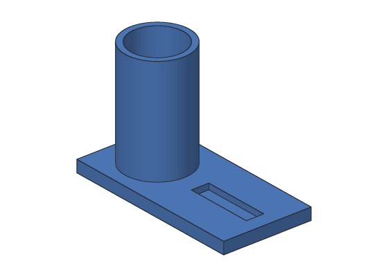

# Khan

Free, open-source parametric CAD for classrooms, makers and small shops.
Works offline, owns no part of your data, and stays free forever.

> **Status:** Phase 0 (foundations). You can design simple parts from the command
> line today; the desktop app is being built.



## What works today

- **Design parts with `kh_cli`:** boxes, cylinders, union, cut and intersect; name,
  rename and delete steps. Each `kh_cli run` adds one step to a design.
- **Save and open designs** as `.khan` files, and **export** STL for 3D printing or
  STEP for other CAD programs.
- **Plugins:** Khan's own modeling commands are a plugin, and you can write your own.
- `kh_app`: an empty main window with the planned layout.

## Guides

| Guide | For |
| --- | --- |
| [User's guide](docs/user-guide/README.md) | How Khan works and what it can do, with pictures |
| [Tutorials](docs/tutorials/README.md) | Step-by-step projects: a keychain tag, a desk organizer |
| [kh_cli reference](docs/cli/README.md) | Every command and option, with examples |
| [Plugin developer guide](docs/plugin-guide/README.md) | Writing your own plugins |

Every example in these guides is run by Khan's tests, so they always match what
Khan does.

## Design

The full design, including architecture, UI mockups, class diagrams and the phased roadmap, is in **[docs/design](docs/design/README.md)**. It is a draft and changes as Khan is built.

## Building

You need a C++20 compiler (Visual Studio 2022, Clang 16+ or GCC 12+), CMake 3.28+,
Ninja, Qt 6.4+ and either vcpkg or system packages.

### Windows (main development platform)

Follow **[docs/windows-setup.md](docs/windows-setup.md)** step by step. In short:

1. Install an up-to-date **Visual Studio 2022** (C++ workload with CMake tools), **Git**,
   and **Qt 6 (MSVC 2022 64-bit)**, not the MinGW build.
2. Put vcpkg and the repository in `C:\dev`, not under Documents.
3. Add the `vsdev` function to your PowerShell profile and run it in each new window.
4. Copy `CMakeUserPresets.example.json` to `CMakeUserPresets.json` and check its paths.
5. Build:

```powershell
vsdev
cd C:\dev\khan
cmake --preset win
cmake --build --preset win
ctest --preset win
.\build\win\apps\kh_app\kh_app.exe
```

The first configure builds OCCT through vcpkg and takes 30-60 minutes; later builds
reuse it. Qt's runtime files are copied next to `kh_app.exe` automatically.

### macOS and Linux with vcpkg

Same steps with your platform's compiler and Ninja: set `VCPKG_ROOT` and `QT_DIR`, then run
`cmake --preset dev`, `cmake --build --preset dev` and `ctest --preset dev`.

### Linux with system packages (Ubuntu 24.04)

```bash
sudo apt install cmake ninja-build g++ catch2 qt6-base-dev qt6-base-private-dev libxcb1-dev libtbb-dev \
  libocct-foundation-dev libocct-modeling-data-dev libocct-modeling-algorithms-dev \
  libocct-data-exchange-dev nlohmann-json3-dev libzip-dev \
  zipcmp zipmerge ziptool   # libzip's CMake files expect these tools
cmake --preset system
cmake --build --preset system
ctest --preset system
```

The desktop app's docking panels use the
[Qt Advanced Docking System](https://github.com/githubuser0xFFFF/Qt-Advanced-Docking-System)
(LGPL-2.1). CMake downloads its pinned release the first time you configure; to build
offline, pass `-DFETCHCONTENT_SOURCE_DIR_QTADS=<path to a copy>`.

Build options: `-DKH_BUILD_APP=OFF` skips the Qt app, `-DKH_WITH_OCCT=OFF` builds only
the kernel-independent libraries.

## Repository layout

```
apps/kh_app        Qt desktop application
apps/kh_cli        command-line tool: design, open, export, plugins, regression corpus
src/core           ids, diagnostics, version
src/kernel         IKernel interface, no OCCT types
src/kernel_occt    IKernel on Open CASCADE
src/model          document, commands, feature graph (growing in Phase 0-2)
src/io             .khan files
src/plugin         plugin host, event bus, open documents
plugins/           built-in plugins (kh.modeling)
tests/             Catch2 unit tests, regression corpus, test plugins
tools/docs         docs checker and picture renderer
cmake/             build helpers
docs/              guides (user-guide, tutorials, cli, plugin-guide), the file
                   format, setup guides and the design (docs/design)
```

## Contributing

See [CONTRIBUTING.md](CONTRIBUTING.md) and the architecture rules in [CLAUDE.md](CLAUDE.md).

## License

Apache License 2.0. See [LICENSE](LICENSE).
