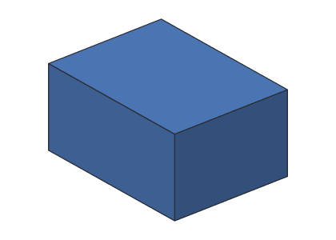
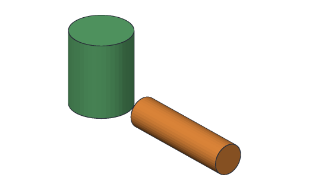
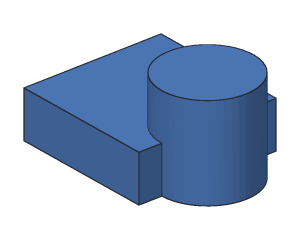
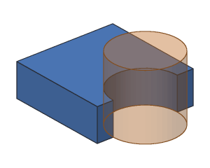
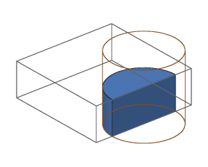

# Modeling commands

These are the commands [`kh_cli run`](run.md) runs. Each one adds or changes one
step of a design. The desktop app's buttons, Python scripts and the AI assistant
will run the same commands, by the same names.

Commands always take lengths in millimeters (mm), whatever unit the design shows
its lengths in (see [`document.set_units`](#documentset_units)); `kh_cli` prints
volumes and sketch lengths in the design's unit. Positions and sizes are written
`x,y,z`: **x** goes right, **y** goes back, **z** goes up.

| Command | What it does |
| --- | --- |
| [`feature.add_box`](#featureadd_box) | Adds a box |
| [`feature.add_cylinder`](#featureadd_cylinder) | Adds a cylinder |
| [`feature.add_boolean`](#featureadd_boolean) | Joins two bodies, cuts one from another, or keeps their overlap |
| [`feature.add_move`](#featureadd_move) | Slides and turns a body |
| [`feature.rename`](#featurerename) | Renames a step |
| [`feature.delete`](#featuredelete) | Deletes a step |
| [`feature.duplicate`](#featureduplicate) | Copies a step, and the steps it uses |
| [`feature.set_material`](#featureset_material) | Picks what a body is made of |
| [`feature.suppress`](#featuresuppress) | Turns steps off, or back on |
| [`folder.add`](#folderadd) | Puts steps in a folder in the feature tree |
| [`folder.rename`](#folderrename) | Renames a folder |
| [`folder.delete`](#folderdelete) | Removes a folder, keeping its steps |
| [`feature.add_sketch`](#featureadd_sketch) | Adds an empty sketch on a plane |
| [`sketch.add_point`](#sketchadd_point), [`sketch.add_line`](#sketchadd_line), [`sketch.add_circle`](#sketchadd_circle), [`sketch.add_arc`](#sketchadd_arc), [`sketch.add_spline`](#sketchadd_spline) | Draw in a sketch |
| [`sketch.constrain`](#sketchconstrain) | Adds a constraint or dimension to a sketch |
| [`sketch.set_value`](#sketchset_value) | Changes a dimension |
| [`sketch.delete`](#sketchdelete) | Deletes something from a sketch |
| [`feature.add_extrude`](#featureadd_extrude) | Turns a sketch's closed shapes into a solid |
| [`document.set_units`](#documentset_units) | Changes the unit the design shows lengths in |
| [`material.define`](#materialdefine) | Adds a material of your own, or changes one |
| [`material.delete`](#materialdelete) | Removes a material you added |

Plugins can add more commands. [`kh_cli help`](help.md) lists every command
Khan has right now.

## feature.add_box

Adds a box with its edges along x, y and z.

| Setting | Kind | Needed | Meaning |
| --- | --- | --- | --- |
| `size` | x,y,z | yes | Width (x), depth (y) and height (z), in mm. Each must be more than 0 |
| `corner` | x,y,z | no | Where the corner nearest the origin goes, in mm. Default `0,0,0` |
| `name` | text | no | The step's name. Default `Box1`, `Box2`, ... |

<!-- cli-example -->
```console
$ kh_cli run --save box.khan feature.add_box size=40,30,20
box: 1 step
  Box1         ok  volume 24000.00 mm^3  mass 29.76 g (PLA)
wrote box.khan
```



Moved away from the origin, and named:

<!-- cli-example -->
```console
$ kh_cli run feature.add_box corner=10,0,5 size=20,20,2 name=Shelf
Untitled: 1 step
  Shelf        ok  volume 800.00 mm^3  mass 0.99 g (PLA)
```

## feature.add_cylinder

Adds a round cylinder.

| Setting | Kind | Needed | Meaning |
| --- | --- | --- | --- |
| `radius` | number | yes | Radius in mm (half the diameter). More than 0 |
| `height` | number | yes | Height in mm, along the axis. More than 0 |
| `base` | x,y,z | no | Center of the bottom circle, in mm. Default `0,0,0` |
| `axis` | x,y,z | no | Which way the cylinder points. Default `0,0,1` (straight up) |
| `name` | text | no | The step's name. Default `Cylinder1`, `Cylinder2`, ... |

<!-- cli-example -->
```console
$ kh_cli run feature.add_cylinder radius=10 height=25
Untitled: 1 step
  Cylinder1    ok  volume 7853.98 mm^3  mass 9.74 g (PLA)
```



Lying on its side, pointing along x:

<!-- cli-example -->
```console
$ kh_cli run feature.add_cylinder radius=5 height=40 axis=1,0,0 name=Rod
Untitled: 1 step
  Rod          ok  volume 3141.59 mm^3  mass 3.90 g (PLA)
```

## feature.add_boolean

Combines two bodies into one.

| Setting | Kind | Needed | Meaning |
| --- | --- | --- | --- |
| `operation` | `union`, `cut` or `intersect` | yes | How to combine them (pictures below) |
| `a` | step name | yes | The first body. For `cut`, the body that keeps its material |
| `b` | step name | yes | The second body. For `cut`, the tool that is taken away |
| `name` | text | no | The step's name. Default `Union1`, `Cut1` or `Intersect1` |

A box and a cylinder that overlap:

<!-- cli-example -->
```console
$ kh_cli run --save parts.khan feature.add_box size=30,30,10
parts: 1 step
  Box1         ok  volume 9000.00 mm^3  mass 11.16 g (PLA)
wrote parts.khan
$ kh_cli run --open parts.khan --save parts.khan feature.add_cylinder base=30,15,0 radius=10 height=20
parts: 2 steps
  Box1         ok  volume 9000.00 mm^3  mass 11.16 g (PLA)
  Cylinder1    ok  volume 6283.19 mm^3  mass 7.79 g (PLA)
wrote parts.khan
```

| `union`: both together | `cut`: a minus b | `intersect`: only the overlap |
| --- | --- | --- |
|  |  |  |

<!-- cli-example -->
```console
$ kh_cli run --open parts.khan feature.add_boolean operation=union a=Box1 b=Cylinder1
parts: 3 steps
  Box1         ok  volume 9000.00 mm^3
  Cylinder1    ok  volume 6283.19 mm^3
  Union1       ok  volume 13712.39 mm^3  mass 17.00 g (PLA)
$ kh_cli run --open parts.khan feature.add_boolean operation=cut a=Box1 b=Cylinder1
parts: 3 steps
  Box1         ok  volume 9000.00 mm^3
  Cylinder1    ok  volume 6283.19 mm^3
  Cut1         ok  volume 7429.20 mm^3  mass 9.21 g (PLA)
$ kh_cli run --open parts.khan feature.add_boolean operation=intersect a=Box1 b=Cylinder1
parts: 3 steps
  Box1         ok  volume 9000.00 mm^3
  Cylinder1    ok  volume 6283.19 mm^3
  Intersect1   ok  volume 1570.80 mm^3  mass 1.95 g (PLA)
```

The Boolean step uses up `a` and `b`: they stay in the design (you can still
change them), but only the combined body is a finished body.

## feature.add_move

Turns a body about a line, then slides it. The body keeps its size and shape, and
the step it moves is used up, like the bodies a Boolean combines. See
[Moving bodies](../user-guide/moving.md).

| Setting | Kind | Needed | Meaning |
| --- | --- | --- | --- |
| `body` | step name | yes | The step whose body is moved |
| `by` | x,y,z (mm) | no | How far to slide it. Default `0,0,0` |
| `turn` | number (degrees) | no | How far to turn it first, counterclockwise looking down the axis. Default `0` |
| `axis` | x,y,z | no | The direction of the line it turns about. Default `0,0,1` (up) |
| `about` | x,y,z (mm) | no | A point on that line. Default `0,0,0` |
| `name` | text | no | Step name. Default `Move1`, `Move2`, ... |

<!-- cli-example -->
```console
$ kh_cli demo demo.khan
wrote demo.khan
$ kh_cli run --open demo.khan --save demo.khan feature.add_move body=Tag by=10,0,0 turn=90 about=30,15,0
Demo tag: 4 steps
  Plate        ok  volume 7200.00 mm^3
  Hole         ok  volume 117.81 mm^3
  Tag          ok  volume 7121.46 mm^3
  Move1        ok  volume 7121.46 mm^3  mass 8.83 g (PLA)
wrote demo.khan
```

Turning about an axis of `0,0,0` fails, with a message saying how to fix it:

<!-- cli-example exit=1 -->
```console
$ kh_cli run --open demo.khan feature.add_move body=Move1 turn=45 axis=0,0,0
Demo tag: 5 steps
  Plate        ok  volume 7200.00 mm^3
  Hole         ok  volume 117.81 mm^3
  Tag          ok  volume 7121.46 mm^3
  Move1        ok  volume 7121.46 mm^3
  Move2        failed
    error [kernel.move.axis]: The axis to turn about can't be 0, 0, 0. Give it a direction, like 0, 0, 1 to turn around an up-and-down line.
```

## feature.rename

Gives a step a new name. Steps that use it keep working, because they point at
the step itself, not its name.

| Setting | Kind | Needed | Meaning |
| --- | --- | --- | --- |
| `feature` | step name | yes | The step to rename |
| `name` | text | yes | Its new name. No other step may have it |

<!-- cli-example -->
```console
$ kh_cli run --save tag.khan feature.add_box size=60,30,4
tag: 1 step
  Box1         ok  volume 7200.00 mm^3  mass 8.93 g (PLA)
wrote tag.khan
$ kh_cli run --open tag.khan --save tag.khan feature.rename feature=Box1 name=Plate
tag: 1 step
  Plate        ok  volume 7200.00 mm^3  mass 8.93 g (PLA)
wrote tag.khan
```

Two steps can't have the same name:

<!-- cli-example exit=1 -->
```console
$ kh_cli demo demo.khan
wrote demo.khan
$ kh_cli run --open demo.khan feature.rename feature=Hole name=Plate
error [feature.name_taken]: Another step is already called Plate. Pick a different name.
```

## feature.delete

Deletes a step. A step that other steps use can't be deleted; delete those first.

| Setting | Kind | Needed | Meaning |
| --- | --- | --- | --- |
| `feature` | step name | yes | The step to delete |

<!-- cli-example -->
```console
$ kh_cli run --save scrap.khan feature.add_box size=10,10,10
scrap: 1 step
  Box1         ok  volume 1000.00 mm^3  mass 1.24 g (PLA)
wrote scrap.khan
$ kh_cli run --open scrap.khan --save scrap.khan feature.delete feature=Box1
scrap: 0 steps
wrote scrap.khan
```

A step that another step uses can't be deleted. In the [demo tag](demo.md), `Tag`
cuts `Hole` out of `Plate`:

<!-- cli-example exit=1 -->
```console
$ kh_cli demo demo.khan
wrote demo.khan
$ kh_cli run --open demo.khan feature.delete feature=Plate
error [feature.in_use]: Plate is used by Tag. Delete or change Tag first.
```

## feature.duplicate

Copies a step, and every step it uses, as new steps at the end of the design.
The copies get new names (the next free number) and have the same sizes and
positions, so they sit exactly on top of the originals until you change them.

| Setting | Kind | Needed | Meaning |
| --- | --- | --- | --- |
| `feature` | step name | yes | The step to copy |

In the [demo tag](demo.md), `Tag` cuts `Hole` out of `Plate`, so duplicating
`Tag` copies all three. The copied `Tag1` cuts `Hole1` out of `Plate1`; changing
the copies never changes the originals.

<!-- cli-example -->
```console
$ kh_cli demo demo.khan
wrote demo.khan
$ kh_cli run --open demo.khan --save demo.khan feature.duplicate feature=Tag
Demo tag: 6 steps
  Plate        ok  volume 7200.00 mm^3
  Hole         ok  volume 117.81 mm^3
  Tag          ok  volume 7121.46 mm^3  mass 8.83 g (PLA)
  Plate1       ok  volume 7200.00 mm^3
  Hole1        ok  volume 117.81 mm^3
  Tag1         ok  volume 7121.46 mm^3  mass 8.83 g (PLA)
wrote demo.khan
```

## feature.set_material

Picks what a step's body is made of. The material sets the body's mass, weight,
material cost and its color in the viewer. A body with no material picked is
**PLA**. A union, cut or intersect with no material of its own takes the material
of its first body, `a` (see [Materials](../user-guide/materials.md)).

| Setting | Kind | Needed | Meaning |
| --- | --- | --- | --- |
| `feature` | step name | yes | The step |
| `material` | text | yes | A material's name, like `PLA` or `"Aluminum 6061"` (upper or lower case). [`kh_cli materials`](materials.md) lists them. Leave it empty (`material=`) to go back to the material the step gets by default |

The demo tag in aluminum instead of PLA: `Tag` cuts the hole out of `Plate`, so it
takes `Plate`'s material.

<!-- cli-example -->
```console
$ kh_cli demo tag.khan
wrote tag.khan
$ kh_cli run --open tag.khan --save tag.khan feature.set_material feature=Plate material="Aluminum 6061"
Demo tag: 3 steps
  Plate        ok  volume 7200.00 mm^3
  Hole         ok  volume 117.81 mm^3
  Tag          ok  volume 7121.46 mm^3  mass 19.23 g (Aluminum 6061)
wrote tag.khan
```

A material Khan doesn't know is refused:

<!-- cli-example exit=1 -->
```console
$ kh_cli demo tag.khan
wrote tag.khan
$ kh_cli run --open tag.khan feature.set_material feature=Plate material=gold
error [material.unknown]: There is no material called gold. See the list with kh_cli materials, or add your own with material.define.
```

## feature.suppress

Turns steps off, so they aren't built, or back on. Nothing is deleted: a step
that's off keeps all its numbers. A step that uses a step that's off is
`blocked` until that step is on again. Turning several steps off or on is one
undo step.

| Setting | Kind | Needed | Meaning |
| --- | --- | --- | --- |
| `steps` | step names | yes | The steps, separated by commas, like `Box1,Hole` |
| `off` | true or false | no | `true` (the default) turns them off; `false` turns them back on |

In the [demo tag](demo.md), turning off `Hole` blocks `Tag`, which cuts it out of
`Plate`. Because a step is blocked, `kh_cli` ends with exit code 1, but the design
is still saved:

<!-- cli-example exit=1 -->
```console
$ kh_cli demo demo.khan
wrote demo.khan
$ kh_cli run --open demo.khan --save demo.khan feature.suppress steps=Hole
Demo tag: 3 steps
  Plate        ok  volume 7200.00 mm^3
  Hole         off
  Tag          blocked
    error [feature.blocked]: This step uses Hole, which is turned off. Turn Hole back on, or change this step.
wrote demo.khan
```

Turn it back on with `off=false`:

<!-- cli-example -->
```console
$ kh_cli run --open demo.khan --save demo.khan feature.suppress steps=Hole off=false
Demo tag: 3 steps
  Plate        ok  volume 7200.00 mm^3
  Hole         ok  volume 117.81 mm^3
  Tag          ok  volume 7121.46 mm^3  mass 8.83 g (PLA)
wrote demo.khan
```

Steps that are already that way can't be changed again:

<!-- cli-example exit=1 -->
```console
$ kh_cli run --open demo.khan feature.suppress steps=Plate,Hole off=false
error [feature.already_on]: Those steps are already turned on.
```

## folder.add

Puts steps into a folder, to keep the feature tree tidy. A folder never changes
what's built. The steps must be next to each other in the tree, and a step can
only be in one folder. `kh_cli` shows a folder's name with a `/` after it, and its
steps indented under it.

| Setting | Kind | Needed | Meaning |
| --- | --- | --- | --- |
| `steps` | step names | yes | The steps, separated by commas, like `Plate,Hole` |
| `name` | text | no | The folder's name. Default `Folder1`, `Folder2`, ... No two folders may share a name |

<!-- cli-example -->
```console
$ kh_cli demo demo.khan
wrote demo.khan
$ kh_cli run --open demo.khan --save demo.khan folder.add steps=Plate,Hole name=Parts
Demo tag: 3 steps
  Parts/
    Plate      ok  volume 7200.00 mm^3
    Hole       ok  volume 117.81 mm^3
  Tag          ok  volume 7121.46 mm^3  mass 8.83 g (PLA)
wrote demo.khan
```

Steps with another step between them can't share a folder:

<!-- cli-example exit=1 -->
```console
$ kh_cli demo demo.khan
wrote demo.khan
$ kh_cli run --open demo.khan folder.add steps=Plate,Tag
error [folder.not_together]: Only steps next to each other in the feature tree can go in one folder. Pick steps with no other steps between them.
```

## folder.rename

Gives a folder a new name.

| Setting | Kind | Needed | Meaning |
| --- | --- | --- | --- |
| `folder` | folder name | yes | The folder to rename |
| `name` | text | yes | Its new name. No other folder may have it |

<!-- cli-example -->
```console
$ kh_cli demo demo.khan
wrote demo.khan
$ kh_cli run --open demo.khan --save demo.khan folder.add steps=Plate,Hole
Demo tag: 3 steps
  Folder1/
    Plate      ok  volume 7200.00 mm^3
    Hole       ok  volume 117.81 mm^3
  Tag          ok  volume 7121.46 mm^3  mass 8.83 g (PLA)
wrote demo.khan
$ kh_cli run --open demo.khan --save demo.khan folder.rename folder=Folder1 name=Parts
Demo tag: 3 steps
  Parts/
    Plate      ok  volume 7200.00 mm^3
    Hole       ok  volume 117.81 mm^3
  Tag          ok  volume 7121.46 mm^3  mass 8.83 g (PLA)
wrote demo.khan
```

## folder.delete

Removes a folder. Its steps stay, back at the top of the tree.

| Setting | Kind | Needed | Meaning |
| --- | --- | --- | --- |
| `folder` | folder name | yes | The folder to remove |

<!-- cli-example -->
```console
$ kh_cli run --open demo.khan --save demo.khan folder.delete folder=Parts
Demo tag: 3 steps
  Plate        ok  volume 7200.00 mm^3
  Hole         ok  volume 117.81 mm^3
  Tag          ok  volume 7121.46 mm^3  mass 8.83 g (PLA)
wrote demo.khan
```

## feature.add_sketch

Adds an empty sketch: a flat drawing on a plane. Draw in it with the `sketch.`
commands below; see [Sketches](../user-guide/sketches.md). A sketch isn't a body:
it has no volume, and it's solved again every time the design rebuilds.

| Setting | Kind | Needed | Meaning |
| --- | --- | --- | --- |
| `plane` | `xy`, `xz` or `yz` | no | `xy` (the ground, the default), `xz` (standing, facing the front) or `yz` (standing, facing the right) |
| `name` | text | no | Step name. Default `Sketch1`, `Sketch2`, ... |

<!-- cli-example -->
```console
$ kh_cli run --save s.khan feature.add_sketch plane=xz
s: 1 step
  Sketch1      ok  empty
wrote s.khan
```

## sketch.add_point

Adds a point.

| Setting | Kind | Needed | Meaning |
| --- | --- | --- | --- |
| `sketch` | step name | yes | The sketch |
| `at` | x,y (mm) | yes | Where |
| `construction` | true or false | no | `true` for helper geometry. Default `false` |
| `name` | text | no | Its name. Default `Point1`, `Point2`, ... |

<!-- cli-example -->
```console
$ kh_cli run --open s.khan --save s.khan sketch.add_point sketch=Sketch1 at=5,5
s: 1 step
  Sketch1      ok  1 point, 0 constraints, free to move 2 ways
wrote s.khan
```

## sketch.add_line

Adds a straight line. Its points are `.start` and `.end`.

| Setting | Kind | Needed | Meaning |
| --- | --- | --- | --- |
| `sketch` | step name | yes | The sketch |
| `from` | x,y (mm) | yes | Its first end |
| `to` | x,y (mm) | yes | Its second end |
| `construction` | true or false | no | `true` for helper geometry. Default `false` |
| `name` | text | no | Its name. Default `Line1`, `Line2`, ... |

<!-- cli-example -->
```console
$ kh_cli run --open s.khan --save s.khan sketch.add_line sketch=Sketch1 from=0,0 to=40,0
s: 1 step
  Sketch1      ok  1 line, 1 point, 0 constraints, free to move 6 ways
wrote s.khan
```

## sketch.add_rectangle

Adds a rectangle: four lines between two opposite corners (`Line1` along the
first corner's side, then round), joined at the corners with `coincident` and
kept level and upright with `horizontal` and `vertical`. It can only move and
change size, so 2 dimensions and a `fix` make it fully constrained.

| Setting | Kind | Needed | Meaning |
| --- | --- | --- | --- |
| `sketch` | step name | yes | The sketch |
| `from` | x,y (mm) | yes | One corner |
| `to` | x,y (mm) | yes | The opposite corner |
| `construction` | true or false | no | `true` for helper geometry. Default `false` |

A 40 × 20 mm plate, extruded 3 mm, is 2400 mm³:

<!-- cli-example -->
```console
$ kh_cli run --save plate.khan feature.add_sketch
plate: 1 step
  Sketch1      ok  empty
wrote plate.khan
$ kh_cli run --open plate.khan --save plate.khan sketch.add_rectangle sketch=Sketch1 from=0,0 to=40,20
plate: 1 step
  Sketch1      ok  4 lines, 8 constraints, free to move 4 ways
wrote plate.khan
$ kh_cli run --open plate.khan feature.add_extrude sketch=Sketch1 distance=3
plate: 2 steps
  Sketch1      ok  4 lines, 8 constraints, free to move 4 ways
  Extrude1     ok  volume 2400.00 mm^3  mass 2.98 g (PLA)
```

<!-- cli-example exit=1 -->
```console
$ kh_cli run --open plate.khan sketch.add_rectangle sketch=Sketch1 from=0,0 to=40,0
error [sketch.rectangle]: A rectangle needs a width and a height: put the corners apart both left to right and up and down, like from=0,0 to=40,20.
```

## sketch.round_corner

Rounds the corner where two lines meet (a fillet): both lines are cut back, and
an arc joins them, tangent to both, with a `radius` dimension you can change
later with [`sketch.set_value`](#sketchset_value). The sharp corner stays as a
helper point on both lines, so constraints that were on the corner move to it,
and a line's `length` becomes the distance from its far end to it: sizes still
measure to the corner. The sketch can move just as many ways as before.

| Setting | Kind | Needed | Meaning |
| --- | --- | --- | --- |
| `sketch` | step name | yes | The sketch |
| `at` | text | yes | The corner: a line's end that's joined to another line's end, like `Line1.end` |
| `radius` | number (mm) | yes | The arc's radius |

The 40 × 20 plate with all four corners rounded to 5 mm loses 4 × (25 − 25π/4)
= 21.46 mm² of area, so 3 mm thick it's (800 − 21.46) × 3 = 2335.62 mm³:

<!-- cli-example -->
```console
$ kh_cli run --open plate.khan --save plate.khan sketch.round_corner sketch=Sketch1 at=Line1.end radius=5
plate: 1 step
  Sketch1      ok  4 lines, 1 arc, 1 point, 14 constraints, free to move 4 ways
wrote plate.khan
$ kh_cli run --open plate.khan --save plate.khan sketch.round_corner sketch=Sketch1 at=Line2.end radius=5
plate: 1 step
  Sketch1      ok  4 lines, 2 arcs, 2 points, 20 constraints, free to move 4 ways
wrote plate.khan
$ kh_cli run --open plate.khan --save plate.khan sketch.round_corner sketch=Sketch1 at=Line3.end radius=5
plate: 1 step
  Sketch1      ok  4 lines, 3 arcs, 3 points, 26 constraints, free to move 4 ways
wrote plate.khan
$ kh_cli run --open plate.khan --save plate.khan sketch.round_corner sketch=Sketch1 at=Line4.end radius=5
plate: 1 step
  Sketch1      ok  4 lines, 4 arcs, 4 points, 32 constraints, free to move 4 ways
wrote plate.khan
$ kh_cli run --open plate.khan feature.add_extrude sketch=Sketch1 distance=3
plate: 2 steps
  Sketch1      ok  4 lines, 4 arcs, 4 points, 32 constraints, free to move 4 ways
  Extrude1     ok  volume 2335.62 mm^3  mass 2.90 g (PLA)
```

A radius has to fit on both lines:

<!-- cli-example exit=1 -->
```console
$ kh_cli run --save rounded.khan feature.add_sketch
rounded: 1 step
  Sketch1      ok  empty
wrote rounded.khan
$ kh_cli run --open rounded.khan --save rounded.khan sketch.add_rectangle sketch=Sketch1 from=0,0 to=40,20
rounded: 1 step
  Sketch1      ok  4 lines, 8 constraints, free to move 4 ways
wrote rounded.khan
$ kh_cli run --open rounded.khan sketch.round_corner sketch=Sketch1 at=Line1.end radius=25
error [sketch.round_corner]: A 25 mm radius doesn't fit that corner: it would cut back past the end of Line2. Use a radius under 20 mm.
```

## sketch.trim

Cuts away the piece of a line, circle or arc between the places nearest a point
where other lines, circles and arcs cross it, or from one of them to its end. The
cut end stays on whatever cut it (`point_on_line` or `point_on_circle`), so the
pieces stay joined. A line cut in the middle becomes two pieces kept in line; an
arc, two arcs of the same circle; a circle crossed in two places or more, an arc.
Something nothing crosses is deleted. Constraints on an end that's cut away go,
and so does a trimmed line's `length`.

| Setting | Kind | Needed | Meaning |
| --- | --- | --- | --- |
| `sketch` | step name | yes | The sketch |
| `item` | text | yes | The line, circle or arc, like `Line1` |
| `near` | x,y (mm) | yes | A point on (or near) the piece to cut away |

A plate with a round tab: a 40 × 20 rectangle and a circle of radius 10 on its
right side. Trimming the circle inside the plate leaves the half that sticks
out, an arc. The plate's right side runs from one end of that arc to the other,
with nothing crossing it in between, so trimming it deletes it. That leaves one
outline, 800 + 50π = 957.08 mm², so 3 mm thick it's 2871.24 mm³:

<!-- cli-example -->
```console
$ kh_cli run --save tab.khan feature.add_sketch
tab: 1 step
  Sketch1      ok  empty
wrote tab.khan
$ kh_cli run --open tab.khan --save tab.khan sketch.add_rectangle sketch=Sketch1 from=0,0 to=40,20
tab: 1 step
  Sketch1      ok  4 lines, 8 constraints, free to move 4 ways
wrote tab.khan
$ kh_cli run --open tab.khan --save tab.khan sketch.add_circle sketch=Sketch1 center=40,10 radius=10
tab: 1 step
  Sketch1      ok  4 lines, 1 circle, 8 constraints, free to move 7 ways
wrote tab.khan
$ kh_cli run --open tab.khan --save tab.khan sketch.trim sketch=Sketch1 item=Circle1 near=30,10
tab: 1 step
  Sketch1      ok  4 lines, 1 arc, 10 constraints, free to move 7 ways
wrote tab.khan
$ kh_cli run --open tab.khan --save tab.khan sketch.trim sketch=Sketch1 item=Line2 near=40,10
tab: 1 step
  Sketch1      ok  3 lines, 1 arc, 7 constraints, free to move 8 ways
wrote tab.khan
$ kh_cli run --open tab.khan feature.add_extrude sketch=Sketch1 distance=3
tab: 2 steps
  Sketch1      ok  3 lines, 1 arc, 7 constraints, free to move 8 ways
  Extrude1     ok  volume 2871.24 mm^3  mass 3.56 g (PLA)
```

<!-- cli-example exit=1 -->
```console
$ kh_cli run --open tab.khan sketch.trim sketch=Sketch1 item=Line9 near=0,0
error [sketch.not_found]: There's nothing called Line9 in this sketch.
```

## sketch.add_circle

Adds a circle. Its point is `.center`.

| Setting | Kind | Needed | Meaning |
| --- | --- | --- | --- |
| `sketch` | step name | yes | The sketch |
| `center` | x,y (mm) | yes | Its center |
| `radius` | number (mm) | yes | Its radius |
| `construction` | true or false | no | `true` for helper geometry. Default `false` |
| `name` | text | no | Its name. Default `Circle1`, `Circle2`, ... |

<!-- cli-example -->
```console
$ kh_cli run --open s.khan --save s.khan sketch.add_circle sketch=Sketch1 center=20,10 radius=4
s: 1 step
  Sketch1      ok  1 line, 1 circle, 1 point, 0 constraints, free to move 9 ways
wrote s.khan
```

## sketch.add_arc

Adds an arc: part of a circle, going counterclockwise from `start` to `end`. Its
points are `.start`, `.end` and `.center`.

| Setting | Kind | Needed | Meaning |
| --- | --- | --- | --- |
| `sketch` | step name | yes | The sketch |
| `center` | x,y (mm) | yes | The center of its circle |
| `radius` | number (mm) | yes | Its radius |
| `start` | number (degrees) | no | Where it starts: 0 points right, 90 up. Default `0` |
| `end` | number (degrees) | no | Where it ends. Default `90` |
| `construction` | true or false | no | `true` for helper geometry. Default `false` |
| `name` | text | no | Its name. Default `Arc1`, `Arc2`, ... |

<!-- cli-example -->
```console
$ kh_cli run --open s.khan --save s.khan sketch.add_arc sketch=Sketch1 center=40,10 radius=10 start=-90 end=90
s: 1 step
  Sketch1      ok  1 line, 1 circle, 1 arc, 1 point, 0 constraints, free to move 14 ways
wrote s.khan
```

## sketch.add_spline

Adds a spline: a smooth curve pulled towards its **control points** (poles), like
a bendy ruler held by pins. An open spline starts at its first control point and
ends at its last; the ones between pull the curve towards them without it going
through them. Or give it points to pass **through**, and Khan works out the
control points. Its points are `.pole1`, `.pole2`, ... (and `.start` and `.end`,
the same as its first and last). See
[Splines](../user-guide/sketches.md#splines).

| Setting | Kind | Needed | Meaning |
| --- | --- | --- | --- |
| `sketch` | step name | yes | The sketch |
| `poles` | x,y/x,y/... (mm) | this or `through` | Its control points, in order, split by `/` |
| `through` | x,y/x,y/... (mm) | this or `poles` | Points it passes through, in order. Khan works out one control point for each |
| `degree` | whole number | no | How smooth: `1` (straight pieces) to `5`. Default `3`, or less with only 2 or 3 points. A spline needs one more control point than its degree |
| `closed` | true or false | no | `true` for a smooth loop with no ends. Default `false` |
| `construction` | true or false | no | `true` for helper geometry. Default `false` |
| `name` | text | no | Its name. Default `Spline1`, `Spline2`, ... |

An arch: a spline from (0, 0) up and over to (40, 0), closed by a line along the
bottom, then extruded 5 mm:

<!-- cli-example -->
```console
$ kh_cli run --save arch.khan feature.add_sketch
arch: 1 step
  Sketch1      ok  empty
wrote arch.khan
$ kh_cli run --open arch.khan --save arch.khan sketch.add_spline sketch=Sketch1 poles=0,0/0,30/40,30/40,0
arch: 1 step
  Sketch1      ok  1 spline, 0 constraints, free to move 8 ways
wrote arch.khan
$ kh_cli run --open arch.khan --save arch.khan sketch.add_line sketch=Sketch1 from=40,0 to=0,0
arch: 1 step
  Sketch1      ok  1 line, 1 spline, 0 constraints, free to move 12 ways
wrote arch.khan
$ kh_cli run --open arch.khan --save arch.khan sketch.constrain sketch=Sketch1 kind=coincident on=Spline1.end,Line1.start
arch: 1 step
  Sketch1      ok  1 line, 1 spline, 1 constraint, free to move 10 ways
wrote arch.khan
$ kh_cli run --open arch.khan --save arch.khan feature.add_extrude sketch=Sketch1 distance=5
arch: 2 steps
  Sketch1      ok  1 line, 1 spline, 1 constraint, free to move 10 ways
  Extrude1     ok  volume 3600.00 mm^3  mass 4.46 g (PLA)
wrote arch.khan
```

A spline with 4 control points and degree 3 is a Bézier curve: the area under
this one is 3/5 of the 40 × 30 mm box around its points, 720 mm², so the volume
is 720 × 5 = 3600 mm³. The middle control points never touch the curve: its top
is 22.5 mm high, not 30.

A closed spline is a smooth loop, and a shape on its own, like a circle. Round
4 control points at the corners of a 30 × 20 mm box it makes a rounded rectangle
covering 61/90 of the box, 406.67 mm²:

<!-- cli-example -->
```console
$ kh_cli run --save blob.khan feature.add_sketch
blob: 1 step
  Sketch1      ok  empty
wrote blob.khan
$ kh_cli run --open blob.khan --save blob.khan sketch.add_spline sketch=Sketch1 poles=0,0/30,0/30,20/0,20 closed=true
blob: 1 step
  Sketch1      ok  1 spline, 0 constraints, free to move 8 ways
wrote blob.khan
$ kh_cli run --open blob.khan feature.add_extrude sketch=Sketch1 distance=2
blob: 2 steps
  Sketch1      ok  1 spline, 0 constraints, free to move 8 ways
  Extrude1     ok  volume 813.33 mm^3  mass 1.01 g (PLA)
```

A spline through points goes exactly through each one. This one passes through
(0, 0), (20, 15) and (40, 0), so its top is 15 mm high. With 3 points its degree
is 2:

<!-- cli-example -->
```console
$ kh_cli run --save hump.khan feature.add_sketch
hump: 1 step
  Sketch1      ok  empty
wrote hump.khan
$ kh_cli run --open hump.khan sketch.add_spline sketch=Sketch1 through=0,0/20,15/40,0
hump: 1 step
  Sketch1      ok  1 spline, 0 constraints, free to move 6 ways
```

Give `poles` or `through`, not both:

<!-- cli-example exit=1 -->
```console
$ kh_cli run --open arch.khan sketch.add_spline sketch=Sketch1 poles=0,0/1,1/2,0 through=0,0/1,1/2,0
error [sketch.spline_points]: Give a spline either its control points (poles=0,0/0,30/40,30/40,0) or points it passes through (through=0,0/20,15/40,0), not both.
```

A spline needs enough control points for its degree, and a control point it has:

<!-- cli-example exit=1 -->
```console
$ kh_cli run --open arch.khan sketch.add_spline sketch=Sketch1 poles=0,0/10,10/20,0 degree=3
error [sketch.spline_poles]: A spline of degree 3 needs at least 4 control points. Add more, or lower its degree.
```

<!-- cli-example exit=1 -->
```console
$ kh_cli run --open arch.khan sketch.constrain sketch=Sketch1 kind=fix on=Spline1.pole9
error [sketch.on]: Spline1 has 4 control points: use Spline1.pole1 to Spline1.pole4. Fix needs one point, like on=Line1.start.
```

## sketch.set_spline

Changes a spline's degree, or turns it into a closed loop (or opens one). Its
control points stay where they are, so the curve changes shape.

| Setting | Kind | Needed | Meaning |
| --- | --- | --- | --- |
| `sketch` | step name | yes | The sketch |
| `spline` | text | yes | The spline, like `Spline1` |
| `degree` | whole number | one of these | How smooth: `1` (straight pieces) to `5`. It needs one more control point than its degree |
| `closed` | true or false | one of these | `true` for a closed loop, `false` for a curve with two ends |

Degree 1 joins the control points with straight pieces, so the arch becomes three
sides of its 40 × 30 mm box, and the extrude grows to 40 × 30 × 5 = 6000 mm³:

<!-- cli-example -->
```console
$ kh_cli run --open arch.khan sketch.set_spline sketch=Sketch1 spline=Spline1 degree=1
arch: 2 steps
  Sketch1      ok  1 line, 1 spline, 1 constraint, free to move 10 ways
  Extrude1     ok  volume 6000.00 mm^3  mass 7.44 g (PLA)
```

<!-- cli-example exit=1 -->
```console
$ kh_cli run --open arch.khan sketch.set_spline sketch=Sketch1 spline=Spline1 degree=4
error [sketch.spline_poles]: A spline of degree 4 needs at least 5 control points. Add more, or lower its degree.
```

## sketch.set_weight

Changes how hard one control point pulls the curve. `1` is normal; a bigger
weight pulls the curve closer to that point, a smaller one lets it go.

| Setting | Kind | Needed | Meaning |
| --- | --- | --- | --- |
| `sketch` | step name | yes | The sketch |
| `point` | text | yes | The control point, like `Spline1.pole2` |
| `weight` | number | yes | More than 0. `1` is normal |

Pulling harder on the arch's two top control points makes it fuller, so it
covers more of its box:

<!-- cli-example -->
```console
$ kh_cli run --open arch.khan --save arch-full.khan sketch.set_weight sketch=Sketch1 point=Spline1.pole2 weight=3
arch: 2 steps
  Sketch1      ok  1 line, 1 spline, 1 constraint, free to move 10 ways
  Extrude1     ok  volume 3958.44 mm^3  mass 4.91 g (PLA)
wrote arch-full.khan
$ kh_cli run --open arch-full.khan sketch.set_weight sketch=Sketch1 point=Spline1.pole3 weight=3
arch: 2 steps
  Sketch1      ok  1 line, 1 spline, 1 constraint, free to move 10 ways
  Extrude1     ok  volume 4566.51 mm^3  mass 5.66 g (PLA)
```

## sketch.add_pole

Adds a control point to a spline, between two that are next to each other, so
you can shape it more finely. Constraints on the later control points stay on
the same points (their numbers go up by one).

| Setting | Kind | Needed | Meaning |
| --- | --- | --- | --- |
| `sketch` | step name | yes | The sketch |
| `spline` | text | yes | The spline, like `Spline1` |
| `after` | whole number | yes | Which control point it goes after: `1` puts it between `pole1` and `pole2`. A closed spline can take one after its last |
| `at` | x,y (mm) | no | Where. Default halfway to the next control point |

<!-- cli-example -->
```console
$ kh_cli run --open arch.khan --save arch5.khan sketch.add_pole sketch=Sketch1 spline=Spline1 after=2 at=20,40
arch: 2 steps
  Sketch1      ok  1 line, 1 spline, 1 constraint, free to move 12 ways
  Extrude1     ok  volume 5900.00 mm^3  mass 7.32 g (PLA)
wrote arch5.khan
```

## sketch.remove_pole

Removes one of a spline's control points, and the constraints on it.
Constraints on the later control points stay on the same points.

| Setting | Kind | Needed | Meaning |
| --- | --- | --- | --- |
| `sketch` | step name | yes | The sketch |
| `point` | text | yes | The control point, like `Spline1.pole3` |

<!-- cli-example -->
```console
$ kh_cli run --open arch5.khan sketch.remove_pole sketch=Sketch1 point=Spline1.pole3
arch: 2 steps
  Sketch1      ok  1 line, 1 spline, 1 constraint, free to move 10 ways
  Extrude1     ok  volume 3600.00 mm^3  mass 4.46 g (PLA)
```

A spline can't have fewer control points than its degree needs:

<!-- cli-example exit=1 -->
```console
$ kh_cli run --open arch.khan sketch.remove_pole sketch=Sketch1 point=Spline1.pole2
error [sketch.spline_poles]: Spline1 has only 4 control points, the fewest a spline of degree 3 can have. Lower its degree first (sketch.set_spline degree=2), or delete the whole spline.
```

## sketch.import_spline

Adds a spline made from a **file of points**: one point per line, x then y,
split by commas, spaces, tabs or semicolons, so a spreadsheet saved as CSV works.
A first line like `x,y` is skipped, `#` starts a comment, and a third number on a
line (z) is left out. Khan remembers the file, so
[`sketch.reload_spline`](#sketchreload_spline) can read it again after it changes.

| Setting | Kind | Needed | Meaning |
| --- | --- | --- | --- |
| `sketch` | step name | yes | The sketch |
| `file` | text | yes | The file of points, like `wave.csv` |
| `through` | true or false | no | `true`: the curve goes through every point; `false`: the points are its control points. Default `true` |
| `unit` | `mm`, `cm`, `m`, `in` or `ft` | no | The unit of the file's numbers. Default `mm` |
| `degree` | whole number | no | How smooth: `1` to `5`. Default `3`, or less with only 2 or 3 points |
| `closed` | true or false | no | `true` for a smooth loop with no ends. Default `false` |
| `construction` | true or false | no | `true` for helper geometry. Default `false` |
| `name` | text | no | Its name. Default `Spline1`, `Spline2`, ... |

[`wave.csv`](files/wave.csv) has 7 points of a wave 60 mm long. The spline goes
through all 7, so it has 7 control points:

<!-- cli-example -->
```console
$ kh_cli run --save wave.khan feature.add_sketch
wave: 1 step
  Sketch1      ok  empty
wrote wave.khan
$ kh_cli run --open wave.khan --save wave.khan sketch.import_spline sketch=Sketch1 file=docs/cli/files/wave.csv
wave: 1 step
  Sketch1      ok  1 spline, 0 constraints, free to move 14 ways
wrote wave.khan
```

A line that isn't two numbers is named, so you can fix it. In
[`wave-typo.csv`](files/wave-typo.csv), `10` was typed with a letter O:

<!-- cli-example exit=1 -->
```console
$ kh_cli run --open wave.khan sketch.import_spline sketch=Sketch1 file=docs/cli/files/wave-typo.csv
error [sketch.points_file]: Line 4 of wave-typo.csv isn't 2 numbers (x and y): "20,1O". Fix that line, or put # at its start to skip it.
```

A file that isn't there:

<!-- cli-example exit=1 -->
```console
$ kh_cli run --open wave.khan sketch.import_spline sketch=Sketch1 file=nowhere.csv
error [sketch.points_file]: Khan can't open nowhere.csv (looked for it at nowhere.csv). Check the file is there, and try again.
```

## sketch.reload_spline

Reads an imported spline's file again, so the spline follows changes you made to
the file (in a spreadsheet, say). Its degree and weights stay; constraints on
control points it doesn't have anymore are removed. Undo puts the old points back.

| Setting | Kind | Needed | Meaning |
| --- | --- | --- | --- |
| `sketch` | step name | yes | The sketch |
| `spline` | text | yes | The imported spline, like `Spline1` |

<!-- cli-example -->
```console
$ kh_cli run --open wave.khan sketch.reload_spline sketch=Sketch1 spline=Spline1
wave: 1 step
  Sketch1      ok  1 spline, 0 constraints, free to move 14 ways
```

Only an imported spline has a file to read:

<!-- cli-example exit=1 -->
```console
$ kh_cli run --open arch.khan sketch.reload_spline sketch=Sketch1 spline=Spline1
error [sketch.not_imported]: Spline1 wasn't imported from a file, so there's nothing to reload. Make one from a file with sketch.import_spline.
```

## sketch.constrain

Adds a constraint (`kind=horizontal`, `tangent`, ...) or a dimension
(`kind=length`, `radius`, ...). The [Sketches](../user-guide/sketches.md#constraints-and-dimensions)
page lists every kind and what it needs.

| Setting | Kind | Needed | Meaning |
| --- | --- | --- | --- |
| `sketch` | step name | yes | The sketch |
| `kind` | `fix`, `coincident`, `horizontal`, `vertical`, `parallel`, `perpendicular`, `equal`, `point_on_line`, `point_on_circle`, `point_on_spline`, `midpoint`, `tangent`, `smooth`, `distance`, `length`, `horizontal_distance`, `vertical_distance`, `radius`, `diameter`, `angle` | yes | What to keep true |
| `on` | text | yes | What it's on, separated by commas: `Line1`, or points like `Line1.end`, `Circle1.center`, `Spline1.pole2` (a spline's second control point), `Point1` |
| `value` | number | for dimensions | mm, or degrees for `angle` |
| `name` | text | no | Its name. Default like `Horizontal1`, `Length1` |

<!-- cli-example -->
```console
$ kh_cli run --open s.khan --save s.khan sketch.constrain sketch=Sketch1 kind=coincident on=Line1.end,Arc1.start
s: 1 step
  Sketch1      ok  1 line, 1 circle, 1 arc, 1 point, 1 constraint, free to move 12 ways
wrote s.khan
$ kh_cli run --open s.khan --save s.khan sketch.constrain sketch=Sketch1 kind=length on=Line1 value=40
s: 1 step
  Sketch1      ok  1 line, 1 circle, 1 arc, 1 point, 2 constraints, free to move 11 ways
wrote s.khan
```

Points need to say which point; lines and circles don't:

<!-- cli-example exit=1 -->
```console
$ kh_cli run --open s.khan sketch.constrain sketch=Sketch1 kind=coincident on=Line1,Arc1
error [sketch.on]: Line1 isn't a single point: say which of its points, like Line1.start or Line1.end.
```

Where a spline's end is joined to a line, arc or spline, `tangent` takes away the
corner, and `smooth` also makes them bend equally there. First they need joining:

<!-- cli-example exit=1 -->
```console
$ kh_cli run --save join.khan feature.add_sketch
join: 1 step
  Sketch1      ok  empty
wrote join.khan
$ kh_cli run --open join.khan --save join.khan sketch.add_spline sketch=Sketch1 poles=0,0/0,30/40,30/40,0
join: 1 step
  Sketch1      ok  1 spline, 0 constraints, free to move 8 ways
wrote join.khan
$ kh_cli run --open join.khan --save join.khan sketch.add_line sketch=Sketch1 from=40,0 to=60,0
join: 1 step
  Sketch1      ok  1 line, 1 spline, 0 constraints, free to move 12 ways
wrote join.khan
$ kh_cli run --open join.khan sketch.constrain sketch=Sketch1 kind=tangent on=Spline1,Line1
error [sketch.constraint]: Tangent needs the two joined end to end: join an end of each with Coincident first.
```

Joined, the spline (which came straight down onto the line) turns to meet it
level, without a corner. Smooth takes 2 ways to move away: the direction and
the bend.

<!-- cli-example -->
```console
$ kh_cli run --open join.khan --save join.khan sketch.constrain sketch=Sketch1 kind=coincident on=Spline1.end,Line1.start
join: 1 step
  Sketch1      ok  1 line, 1 spline, 1 constraint, free to move 10 ways
wrote join.khan
$ kh_cli run --open join.khan sketch.constrain sketch=Sketch1 kind=smooth on=Spline1,Line1
join: 1 step
  Sketch1      ok  1 line, 1 spline, 2 constraints, free to move 8 ways
```

## sketch.set_value

Changes a dimension's number.

| Setting | Kind | Needed | Meaning |
| --- | --- | --- | --- |
| `sketch` | step name | yes | The sketch |
| `constraint` | text | yes | The dimension, like `Length1` |
| `value` | number | yes | Its new number: mm, or degrees for an angle |

<!-- cli-example -->
```console
$ kh_cli run --open s.khan --save s.khan sketch.set_value sketch=Sketch1 constraint=Length1 value=30
s: 1 step
  Sketch1      ok  1 line, 1 circle, 1 arc, 1 point, 2 constraints, free to move 11 ways
wrote s.khan
```

## sketch.delete

Deletes a line, circle, arc or point, and every constraint on it; or one
constraint.

| Setting | Kind | Needed | Meaning |
| --- | --- | --- | --- |
| `sketch` | step name | yes | The sketch |
| `item` | text | yes | What to delete, like `Line1` or `Length1` |

<!-- cli-example -->
```console
$ kh_cli run --open s.khan --save s.khan sketch.delete sketch=Sketch1 item=Line1
s: 1 step
  Sketch1      ok  1 circle, 1 arc, 1 point, 0 constraints, free to move 10 ways
wrote s.khan
```

## feature.add_extrude

Turns every closed shape of a sketch into a solid, by sweeping it straight out of
the sketch's plane. Holes in a shape go all the way through, and several shapes
make one body. The sketch stays as it is (it isn't a body), so changing it changes
the solid. See [Extrude](../user-guide/extrude.md).

| Setting | Kind | Needed | Meaning |
| --- | --- | --- | --- |
| `sketch` | step name | yes | The sketch |
| `distance` | number (mm) | no | How far. Default `10` |
| `side` | `one`, `flip` or `both` | no | `one`: out of the sketch's front (up, for a sketch on XY); `flip`: the other way; `both`: half the distance each way. Default `one` |
| `name` | text | no | Step name. Default `Extrude1`, `Extrude2`, ... |

A 40 × 20 mm rectangle with a hole of radius 4 mm in it, extruded 5 mm into a plate:

<!-- cli-example -->
```console
$ kh_cli run --save plate.khan feature.add_sketch
plate: 1 step
  Sketch1      ok  empty
wrote plate.khan
$ kh_cli run --open plate.khan --save plate.khan sketch.add_line sketch=Sketch1 from=0,0 to=40,0
plate: 1 step
  Sketch1      ok  1 line, 0 constraints, free to move 4 ways
wrote plate.khan
$ kh_cli run --open plate.khan --save plate.khan sketch.add_line sketch=Sketch1 from=40,0 to=40,20
plate: 1 step
  Sketch1      ok  2 lines, 0 constraints, free to move 8 ways
wrote plate.khan
$ kh_cli run --open plate.khan --save plate.khan sketch.add_line sketch=Sketch1 from=40,20 to=0,20
plate: 1 step
  Sketch1      ok  3 lines, 0 constraints, free to move 12 ways
wrote plate.khan
$ kh_cli run --open plate.khan --save plate.khan sketch.add_line sketch=Sketch1 from=0,20 to=0,0
plate: 1 step
  Sketch1      ok  4 lines, 0 constraints, free to move 16 ways
wrote plate.khan
$ kh_cli run --open plate.khan --save plate.khan sketch.add_circle sketch=Sketch1 center=10,10 radius=4
plate: 1 step
  Sketch1      ok  4 lines, 1 circle, 0 constraints, free to move 19 ways
wrote plate.khan
$ kh_cli run --open plate.khan --save plate.khan feature.add_extrude sketch=Sketch1 distance=5
plate: 2 steps
  Sketch1      ok  4 lines, 1 circle, 0 constraints, free to move 19 ways
  Extrude1     ok  volume 3748.67 mm^3  mass 4.65 g (PLA)
wrote plate.khan
```

That's (40 × 20 − π × 4²) × 5 = 3748.67 mm³. With `side=both` the plate sits
half above the sketch and half below:

<!-- cli-example -->
```console
$ kh_cli run --open plate.khan feature.add_extrude sketch=Sketch1 distance=6 side=both name=Thick
plate: 3 steps
  Sketch1      ok  4 lines, 1 circle, 0 constraints, free to move 19 ways
  Extrude1     ok  volume 3748.67 mm^3  mass 4.65 g (PLA)
  Thick        ok  volume 4498.41 mm^3  mass 5.58 g (PLA)
```

A sketch with no closed shape can't be extruded; the message says which ends
aren't joined:

<!-- cli-example exit=1 -->
```console
$ kh_cli run --save open.khan feature.add_sketch
open: 1 step
  Sketch1      ok  empty
wrote open.khan
$ kh_cli run --open open.khan --save open.khan sketch.add_line sketch=Sketch1 from=0,0 to=10,0
open: 1 step
  Sketch1      ok  1 line, 0 constraints, free to move 4 ways
wrote open.khan
$ kh_cli run --open open.khan feature.add_extrude sketch=Sketch1
open: 2 steps
  Sketch1      ok  1 line, 0 constraints, free to move 4 ways
  Extrude1     failed
    error [extrude.no_shape]: The sketch has no closed shape to extrude. These ends aren't joined: Line1's start, Line1's end. Join them so the lines go all the way round.
```

## document.set_units

Changes the unit the design shows its lengths in: millimeters, centimeters,
meters, inches or feet. Nothing changes size: Khan keeps every length in mm
inside, and commands still take mm. The desktop app shows and takes every
length in the new unit (it's under **Document settings** in the feature tree),
and `kh_cli` prints volumes and sketch lengths in it. See
[Units](../user-guide/desktop-app.md#document-settings-and-units).

| Setting | Kind | Needed | Meaning |
| --- | --- | --- | --- |
| `unit` | `mm`, `cm`, `m`, `in` or `ft` | yes | The unit |

A 2 × 1 inch plate, 10 mm thick, shown in inches:

<!-- cli-example -->
```console
$ kh_cli run --save plate.khan feature.add_box size=50.8,25.4,10
plate: 1 step
  Box1         ok  volume 12903.20 mm^3  mass 16.00 g (PLA)
wrote plate.khan
$ kh_cli run --open plate.khan --save plate.khan document.set_units unit=in
plate: 1 step
  Box1         ok  volume 0.79 in^3  mass 16.00 g (PLA)
wrote plate.khan
```

The volume is the same, written in cubic inches: 2 × 1 × 0.394 = 0.79 in^3. The
mass doesn't change either. A new step's numbers are still mm, so a 1 inch cube
is `size=25.4,25.4,25.4`:

<!-- cli-example -->
```console
$ kh_cli run --open plate.khan feature.add_box name=Cube size=25.4,25.4,25.4
plate: 2 steps
  Box1         ok  volume 0.79 in^3  mass 16.00 g (PLA)
  Cube         ok  volume 1.00 in^3  mass 20.32 g (PLA)
```

Only the five units are known:

<!-- cli-example exit=1 -->
```console
$ kh_cli run --open plate.khan document.set_units unit=yards
error [command.arg_choice]: unit must be one of: mm, cm, m, in, ft.
```

## material.define

Adds a material of your own to the design, for a filament or stock Khan doesn't
list. It's saved in the design. Defining a material with the same name again
changes it, and every step that uses it follows. Khan's own materials can't be
changed: give yours another name, like `My PLA`.

| Setting | Kind | Needed | Meaning |
| --- | --- | --- | --- |
| `name` | text | yes | The material's name |
| `density` | number | yes | Density in g/cm³, from 0.01 to 25. Water is 1; the maker's data sheet has it |
| `color` | text | no | Its color in the viewer, as `#` and six hex digits, like `#3366cc`. Default `#9eb2cc` |
| `youngs_modulus` | number | no | Stiffness (Young's modulus) in GPa. Default 0, meaning unknown |
| `poissons_ratio` | number | no | Poisson's ratio, 0 to 0.5. Default 0, meaning unknown |
| `yield_strength` | number | no | Yield strength in MPa. Default 0, meaning unknown |
| `cost_per_kg` | number | no | Price per kilogram. Default 0, meaning unknown |

<!-- cli-example -->
```console
$ kh_cli demo tag.khan
wrote tag.khan
$ kh_cli run --open tag.khan --save tag.khan material.define name="Blue PETG" density=1.27 color=#3366cc cost_per_kg=25
Demo tag: 3 steps
  Plate        ok  volume 7200.00 mm^3
  Hole         ok  volume 117.81 mm^3
  Tag          ok  volume 7121.46 mm^3  mass 8.83 g (PLA)
wrote tag.khan
$ kh_cli run --open tag.khan --save tag.khan feature.set_material feature=Plate material="Blue PETG"
Demo tag: 3 steps
  Plate        ok  volume 7200.00 mm^3
  Hole         ok  volume 117.81 mm^3
  Tag          ok  volume 7121.46 mm^3  mass 9.04 g (Blue PETG)
wrote tag.khan
$ kh_cli materials tag.khan
material                density stiffness  poisson    yield   price
                         g/cm^3       GPa               MPa  per kg
...
Demo tag's own:
Blue PETG                  1.27         -        -        -   25.00
```

Numbers that can't be right are refused:

<!-- cli-example exit=1 -->
```console
$ kh_cli demo tag.khan
wrote tag.khan
$ kh_cli run --open tag.khan material.define name=Fluff density=0
error [material.density]: A material's density must be between 0.01 and 25 g/cm³. Water is 1 g/cm³, PLA 1.24, steel 7.87.
```

## material.delete

Removes a material you added. A material a step uses can't be removed: pick
another material for that step first. Khan's own materials can't be removed.

| Setting | Kind | Needed | Meaning |
| --- | --- | --- | --- |
| `name` | text | yes | The material's name |

<!-- cli-example -->
```console
$ kh_cli demo tag.khan
wrote tag.khan
$ kh_cli run --open tag.khan --save tag.khan material.define name=Cork density=0.24
Demo tag: 3 steps
  Plate        ok  volume 7200.00 mm^3
  Hole         ok  volume 117.81 mm^3
  Tag          ok  volume 7121.46 mm^3  mass 8.83 g (PLA)
wrote tag.khan
$ kh_cli run --open tag.khan --save tag.khan material.delete name=Cork
Demo tag: 3 steps
  Plate        ok  volume 7200.00 mm^3
  Hole         ok  volume 117.81 mm^3
  Tag          ok  volume 7121.46 mm^3  mass 8.83 g (PLA)
wrote tag.khan
```
