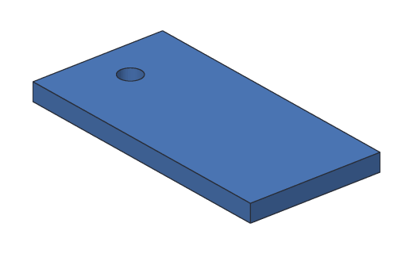

# kh_cli demo

Makes a sample part, a keychain tag with a hole, so you can check that Khan and
its geometry kernel work.

```text
kh_cli demo <out.khan|out.stl|out.step>
```

| Argument | Meaning |
| --- | --- |
| `out.khan` | Save the tag as a Khan design: three steps you can open and change |
| `out.stl` | Save only the shape, as a mesh for 3D printing |
| `out.step` | Save only the shape, as a STEP file for other CAD programs |



## Examples

Save it as a design, then look at its steps with [`kh_cli open`](open.md):

<!-- cli-example -->
```console
$ kh_cli demo tag.khan
wrote tag.khan
$ kh_cli open tag.khan
Demo tag: 3 steps
  Plate        ok  volume 7200.00 mm^3
  Hole         ok  volume 117.81 mm^3
  Tag          ok  volume 7121.46 mm^3
```

Save only the shape, for a slicer or another CAD program:

<!-- cli-example -->
```console
$ kh_cli demo tag.stl
volume: 7121.46 mm^3
wrote tag.stl
$ kh_cli demo tag.step
volume: 7121.46 mm^3
wrote tag.step
```

The plate is 60 × 30 × 4 mm = 7200 mm^3. The hole takes away
π × 2.5² × 4 ≈ 78.54 mm^3, which leaves 7121.46 mm^3.
