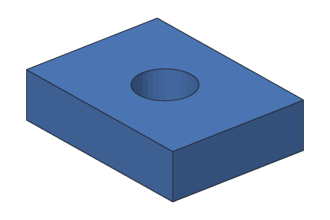

# kh_cli run

Runs one modeling command, such as "add a box" or "cut a hole", on a new or saved
design. Then it rebuilds the design, prints every step, and saves it.

```text
kh_cli run [--plugins <folder>]... [--open <in.khan>] [--save <out.khan>] <command> [name=value]...
```

| Option | Meaning |
| --- | --- |
| `<command>` | The modeling command to run, e.g. `feature.add_box`. See [Modeling commands](commands.md), or run [`kh_cli help`](help.md) |
| `name=value` | One setting for the command, e.g. `size=40,30,10`. Settings that aren't required can be left out |
| `--open <in.khan>` | Start from this saved design. Without it, `run` starts a new, empty design |
| `--save <out.khan>` | Save the result here. It may be the same file as `--open`. A new design is named after this file |
| `--plugins <folder>` | Load the plugins in this folder, so their commands can run. Can be given more than once |

Without `--save`, nothing is saved: useful to try a command first.

## Build a part one command at a time

Each `run` adds one step. Save to the same file each time to build up a design:

<!-- cli-example -->
```console
$ kh_cli run --save block.khan feature.add_box size=40,30,10
block: 1 step
  Box1         ok  volume 12000.00 mm^3  mass 14.88 g (PLA)
wrote block.khan
$ kh_cli run --open block.khan --save block.khan feature.add_cylinder base=20,15,-1 radius=6 height=12
block: 2 steps
  Box1         ok  volume 12000.00 mm^3  mass 14.88 g (PLA)
  Cylinder1    ok  volume 1357.17 mm^3  mass 1.68 g (PLA)
wrote block.khan
$ kh_cli run --open block.khan --save block.khan feature.add_boolean operation=cut a=Box1 b=Cylinder1
block: 3 steps
  Box1         ok  volume 12000.00 mm^3
  Cylinder1    ok  volume 1357.17 mm^3
  Cut1         ok  volume 10869.03 mm^3  mass 13.48 g (PLA)
wrote block.khan
```



Steps that you don't name get names like `Box1` and `Cut1`. Later commands use
those names, like `a=Box1`.

## Try a command without saving

<!-- cli-example -->
```console
$ kh_cli run feature.add_box size=10,10,10
Untitled: 1 step
  Box1         ok  volume 1000.00 mm^3  mass 1.24 g (PLA)
```

## Run a plugin's command

<!-- cli-example -->
```console
$ kh_cli run --plugins build/dev/khan-plugins example.hello.add_cube size=25
Untitled: 1 step
  Cube1        ok  volume 15625.00 mm^3  mass 19.37 g (PLA)
[example.hello] Hello saw a change: Add Cube1
```

Lines in `[brackets]` are messages from plugins.

## When something is wrong

`run` checks the settings before changing anything, says what's wrong, and exits
with code 1. The design is not changed or saved.

A setting that's missing:

<!-- cli-example exit=1 -->
```console
$ kh_cli run feature.add_box
error [command.arg_missing]: Add box needs size: Width, depth and height in mm.
```

A value of the wrong kind:

<!-- cli-example exit=1 -->
```console
$ kh_cli run feature.add_box size=10,20
error: size must be three numbers in mm, like 10,20,30
```

A setting the command doesn't have:

<!-- cli-example exit=1 -->
```console
$ kh_cli run feature.add_box size=10,20,30 colour=red
error: Add box has no setting called colour. Its settings are: size corner name
```

A step that is added but doesn't build, such as a box with no depth. The step
shows `failed` with the reason, and `run` exits with code 1. With `--save`, the
design is still saved, so you can fix the step later:

<!-- cli-example exit=1 -->
```console
$ kh_cli run feature.add_box size=10,0,10
Untitled: 1 step
  Box1         failed
    error [kernel.box.size]: A box needs a width, depth and height greater than 0 mm.
```
