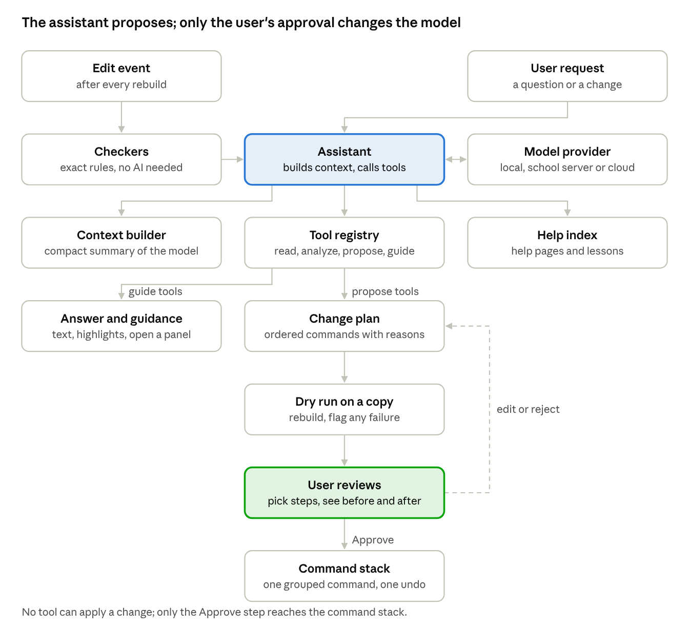
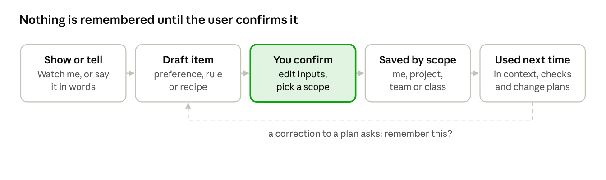

# AI assistant

> **Draft.** This design changes as Khan is built. Questions and ideas are welcome in [GitHub Discussions](https://github.com/ddreeves70/khan/discussions).

The assistant is an optional panel that reviews the model as you edit, plans multi-part changes for you to approve, and answers how-to questions about the app. It never edits silently: everything it does becomes ordinary commands that you preview, approve, and can undo in one step.

**Principles**

- **Off by default, one switch to turn on.** The app is fully usable without it, including offline.
- **Suggest, preview, approve.** The assistant proposes; the user decides. No change lands without an explicit approval.
- **Same path as a human.** It acts only through the command registry and query API that scripts use, so undo, history and file format need nothing special.
- **Exact checks first, AI second.** Deterministic checkers find problems; the language model explains them, ranks them, and spots design-intent issues rules cannot.
- **Grounded answers.** How-to answers come from the app's own help pages and the user's actual model, with a link to the source page.
- **Teacher and admin control.** Schools choose off, hints-only, or full assistance per class.

## The three modes

| Mode | Example | How it works | When it acts |
| --- | --- | --- | --- |
| **Review** (catch issues) | "Hole1 is 1.5 mm from the edge; it may crack when printed." "These two holes look like they should match the lid's pins, but one is 5 mm and one is 5.2 mm." | Checkers run after every rebuild (sketch under-defined, thin walls, interference, hole-to-edge distance, mismatched mating sizes, missing draft). The model ranks findings and explains them in plain words, with a one-click fix when one exists | Continuously, as quiet markers in the viewport and timeline; never blocks editing |
| **Change across parts** | "Change every M4 hole to M5." "Make the lid 2 mm wider and update the box to match." | Finds affected features through parameters, the reference graph and where-used queries, then builds a change plan of ordinary commands, dry-runs it on a copy, and shows a before/after preview | Only when asked; applies only after approval |
| **Ask how-to** | "How do I make a circular pattern of holes?" "Why did my fillet fail?" | Answers from the help index plus the current model state; can highlight the right toolbar button, open the command panel prefilled, or offer "do it for me" as a change plan | When asked, in a side panel or command search |

## How it works

The model provider is swappable behind one interface, like the kernel. Checkers run without any AI, so review mode works offline and on any hardware; the language model adds explanations and catches design-intent issues on top.

## Tools the assistant can call

The assistant sees the model through the same typed API as Python scripts. Tools are generated from the command registry, so every new command is automatically available to it.

| Group | Tools | Can change the model? |
| --- | --- | --- |
| Read | `get_feature_tree`, `get_parameters`, `get_selection`, `find_features(type, filter)`, `where_used(id)`, `measure(a, b)`, `get_findings()` | No |
| Analyze | `run_checks(scope)`, `dry_run(plan)`, `compare(before, after)` | No (dry runs use a copy) |
| Propose | `propose_command(name, args)`, `build_plan(steps)` | No; produces a `ChangePlan` for review |
| Guide | `highlight(target)`, `open_command(name, prefill)`, `show_help(page)` | No; UI only |

There is deliberately no tool that applies a change. Only the user's Approve button sends a plan to the command stack.

## Change plans and safety

1. The assistant builds a `ChangePlan`: an ordered list of commands with a one-line reason each, plus the files they touch.
2. The plan is dry-run on a copy of the affected documents. Any step that fails rebuild or breaks a reference is flagged before the user sees the plan.
3. The review panel shows each step with a checkbox, ghosted before/after geometry in the viewport, and a list of affected parts and drawings.
4. Approve applies the checked steps as one grouped command: one undo reverts the whole plan.
5. Every applied plan is logged in the document history with its original request, so teammates and teachers can see what the assistant changed.

Limits: plans cannot delete files, change files outside the open workspace, or alter released (PDM-locked) parts; large plans (for example more than 50 steps) require a second confirmation.

## Teaching the assistant

Users can teach the assistant how they work, and it applies that next time. Teaching is memory, not model training: what it learns is saved as readable items the user can see, edit, share and delete, and it works the same with a local or cloud model.

There are three kinds of things to teach.

| Kind | How the user teaches it | How it is used later | Example |
| --- | --- | --- | --- |
| **Preference** | Says it: "From now on, use M5 for mounting holes." | Added to the assistant's context when relevant; shapes plans and answers | Default hole size, naming style, preferred units, fillet sizes for printed parts |
| **Rule** | Says or picks a finding: "Warn me when a wall is under 2 mm." | Compiled into a checker when it can be expressed exactly; otherwise checked by the model | Minimum wall, hole-to-edge distance, required chamfers on outside edges |
| **Recipe** | Shows it: "Watch me", does the steps once, then "Remember this as Mounting boss." | Replayed on new geometry as a change plan, with inputs filled in | Mounting boss with screw hole, snap-fit clip, lid lip, standard bracket |

**Teaching is always confirmed.** The assistant never learns silently. When it notices a pattern (for example, you fix its plan the same way twice) it asks "Remember this?" and shows exactly what it would save.

**Example: teaching a recipe**

1. The user clicks **Watch me** and models a mounting boss: a sketch circle on a face, extrude 6 mm, a hole for an M3 screw, a 0.5 mm fillet at the base.
2. The user clicks **Stop** and names it "Mounting boss".
3. The assistant generalizes the recording. It proposes inputs (the face, the position, the screw size) and keeps the rest as fixed steps or formulas (hole diameter = screw size + 0.2 mm clearance; boss diameter = 2.5 × screw size).
4. The user reviews the recipe card, renames inputs, changes a value into a formula or back, and saves it.
5. Later: "Add mounting bosses at these four points for M4 screws." The assistant fills in the recipe four times and shows one change plan to approve.

**Where taught items live**

| Scope | Who sees it | Stored in |
| --- | --- | --- |
| Me | Only this user, every project | User profile folder |
| Project | Everyone who opens the project | The project folder, so it travels with the files and versions in Git or PDM |
| Team or class | Members of a team, or a teacher's class | Shared folder, PDM vault, or the class hand-in folder |
| Built-in | Everyone | Ships with the app (starter recipes and rules) |

When two items conflict, the narrower scope wins (Me over Project over Team over Built-in), and the assistant names the item it used: "Using your rule: walls at least 2 mm." A **What the assistant knows** panel lists every item with its scope, source and last use, with edit, disable, delete and export buttons. Items are plain text plus a small JSON file, so they can be reviewed, versioned and shared like any other file.

**Safety for taught items.** Recipes run only as change plans: dry run, preview, approve, one undo. A recipe or rule shared by someone else shows its steps and asks for approval before its first use. Teachers can publish recipes and rules to a class and choose whether students may add their own.

**Class model additions**

| Class | Responsibility | Key members |
| --- | --- | --- |
| `KnowledgeStore` | Loads, searches and saves taught items across scopes | `find(context): KnowledgeItem[]`, `save(item, scope)`, `resolveConflicts()` |
| `KnowledgeItem` (abstract) | One taught item | `id`, `scope`, `title`, `text`, `tags`, `source`, `version`, `enabled`, `lastUsed` |
| `Preference` | A stated default or style | `appliesTo: FeatureType[]`, `value` |
| `Rule` | A check the user asked for | `expression?`, `checker: Checker?`, `severity` |
| `Recipe` | A reusable, parameterized procedure | `inputs: RecipeInput[]`, `steps: CommandTemplate[]`, `preconditions` |
| `RecipeInput` | One value or selection the user supplies | `name`, `type` (face, point, length, size), `default` |
| `CommandTemplate` | A recorded command with inputs and formulas in place of fixed values | `command`, `args: map<Name, ArgSource>` |
| `Recorder` | Captures commands between Watch me and Stop | `start()`, `stop(): CommandLog` |
| `Generalizer` | Turns a command log into a draft recipe (finds inputs, formulas, references) | `draft(log): Recipe` |

**When it ships**

- **v0.2:** preferences and simple rules, Me scope only.
- **Phase 6-7:** recipes (Watch me, generalize, replay as change plans) and Project scope.
- **Stage 3-4:** Team and class scopes shared through the hub or PDM; teacher-published recipes.

The groundwork is already in the plan: recipes are recorded commands, so the command registry with typed arguments (Phases 0-2) is what makes recording and replay possible.

## Privacy, cost and classroom controls

| Choice | Options | Default |
| --- | --- | --- |
| On or off | Per user; per class or site for schools | Off |
| Model provider | Local model on the computer (offline, free, smaller); school or company server; cloud service with the user's or school's own key | Local where hardware allows; cloud is opt-in |
| What is shared | Structured model summary (features, parameters, findings, names); geometry meshes only if the user allows | Summary only |
| Assistance level | Off, hints only (explains and points, never builds plans), full | Hints only in lesson mode |
| Data retention | Conversations stored only in the local document history; no use of user data for model training by the project | Local only |

Schools: the hints-only level keeps the assistant from doing a student's graded work. Cloud providers must meet the school's student-privacy obligations (for example FERPA and COPPA in the US), which is why local and school-hosted options come first.

## Class model additions

A new library, `kh_assist`, sits beside `kh_commands` and depends only on the public API.

| Class | Responsibility | Key members |
| --- | --- | --- |
| `Assistant` | Orchestrates a request: builds context, calls the provider, runs tools, returns answers or plans | `ask(text)`, `review(scope)`, `plan(request)`, `policy` |
| `AssistantProvider` (interface) | One language-model backend | `complete(messages, tools): Response`, `capabilities()` |
| `LocalProvider`, `ServerProvider`, `CloudProvider` | Concrete backends: on-device, self-hosted, third-party API | endpoint, model name, key storage |
| `ContextBuilder` | Turns the document into a compact, token-budgeted summary | `summarize(doc, focus): Context` |
| `ToolRegistry` | Exposes read, analyze, propose and guide tools generated from the command registry | `tools()`, `invoke(name, args)` |
| `Checker` (interface) | One deterministic rule | `run(doc, scope): Finding[]` |
| `Finding` | A detected issue | `severity`, `refs: GeometryRef[]`, `message`, `fix: ChangePlan?` |
| `ChangePlan` | Proposed edits awaiting approval | `request`, `steps: PlannedStep[]`, `affectedDocs`, `dryRunReport` |
| `PlannedStep` | One proposed command | `command`, `reason`, `selected: bool` |
| `HelpIndex` | Searchable help pages and lesson text for grounded answers | `search(query): HelpPage[]` |
| `AssistantPolicy` | Effective settings from user, class and site | `level`, `provider`, `shareGeometry` |

## Where it lands in the roadmap

| When | What ships | Needs |
| --- | --- | --- |
| Phases 0-2 | Nothing user-facing. Command registry with names, typed arguments and descriptions; `Checker` interface | Already in the plan; just write descriptions as you go |
| Phase 3 (v0.1) | Review mode with deterministic checkers only (print-readiness, sketch definition, hole-to-edge); plain-language messages | No AI model at all |
| Phase 4-5 (v0.2) | Ask how-to with the help index; AI explanations of findings; provider settings; hints-only level for lessons | `kh_assist`, help index, one local and one cloud provider |
| Phase 6-7 | Single-part change plans ("round all outside edges 1 mm") with dry run and preview | Change-plan review panel |
| Stage 3-4 | Cross-part change plans ("M4 to M5 everywhere"), mating-size checks across assemblies | Workspace reference graph, where-used, configurations |
| Stage 4-5 | Design review against company standards and manufacturing rules (DFM), drawing and GD&T checks | PMI data model, rule packs |

This ordering means the first useful version needs no AI service, and each later step reuses work the core plan already requires.

## Risks

| Risk | Mitigation |
| --- | --- |
| Wrong or incomplete change plans | Dry run before preview; per-step checkboxes; one-step undo; plans logged with the request |
| Confident but wrong how-to answers | Answers grounded in the help index and cite the page; "I'm not sure" is allowed and preferred to guessing |
| Students leaning on it instead of learning | Hints-only level by default in lessons; teacher controls; lesson checks still judge the student's own work |
| Cost of cloud models | Local default; cloud only with the user's or school's key; caching of context summaries |
| Slow responses on modest school laptops | Deterministic checks need no model; small local models for hints; larger models optional |
| Privacy of proprietary designs (professional users) | Self-hosted provider option; geometry never leaves the machine unless allowed |
