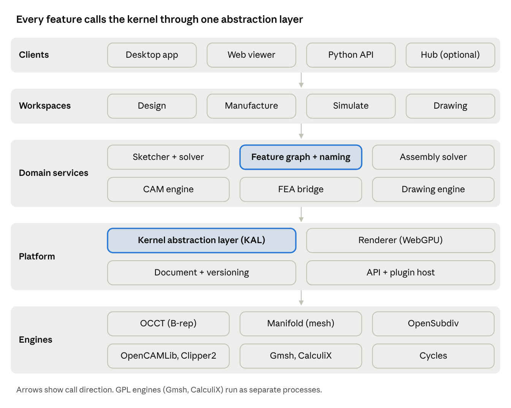
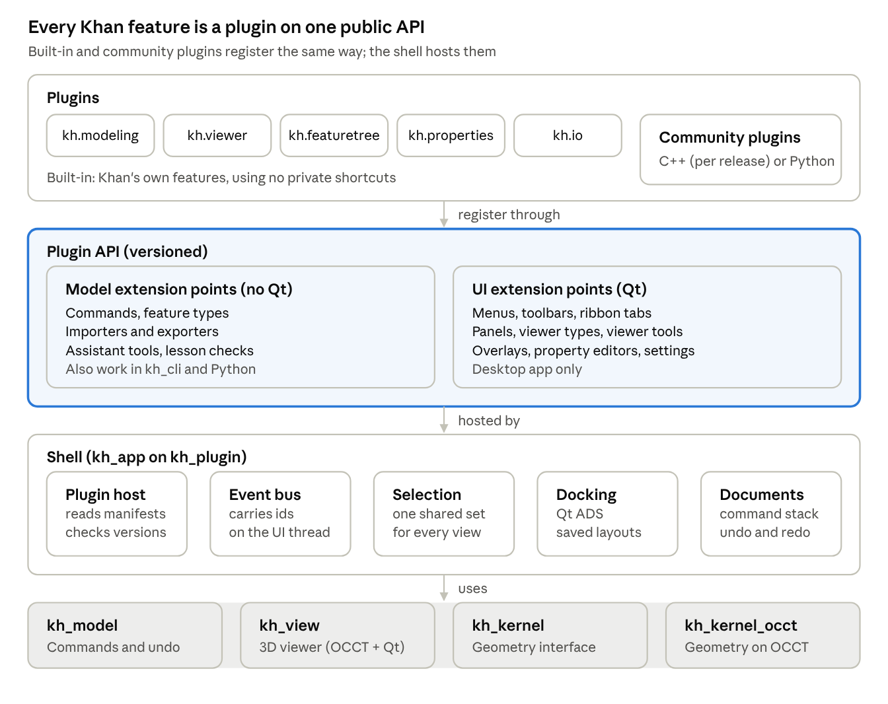

# Architecture

> **Draft.** This design changes as Khan is built. Questions and ideas are welcome in [GitHub Discussions](https://github.com/ddreeves70/khan/discussions).

## Purpose and goals

Build an open-source, integrated product-design tool whose core loop is as fast and dependable as Fusion's: sketch, model, assemble, document, and manufacture, all in one parametric model. Win on UX coherence, openness, and file ownership, not on matching every Fusion checkbox.

**Goals**

- One associative model drives parts, assemblies, drawings, and CAM. A dimension change flows everywhere.
- Models do not break on upstream edits. Robust references are a first-class design requirement.
- Users own their data: a documented, versionable native format plus first-class STEP.
- Runs fully offline. Cloud features are optional and self-hostable.
- Extensible through a stable scripting API and plugins.

**Non-goals for v1**

- Generative design, cloud-scale simulation, and photoreal rendering farms.
- PCB design. Integrate with KiCad instead of rebuilding it.
- Large-assembly enterprise PDM. (Deferred, not excluded: see [SolidWorks-class scope](solidworks-scope.md).)

**Assumptions**

- Primary users: high school (grades 9-12) engineering, technology and CTE classes first, then makers, small shops and startups, the segment Fusion's licensing changes have pushed around. Middle schools (often on Chromebooks) and community colleges (which need drawings and CAM) come later.
- Desktop-first native app (Windows, macOS, Linux), with an architecture that allows a web client later.
- Permissive license (MIT or Apache-2.0) for the core so companies can embed and contribute.

## Fusion capability map

Parity means covering Tier 1 well before touching Tier 3. Most Fusion users live in sketch, part, assembly, drawing, and 2.5D/3-axis CAM.

| Capability area | What Fusion offers | Tier | Our approach |
| --- | --- | --- | --- |
| Sketching | 2D constrained sketches, projections, text, splines | 1 | Native sketcher on a geometric constraint solver |
| Solid modeling | Extrude, revolve, sweep, loft, fillet, shell, patterns, Booleans | 1 | Parametric feature engine on a B-rep kernel |
| Timeline | History rollback, reorder, suppress, edit-in-place | 1 | Feature dependency graph with a linear timeline view |
| Assemblies | Components, joints, motion limits, interference | 1 | Joint-based assembly solver |
| Drawings | Views, sections, dimensions, BOM, GD&T | 1 | Associative 2D drawing module, PDF/DXF out |
| Interop | STEP, IGES, STL, 3MF, DXF, many importers | 1 | STEP/STL/3MF/DXF first; others via plugins |
| CAM | 2D/2.5D, 3-axis, adaptive clearing, post-processors | 1 (2.5D, 3-axis) / 3 (5-axis) | Toolpath engine + open post-processor library |
| Direct editing | Push/pull, move face, edit imported solids | 2 | Direct-edit ops recorded as timeline features |
| Freeform | T-spline "Form" sculpting | 2 | Subdivision surfaces converted to NURBS |
| Mesh | Mesh repair, mesh-to-B-rep | 2 | Mesh workspace for scans and STL edits |
| Sheet metal | Flanges, bends, flat patterns | 2 | Feature set + unfold algorithm |
| Simulation | Static, modal, thermal FEA | 2 (static) / 3 (rest) | Wrap an open FEA solver |
| Rendering | Ray-traced appearance renders | 2 | Integrate an open path tracer |
| Collaboration | Cloud hub, versions, sharing, comments | 2 | Git-style versioning + optional self-hosted server |
| Electronics | PCB design linked to 3D | 3 | KiCad bridge (board outline and STEP sync) |
| Generative design | Topology optimization in the cloud | 3 | Later; open topology-optimization research |

Beyond Fusion: an optional AI assistant that reviews models as you edit, plans multi-part changes for approval, and answers how-to questions. Design in [AI assistant](ai-assistant.md).

## System architecture

Five layers, each calling only the one below it. The two highlighted components, the feature graph and the kernel abstraction layer, carry the most risk and get built first.

Workspaces are views over one shared document, so a change in Design flows to CAM, simulation, and drawings without export steps.

## Geometry kernel

Recommendation: put every kernel call behind our own Kernel Abstraction Layer (KAL), ship v1 on OCCT, and use Manifold for mesh work. This gets a production-grade B-rep today and keeps a path to a Rust kernel or a commercial one later.

| Option | Type | License | Maturity | Fit |
| --- | --- | --- | --- | --- |
| [Open CASCADE (OCCT)](https://dev.opencascade.org/) | NURBS B-rep, C++ | LGPL 2.1 + exception | 30+ years, used by FreeCAD, KiCad, CadQuery | Best free B-rep today. Weak spots: fillet and Boolean robustness, threading |
| [Truck](https://github.com/ricosjp/truck) / [monstertruck fork](https://docs.rs/monstertruck) | NURBS B-rep, Rust | Apache-2.0 | Booleans, sweeps, meshing, STEP; young | Watch and contribute; not v1-ready for fillets and complex features |
| [Fornjot](https://github.com/hannobraun/fornjot) | B-rep, Rust | MIT/Apache | Repository archived June 2026; simple models only | Not viable |
| [Manifold](https://github.com/elalish/manifold) | Triangle mesh, C++ | Apache-2.0 | Very robust, fast mesh Booleans; used by OpenSCAD and Blender | Mesh workspace, STL/3MF repair, CAM stock models. Not exact B-rep |
| Parasolid (Siemens) / ACIS (Spatial) / C3D | Commercial B-rep | Paid license | Industry grade (Onshape, SolidWorks use Parasolid) | Ruled out: cannot ship in a free product |
| Build our own | NURBS B-rep | Ours | 5-10+ engineer-years to match OCCT | Only as a long-term research track |

**Kernel Abstraction Layer responsibilities**

- A stable C API over shapes, features, and queries so the kernel can be swapped per operation.
- Persistent IDs for every face, edge, and vertex the kernel returns (feeds topological naming).
- Tolerance policy, error classification, and automatic healing retries.
- Threading: run kernel jobs off the UI thread, with cancellation.
- Deterministic results: same inputs, same output, for caching and tests.

## Sketcher and constraint solver

The sketcher is where users spend most of their time, so it must feel instant and never surprise them. Build it as a standalone library with its own tests.

- **Entities:** points, lines, arcs, circles, ellipses, splines, construction geometry, text, and projected or intersected edges from 3D.
- **Constraints:** coincident, horizontal/vertical, parallel, perpendicular, tangent, equal, symmetric, midpoint, fix, plus dimensions driven by named parameters and expressions.
- **Solver:** Newton/Levenberg-Marquardt over a sparse system, decomposed into independent clusters so drags stay real-time. Start from SolveSpace's solver (GPLv3, so check license fit) or FreeCAD's PlaneGCS (LGPL), or write our own on Eigen.
- **Diagnostics:** degrees-of-freedom display (under, fully, over-constrained), conflicting constraint highlighting, and suggested fixes.
- **Inference:** auto-constraints while drawing, with snapping that matches Fusion's feel.
- **Profiles:** automatic region detection for closed loops, including nested and overlapping regions, as inputs to features.

## Parametric modeling engine

This is the heart of the product and the main differentiator. The model is a directed acyclic graph of features, shown to the user as a linear timeline, and regenerated incrementally.

**Core pieces**

- **Parameter store:** named user parameters, units, and expressions with dependency tracking.
- **Feature graph:** each feature has typed inputs (sketch profiles, references, parameters) and produces bodies. Only invalidated downstream features recompute.
- **Timeline:** rollback marker, reorder, suppress, edit-in-place, and groups, matching Fusion's model.
- **Feature library (v1):** extrude, revolve, sweep, loft, hole and thread, fillet, chamfer, shell, draft, rib, mirror, linear/circular/path patterns, combine, split, construction planes/axes/points.
- **Multi-body and components:** many bodies per part, promotion of bodies to components.
- **Caching:** content-addressed cache of feature outputs so edits and undo are fast.

**Topological naming (design up front)**

Downstream features must keep referring to the same face or edge after upstream edits. Approach:

- Every generated entity gets a name built from its history: which feature created it, from which sketch element or input face, and how (for example "side face from line L3 of Sketch2, Extrude1").
- References store that name plus a geometric signature (normal, centroid, adjacency) used as a fallback matcher.
- When matching is ambiguous, flag the feature and ask the user to repick, never silently guess.
- Prior art to study: FreeCAD's topological naming mitigation (merged for FreeCAD 1.0) and the academic literature on persistent naming.

## Direct, freeform and mesh modeling

These let users edit geometry they did not model themselves, which is common with imported STEP files and scans.

- **Direct editing:** push/pull faces, move/rotate faces, delete face and heal, replace face. Each op is recorded as a timeline feature so history stays intact.
- **Freeform (Fusion's Form workspace):** subdivision-surface cage editing (OpenSubdiv, Apache-2.0) with crease and symmetry, converted to NURBS or exact B-rep patches on exit. T-splines are patent-encumbered historically, so SubD is the safer route.
- **Mesh workspace:** import STL/OBJ/3MF, repair, remesh, section, and convert to B-rep (planar faces, or fitted surfaces as a later feature). Manifold handles mesh Booleans.
- **Sheet metal:** flange, bend, hem, relief, and flat pattern with K-factor tables, built as features on the main engine.

## Assemblies, joints and motion

Use Fusion's joint model rather than SolidWorks-style mates: one joint between two components defines both position and allowed motion, which is easier to learn.

- **Component tree:** in-place and external (linked) components, instances, and per-instance overrides.
- **Joints:** rigid, revolute, slider, cylindrical, pin-slot, planar, ball, with limits and rest positions. As-built joints for parts modeled in place.
- **Assembly solver:** rigid-body kinematic solver separate from the sketch solver; incremental so dragging is real-time.
- **Motion:** drive joints, motion links (gears, rack and pinion), contact sets, and simple motion studies exported as animation.
- **Checks:** interference, clearance, mass properties, center of gravity.
- **BOM data:** part numbers, materials, and quantities flow to drawings and exports.
- **Scale target:** smooth at 1,000+ components via instancing and lightweight display representations.

## 2D drawings and documentation

Drawings must stay associative: a model change updates views and flags dimensions that lost their references.

- **Views:** base, projected, section, detail, broken, auxiliary, and exploded, with hidden-line removal (OCCT HLR or a GPU method).
- **Annotation:** dimensions, ordinate, hole and thread callouts, centerlines, surface finish, weld symbols, GD&T frames and datums.
- **Tables:** BOM with balloons, hole tables, revision tables.
- **Standards:** ISO and ASME templates, title blocks, sheet sizes.
- **Output:** PDF, DXF, DWG (via the open LibreDWG library, subject to its GPL license, or a plugin), and SVG.

## CAM / manufacturing

Integrated CAM is a major reason people choose Fusion, so it is Tier 1. Toolpaths are features in the same model graph, so they regenerate when geometry changes.

- **Setups:** stock definition, work coordinate system, fixtures, machine definition.
- **2D/2.5D operations:** facing, contour, pocket, adaptive (constant-engagement) clearing, drilling cycles, thread milling, chamfer, engraving. Use Clipper2 (Boost license) for robust 2D offsets.
- **3D operations:** adaptive roughing, parallel, scallop, waterline, pencil, using OpenCAMLib (LGPL) drop-cutter and waterline as a starting point.
- **Tool library:** tools, holders, feeds and speeds presets, shareable as files.
- **Simulation:** stock removal on a mesh or voxel model (Manifold), gouge and collision checks, cycle-time estimate.
- **Post-processors:** a sandboxed scripting format with an open community library (Grbl, LinuxCNC, Haas, Fanuc, Mach3/4).
- **Additive:** export 3MF to slicers (PrusaSlicer, OrcaSlicer, Cura) rather than building a slicer. Laser and plasma via 2D profiles.
- **Later:** 3+2 indexed and 4/5-axis simultaneous, probing cycles.

## Simulation (FEA)

Wrap proven open solvers instead of writing one. The product work is the setup UX and result display, not the math.

- **v1 study types:** linear static stress and modal frequencies on parts and simple assemblies.
- **Later:** thermal, buckling, nonlinear contact, and shape/topology optimization.
- **Meshing:** Gmsh (GPL, run as a separate process) or Netgen (LGPL) from the B-rep, with local refinement.
- **Solvers:** CalculiX (GPL, run as a separate process) for structural; FEniCSx or Elmer as alternatives.
- **Setup UX:** materials library, fixed and pinned constraints, forces, pressure, bolt preload, guided wizard with sanity checks.
- **Results:** stress, displacement, safety factor, mode shapes, animated in the viewer, exportable as reports.

## Visualization, rendering and UI shell

The UX is where we beat FreeCAD and match Fusion. Set a hard budget: 60 fps orbit on a 1,000-part assembly on a mid-range laptop.

**Viewport**

- Renderer on WebGPU-class APIs (wgpu in Rust, or Dawn in C++), so desktop and a future web client share one renderer.
- Tessellation cache with level of detail, GPU picking with stable entity IDs, section planes, edge and silhouette rendering, zebra and curvature analysis.
- Photoreal rendering by integrating Blender's Cycles (Apache-2.0) as a separate render mode.

**Application shell**

- Workspaces (Design, Manufacture, Simulate, Drawing) sharing one document, like Fusion.
- Timeline bar, browser tree, context-sensitive toolbar, marking menu, command search, and a shortcut box.
- Every command is a modal tool with live preview and on-canvas manipulators, undoable as one step.
- UI toolkit: Qt 6 (mature, LGPL) for a C++ stack, or a Rust-native option such as egui/Slint if the core is Rust.
- Accessibility, high-DPI, dark mode, and localization from day one.

## UI and plugin architecture

Khan's app is a small shell, and every capability, including the box tool and the 3D viewer, ships as a plugin built on the same public API outside developers use. Decided Oct 22, 2026: docking uses the Qt Advanced Docking System, and plugins follow the binary-compatibility plan below.

Plugins register into one versioned API; the shell hosts them and the core libraries do the work underneath.

Mockups of the main window, split views, two monitors and the Plugin manager, each with a numbered breakdown: [UI screens](ui-screens.md).

**The shell** owns the main window, the docking layout, the plugin host, the event bus, the shared selection and the list of open documents. It has no modeling features of its own. If Khan's own features can be built through the plugin API, the API is good enough for everyone else.

**A plugin** is a folder with a `plugin.json` manifest (id, name, version, `apiVersion`, dependencies, permissions) and either a shared library with one entry function, `kh_plugin_register(PluginContext&)`, or a Python module. At start the host reads every manifest, checks the API version and dependencies, loads plugins in dependency order and calls each entry function. A plugin that fails to load shows in the Plugin manager with a plain message, and Khan still starts.

**Built-in plugins**

| Plugin | What it adds | Phase |
| --- | --- | --- |
| `kh.modeling` | Box, cylinder and Boolean commands and feature types; later sketch, extrude, fillet | 0 |
| `kh.viewer` | The 3D viewer type, split layouts, view cube, picking and selection tools | 0 |
| `kh.featuretree` | The feature tree panel | 0 |
| `kh.properties` | The properties panel for the selected step | 0 |
| `kh.io` | `.khan` save and open, STEP and STL import and export | 0 |
| `kh.timeline` | The timeline bar with the rollback marker | 2 |
| `kh.lessons` | The lesson panel, lesson steps and checks | 3 |
| `kh.assistant` | The AI assistant panel and its tools | 3 (checks), 4 to 5 (AI) |
| `kh.makeit` | The Make it button: print checks and service export | 3 |

**Extension points.** Two layers keep Qt out of the core libraries. Model-layer extensions also work in `kh_cli`, Python scripts and a future server.

| Area | Layer | What a plugin registers | Built-in user |
| --- | --- | --- | --- |
| Commands | Model | Name, typed arguments, factory (the `CommandRegistry`, done) | `kh.modeling` |
| Feature types | Model | Type id, factory, save and load, schema version | `kh.modeling` |
| Importers and exporters | Model | File extensions, read or write function | `kh.io` |
| Assistant tools | Model | Tool name, description, arguments, the command it runs | `kh.assistant` |
| Lesson checks | Model | Check type and `evaluate(doc)` | `kh.lessons` |
| Menus, toolbars, ribbon tabs | UI | Actions that run a command by name | every plugin |
| Panels | UI | A dockable widget factory and its default dock area | `kh.featuretree`, `kh.properties` |
| Viewer types | UI | A view factory: 3D model, drawing sheet, CAM simulation | `kh.viewer` |
| Viewer tools | UI | An interaction mode: mouse and keys, live preview, then a command | `kh.viewer`, `kh.modeling` |
| Overlays | UI | Things drawn in a viewer: dimensions, manipulators, labels | `kh.modeling` |
| Property editors | UI | The editor for one feature type | `kh.properties` |
| Settings pages | UI | A page in Settings | any |

Three rules hold for every plugin. It changes a document only by running commands, so undo always works. Every contribution has a stable id such as `kh.modeling.add_box`, so saved layouts, shortcuts and toolbars survive updates. Model-layer code never includes Qt.

**Events.** Input in one place updates every view through the shell's event bus.

| Event | Sent by | Carries | Typical listeners |
| --- | --- | --- | --- |
| `DocumentChanged` | The document list, after execute, undo or redo | Document id, executed/undone/redone, the step's label (changed feature ids come with incremental rebuilds in Phase 2) | Feature tree, properties |
| `RebuildFinished` | The document list (rebuilds after each change) | Document id, whether every step built; the report is read from the list | Every viewer, feature tree status icons |
| `SelectionChanged` | The shared selection | Document id, selected references | All viewers (highlight), feature tree, properties |
| `HoverChanged` | The viewer under the mouse | The reference under the cursor | Other viewers (pre-highlight), status bar |
| `DocumentOpened`, `DocumentClosed` | The document list | Document id | Window menu, panels |
| `ActiveDocumentChanged` | The document list | Document id (nil when none is open) | Menus, panels |
| `CameraChanged` | A viewer | View id, camera | Viewers linked to it |
| `ToolChanged` | The tool manager | Tool id | Status bar, properties |

Built so far (Phase 0): the plugin host, manifests, the event bus, the document list, the shared selection and actions in `kh_plugin` (all Qt-free; the selection moved here from the planned `kh_app` so `kh_cli` and Python share it); `UiRegistry` for panels in a small Qt library, `kh_ui`, rather than in `kh_app`, so plugins can link it; the `kh.modeling`, `kh.featuretree` and `kh.properties` built-in plugins; the desktop shell with Qt ADS docking and named layouts; and the 3D viewer: `kh_view` (OCCT's AIS/V3d in a `QOpenGLWidget`, plus a flat fallback without OpenGL) and the `kh.viewer` plugin, whose panel is the shell's central widget and which `PanelSpec::allowMultiple` lets the student open more than once (plugin API 3). Hover, camera-link and tool events are still to come.

Events carry ids, never pointers. They are delivered in order on the UI thread. A listener that wants to change the design runs a command; events only report. Event types are part of the versioned plugin API.

**Viewer.** One viewer can show 1, 2 (side by side or stacked) or 4 panes; the four-pane layout is Top, Front, Right and a 3D view. Each pane has its own camera and display mode (shaded, wireframe, hidden lines). All panes and viewers of one document share one scene: one OCCT `V3d_Viewer` and `AIS_InteractiveContext` with a `V3d_View` per pane, so the model is not copied and a selection shows everywhere. Window > New viewer opens another viewer of the same part, and viewers of different parts can sit side by side. Two viewers can link cameras, so orbiting one moves both. *As built (Oct 24, 2026):* each pane is its own `QOpenGLWidget` with its own `V3d_Viewer` and `AIS_InteractiveContext` (all on one shared OCCT graphics driver, with Qt's shared OpenGL contexts), because one OCCT viewer redrawing views that live in other Qt widgets' contexts isn't safe. The selection still shows everywhere through the shared `Selection`. Panes draw a copy of each body (new topology, shared geometry), so meshing for the screen never changes the kernel's shapes or later STL exports (rule 5).

**Docking.** Every panel and viewer is a dock widget in the [Qt Advanced Docking System](https://github.com/githubuser0xFFFF/Qt-Advanced-Docking-System) (LGPL-2.1). It can dock to any side, tab with others, split, float as its own window and move to another monitor. Viewers live in the central area, panels around it. Named layouts (Modeling, Classroom, Review) are saved per user; Khan reopens the last layout on the same screens and pulls a window back onto a remaining screen if a monitor is gone.

**Binary compatibility**

| Plugin kind | Built with | Works with |
| --- | --- | --- |
| Built-in C++ | The Khan repo and its compiler | Every release, automatically |
| Outside C++ | The Khan SDK for one release, with the same compiler (MSVC on Windows, Clang on macOS, GCC on Linux) | That release; rebuilt for each release. `apiVersion` is checked at load |
| Python | The pybind11 bindings of the same API | Any release with that API version; no compiler needed |
| Stable C API | Later, if the community needs it | Across releases |

Plugins run inside Khan's process: fast, but a crashing C++ plugin can crash Khan. Python plugins get the sandboxing and signing described under Scripting, plugins and integrations.

**Plugin developer guide.** The guide lives in the repo at `docs/plugin-guide/` and is published with the API reference. It starts with the shell (Phase 0, weeks 4 to 5) as a Hello plugin tutorial, and every change to the plugin API updates it in the same pull request.

## Data model, file formats and interop

The native format stores intent (features and parameters), not just geometry, and is documented so others can read it.

- **Native format:** a zip container holding a JSON or CBOR feature graph, sketches, parameters, metadata, a cached B-rep, and a cached mesh preview. Text-diffable parts make Git workflows practical.
- **Schema versioning:** every file carries a schema version, with forward migration code and a fixture corpus in CI.
- **Exchange (v1):** STEP AP214/AP242 import and export including colors and assembly structure, IGES, STL, 3MF, OBJ, DXF/SVG, glTF.
- **Later:** Parasolid x\_t and other proprietary formats through optional plugins.
- **Fusion migration:** a best-effort importer via exported STEP plus a script that captures parameters from Fusion's API, since Fusion's native format is closed.

## Versioning, collaboration and cloud

Offline-first, with collaboration as an optional layer users can self-host. This is a direct answer to Fusion's cloud lock-in.

- **Local versioning:** every save is a version; named milestones; visual diff of two versions (geometry overlay plus changed features and parameters).
- **Git integration:** text-diffable format, a custom merge driver for feature graphs, and Git LFS for cached geometry.
- **Hub server (optional, self-hostable):** projects, permissions, version history, comments pinned to geometry, share links with a web viewer.
- **Web viewer:** read-only browser view of models and drawings, built on the shared WebGPU renderer and a WASM build of the kernel.
- **Later:** real-time co-editing on the feature graph (operation-based sync), release workflow, and part numbering.

## Scripting, plugins and electronics

A stable API is how an open project grows faster than a closed one.

- **Python API:** full access to documents, parameters, sketches, features, assemblies, CAM, and export. Also usable headless for batch jobs and code-CAD.
- **Plugin system:** versioned plugin manifest, custom features that participate in the timeline, custom commands, panels, importers, exporters, and post-processors. Khan's own features use the same API; see UI and plugin architecture.
- **Sandboxing:** plugins run with declared permissions; post-processors run in a restricted interpreter.
- **Extension registry:** a community catalog, like VS Code's marketplace, with signing.
- **Electronics:** bidirectional KiCad bridge. Push the board outline and mounting holes to KiCad, pull back the populated board as STEP, and flag collisions with the enclosure.

## Testing, performance, licensing and governance

- **Geometry regression suite:** thousands of reference models regenerated on every commit, comparing volumes, face counts, and reference resolution. This is the most important engineering investment.
- **Fuzzing:** randomized feature sequences and parameter sweeps to find kernel and naming failures.
- **Performance budgets in CI:** regeneration time, startup time, memory, and frame time on benchmark models.
- **Crash reporting and telemetry:** opt-in only, used to rank kernel failures.
- **Licensing:** core under Apache-2.0 or MIT. GPL tools such as CalculiX and Gmsh run as separate processes to keep the core permissive. Verify every dependency's license before adoption.
- **Governance:** a foundation or fiscal host (for example via the Linux Foundation or Open Collective), a public roadmap, and an RFC process for file-format and API changes.
- **Sustainability:** optional paid services (hosted hub, AI, courses, support, consulting, marketplace) and sponsors, while every feature of the app stays free. See [principles](README.md#principles).

## Risks

| Risk | Impact | Mitigation |
| --- | --- | --- |
| Kernel robustness (fillets, Booleans fail) | Users lose trust fast | KAL with healing retries, regression corpus, upstream fixes to OCCT |
| Topological naming breaks models | Core promise fails | Design naming in the first milestone; fuzz it continuously |
| Scope creep toward full Fusion parity | Nothing ships well | Hold to Tier 1 until it beats FreeCAD on usability |
| UX quality without a funded design team | Looks like another FreeCAD | Hire or recruit a product designer early; usability tests each release |
| Contributor ramp-up on a complex codebase | Slow growth | Clean module boundaries, docs, good-first-issue pipeline |
| Funding | Project stalls | Hosted hub and support revenue; grants; corporate sponsors |

The phased plan is in [Roadmap](roadmap.md).
