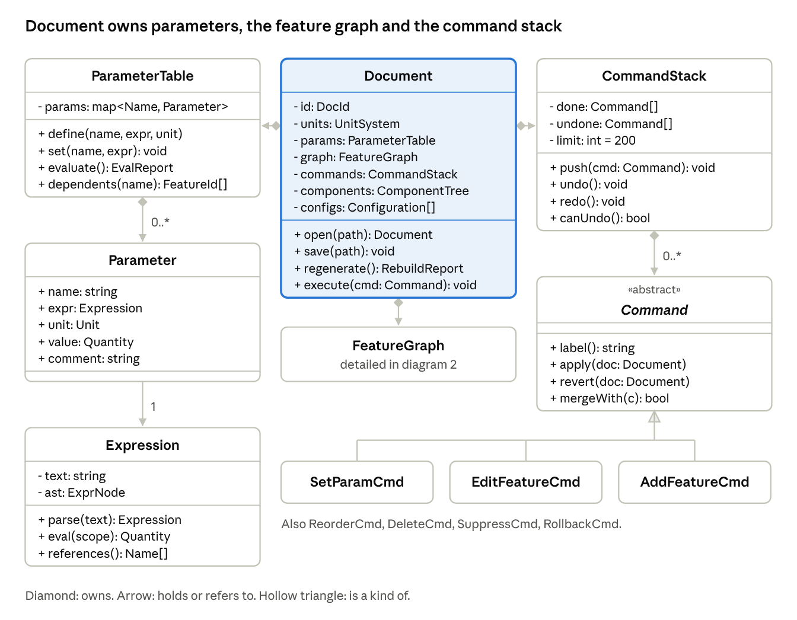
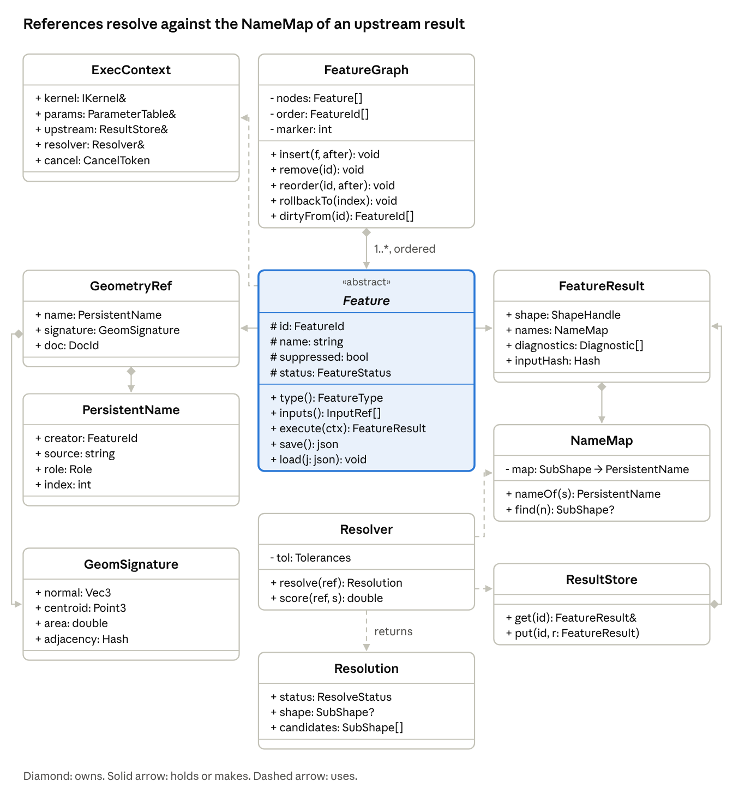
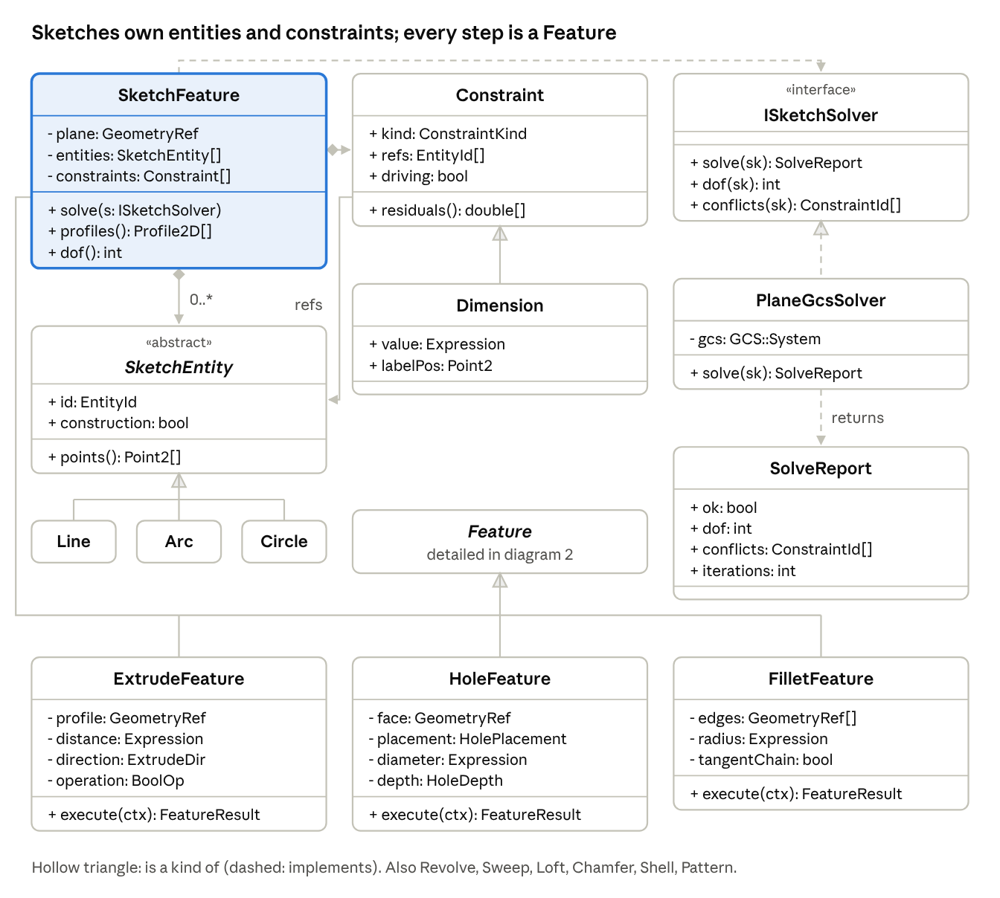
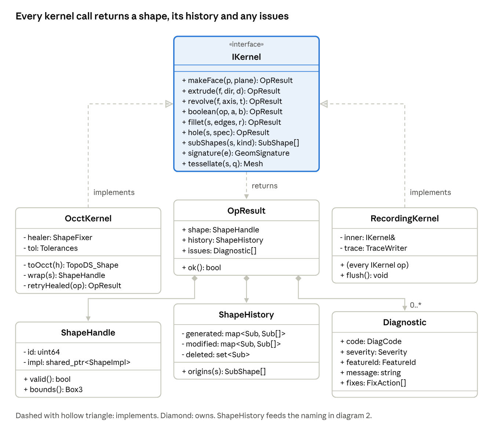
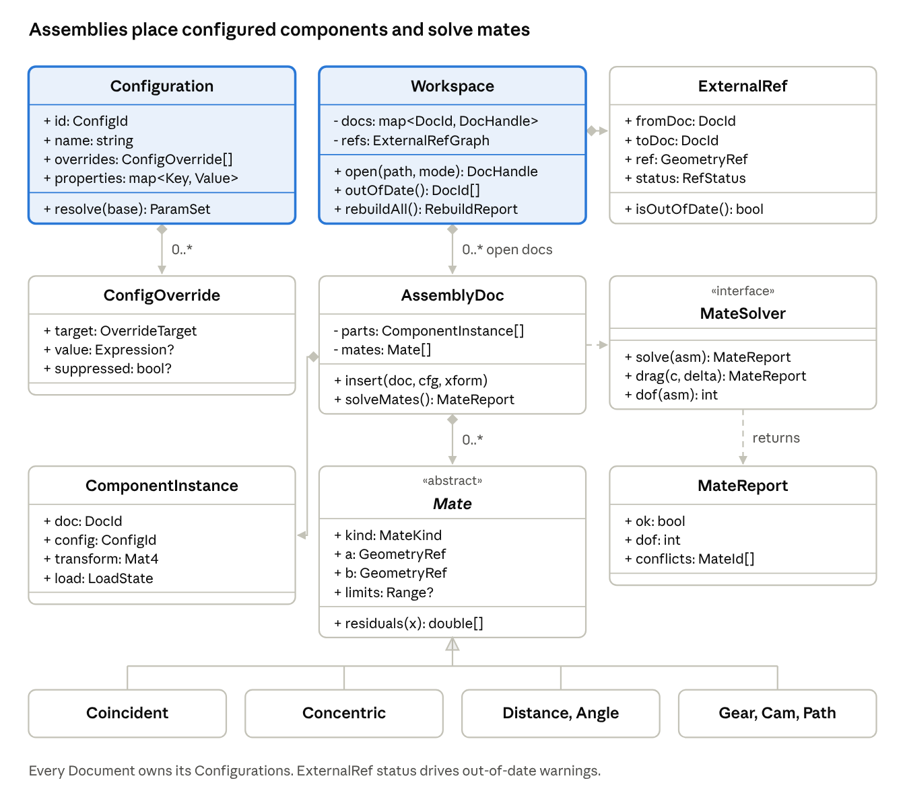
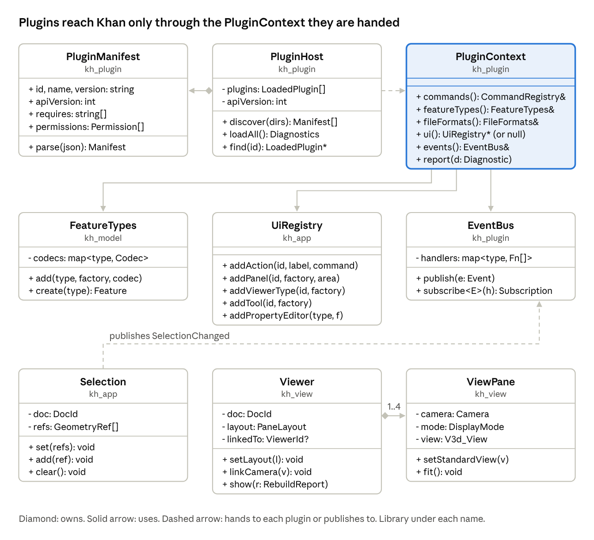

# Class model

> **Draft.** This design changes as Khan is built. Questions and ideas are welcome as [GitHub issues](https://github.com/ddreeves70/khan/issues).

The class model has about 45 core classes in four groups, one UML diagram each. It expands the domain model in [Design model](design-model.md) with attributes, operations, and multiplicities, and matches the interfaces sketched there.

**Notation.** Each box lists the class name, then attributes, then operations. `+` is public, `-` private, `#` protected. Italic names are abstract classes; «interface» marks pure interfaces. A filled diamond means the owner holds the part's lifetime; a hollow triangle means "is a kind of"; a dashed line means "uses" or "implements".

## 1. Document, parameters and commands

Every change goes through `Document::execute()`, which pushes the command and marks the right features dirty. Parameters are evaluated in dependency order before any feature rebuilds.

## 2. Feature graph and naming

A feature has zero or more `GeometryRef` inputs and exactly one `FeatureResult` per rebuild. `Resolver` turns each reference into a `SubShape` by looking up the upstream `NameMap` in the `ResultStore`, falling back to signature scoring.

## 3. Sketches and modeling features

Sketch geometry is solved through `ISketchSolver`, so PlaneGCS can be replaced without touching `SketchFeature`. Every modeling feature stores its inputs as `GeometryRef`s and `Expression`s, never as kernel shapes or plain numbers.

## 4. Kernel layer

`OcctKernel` is the only class that includes OCCT headers. `RecordingKernel` wraps any `IKernel` to capture a replayable trace for bug reports and tests; a future Rust or commercial kernel would be a third implementation.

## 5. Configurations, workspace and assemblies (Stage 4)

A `ComponentInstance` points at a document and one of its configurations, so the same part file can appear as an M4 and an M6 bolt. The `Workspace` watches `ExternalRef`s across files and flags dependents when a source changes.

## 6. Shell and plugins

The `PluginHost` reads each `PluginManifest`, loads plugins in dependency order and hands each one a `PluginContext`. That context is the only door into Khan: the command registry, feature types, file formats, the event bus and, in the desktop app only, the `UiRegistry`. A `Viewer` owns 1 to 4 `ViewPane`s that share one scene, and every viewer listens on the bus for `SelectionChanged` and `RebuildFinished`.

**New library: `kh_plugin`.** The host, manifest, context and event bus need no Qt, so `kh_cli` and Python can load model-layer plugins too. It sits above `kh_model` and below the apps. `UiRegistry` and `Selection` stay in `kh_app`, and the docking layout (`DockLayout`, wrapping the Qt ADS dock manager with `savePerspective(name)` and `restore(name)`) lives there too.

## Stage 4 additions: PMI and new types

PMI (product manufacturing information) stores tolerances and datums on the 3D model itself, so drawings and STEP AP242 exports read them from one place.

| Class or type | Kind | Fields or values |
| --- | --- | --- |
| `PmiAnnotation` | abstract class | `id`, `refs: GeometryRef[]`, `plane: AnnotationPlane`, `toStep(): StepEntity` |
| `Datum` | PmiAnnotation | `label` (A, B, C), `feature: GeometryRef` |
| `ToleranceFrame` | PmiAnnotation | `characteristic` (flatness, position, profile, ...), `value`, `modifiers`, `datums: DatumRef[]` |
| `DimensionPmi` | PmiAnnotation | `nominal`, `upper`, `lower`, `fit` (for example H7) |
| `SurfaceFinish` | PmiAnnotation | `ra`, `process`, `lay` |
| `LoadState` | enum | GraphicsOnly, Lightweight, Resolved |
| `RefStatus` | enum | UpToDate, OutOfDate, Broken, Locked |
| `MateKind` | enum | Coincident, Concentric, Parallel, Perpendicular, Tangent, Distance, Angle, Lock, Gear, Cam, Path, Slot, Width, Limit |
| `OverrideTarget` | variant | Parameter(name), Feature(FeatureId), Component(InstanceId) |
| `DocId`, `ConfigId`, `InstanceId` | value | UUIDs, stable across files and versions |

Also updated: `Document` now owns `configs: Configuration[]` (diagram 1) and `GeometryRef` carries `doc: DocId` (diagram 2).

## Service classes

These sit above the model and depend on it, never the other way round.

| Class | Library | Key attributes | Key operations |
| --- | --- | --- | --- |
| `ComponentTree` | kh\_model | `root: Component`, `bodies: Body[]` | `addComponent()`, `promote(body)`, `find(id)` |
| `Body` | kh\_model | `id`, `name`, `appearance`, `material`, `sourceFeature: FeatureId` | `shape()`, `massProps()` |
| `Lesson` | kh\_lesson | `id`, `title`, `level`, `steps: LessonStep[]`, `progress` | `load(path)`, `currentStep()`, `advance()` |
| `LessonStep` | kh\_lesson | `title`, `instruction`, `clip`, `checks: LessonCheck[]` | `evaluate(doc): StepResult` |
| `LessonCheck` (abstract) | kh\_lesson | `label`, `expected` | `run(doc): CheckResult` |
| `ThicknessCheck`, `HoleSizeCheck`, `FeatureExistsCheck` | kh\_lesson | `min`, `max` or `featureType` | `run(doc)` |
| `HandIn` | kh\_lesson | `destination`, `note`, `package: Path` | `build(doc, lesson)`, `send()` |
| `Exporter` (abstract) | kh\_io | `options` | `write(bodies, path): ExportReport` |
| `StepExporter`, `StlExporter`, `ThreeMfExporter` | kh\_io | format-specific options | `write()` |
| `PrintCheck` (abstract) | kh\_io | `label` | `run(shape, printer): CheckResult` |
| `WatertightCheck`, `MinWallCheck`, `BedFitCheck`, `HoleSizeCheck` | kh\_io | thresholds | `run()` |
| `KhanArchive` | kh\_io | `manifest`, `entries` | `read(path): Document`, `write(doc, path)`, `migrate(schema)` |
| `Viewer` | kh\_view | `scene`, `camera`, `selection: Selection` | `show(result)`, `pick(x, y): Pick`, `highlight(refs)` |
| `Selection` | kh\_view | `items: GeometryRef[]` | `add()`, `clear()`, `changed` signal |
| `Tool` (abstract) | kh\_app | `name`, `panel` | `activate()`, `preview()`, `commit(): Command` |

## Enumerations and value types

| Type | Kind | Values or fields |
| --- | --- | --- |
| `FeatureType` | enum | Sketch, Extrude, Revolve, Sweep, Loft, Hole, Fillet, Chamfer, Shell, Pattern, Mirror, Plane |
| `FeatureStatus` | enum | Ok, Dirty, Failed, Blocked, Suppressed, RolledBack |
| `Role` | enum | Side, CapStart, CapEnd, FilletFace, HoleWall, SplitPart, Profile |
| `ResolveStatus` | enum | Exact, Matched, Ambiguous, Missing |
| `ConstraintKind` | enum | Coincident, Horizontal, Vertical, Parallel, Perpendicular, Tangent, Equal, Symmetric, Midpoint, Fix, Distance, Angle, Radius |
| `BoolOp` | enum | NewBody, Join, Cut, Intersect |
| `ExtrudeDir` | enum | OneSide, Symmetric, TwoSides |
| `HoleDepth` | variant | Through, Blind(Length), UpTo(GeometryRef) |
| `HolePlacement` | variant | FromEdges(edgeA, distA, edgeB, distB), AtPoint(GeometryRef) |
| `Severity` | enum | Info, Warning, Error |
| `TopoKind` | enum | Vertex, Edge, Face, Shell, Solid |
| `Quantity` | value | `value: double`, `unit: Unit` (unit-checked arithmetic) |
| `FeatureId`, `EntityId`, `DocId` | value | strong-typed integers or short strings; never reused |
| `SubShape` | value | `shape: ShapeHandle`, `kind: TopoKind`, `index: int` (valid only for one rebuild) |

## Class design rules

- **Ownership is a tree.** `Document` owns everything through `std::unique_ptr`; cross-references use ids (`FeatureId`, `EntityId`), never raw pointers that outlive a rebuild.
- **Value types for data, interfaces for services.** `GeometryRef`, `PersistentName`, `Quantity` are copyable values; `IKernel`, `ISketchSolver`, `Exporter` are interfaces injected where needed.
- **Features are pure.** `execute()` reads `ExecContext` and returns a `FeatureResult`; it never touches the document, the UI, or globals. That makes rebuilds cacheable and testable.
- **Only commands mutate.** UI, Python, and lessons all change a document by pushing a `Command`.
- **No exceptions across library boundaries.** Kernel and solver errors come back as `Diagnostic` values; exceptions are reserved for programmer errors.
- **`SubShape` never persists.** It is valid for one rebuild only; anything saved stores a `GeometryRef`.
- **Every saveable class has `save()`/`load()`** against the schema in the file format section, with a migration test per schema version.
