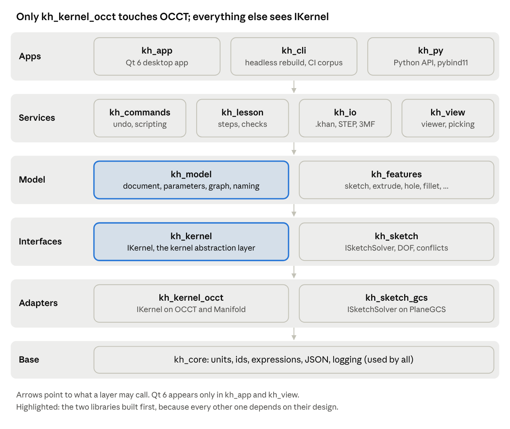
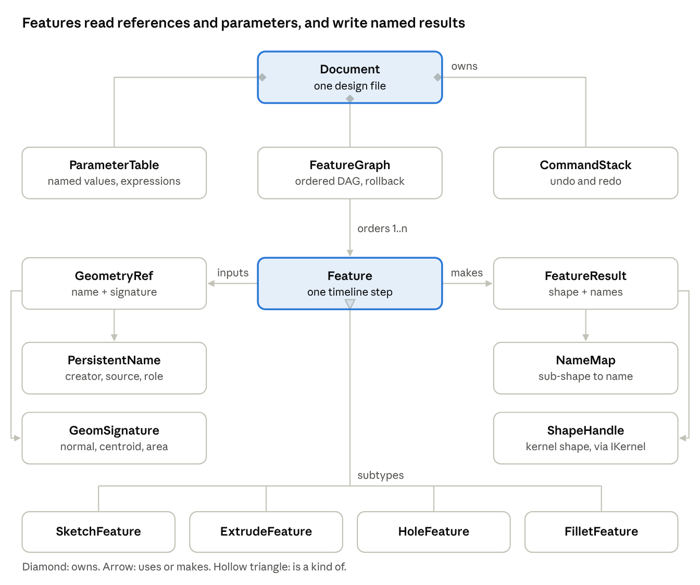
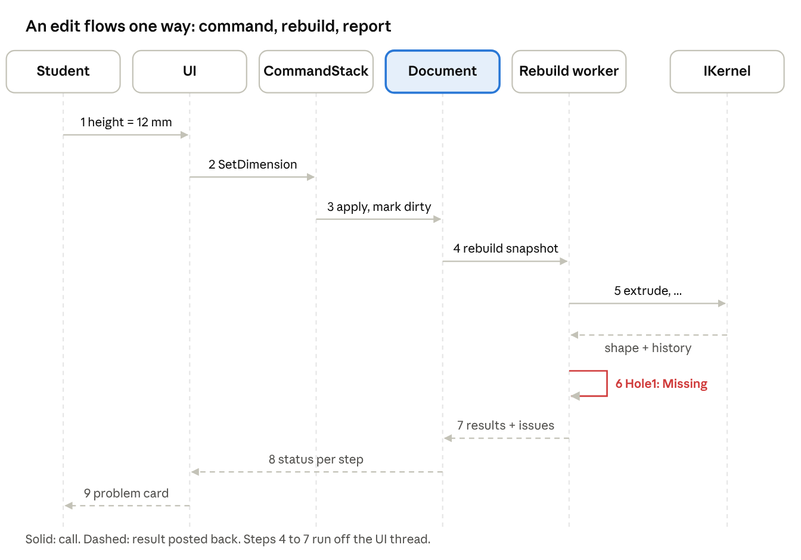

# Design model

> **Draft.** This design changes as Khan is built. Questions and ideas are welcome in [GitHub Discussions](https://github.com/ddreeves70/khan/discussions).

The core is 14 C++ libraries in strict layers. The model never calls OCCT or Qt directly, so it runs headless in tests and the kernel can be replaced later.

## Module map



Each box is a CMake target. A library may depend only on layers below it; `kh_core` is the only library every target links.

## Domain model



A `GeometryRef` is resolved against the `NameMap` of an upstream `FeatureResult`; that lookup is the topological naming system. Features never hold raw kernel shapes between rebuilds, only names.

## Class reference

| Class | Library | Responsibility | Key members |
| --- | --- | --- | --- |
| `Document` | kh\_model | Owns everything in one design file; the unit of save, undo, and regeneration | `params`, `graph`, `components`, `commands`, `regenerate()` |
| `ParameterTable` | kh\_model | Named values with units and expressions; dependency order for evaluation | `define()`, `set()`, `evaluate()`, `dependents()` |
| `Expression` | kh\_model | Parsed formula such as `Sketch1.height / 2`; unit-checked | `parse()`, `eval()`, `references()` |
| `FeatureGraph` | kh\_model | DAG of features; topological order; dirty tracking | `insert()`, `remove()`, `reorder()`, `rollbackTo()`, `dirtyFrom()` |
| `Feature` (abstract) | kh\_model | One timeline step: typed inputs in, `FeatureResult` out | `id`, `name`, `suppressed`, `inputs()`, `execute()` |
| `SketchFeature` | kh\_features | Sketch on a plane or face; owns entities and constraints | `plane`, `entities`, `constraints`, `solve()`, `profiles()` |
| `ExtrudeFeature`, `HoleFeature`, `FilletFeature`, … | kh\_features | Concrete modeling operations calling the kernel | per-feature parameters and `GeometryRef` inputs |
| `GeometryRef` | kh\_model | A durable pointer to a face, edge, vertex or profile | `name: PersistentName`, `signature`, `resolve()` |
| `PersistentName` | kh\_model | History-based name: creating feature, source element, role | `featureId`, `source`, `role`, `index` |
| `FeatureResult` | kh\_model | Output of one feature | `shape: ShapeHandle`, `names: NameMap`, `diagnostics` |
| `NameMap` | kh\_model | Maps kernel sub-shapes to `PersistentName`s for one result | `nameOf()`, `find()` |
| `ShapeHandle` | kh\_kernel | Opaque, ref-counted handle to a kernel shape | `id()`, `bounds()` |
| `IKernel` | kh\_kernel | The Kernel Abstraction Layer; all geometry goes through it | `extrude()`, `boolean()`, `fillet()`, `tessellate()`, `history()` |
| `OcctKernel` | kh\_kernel\_occt | `IKernel` on Open CASCADE | wraps `BRepAlgoAPI_*`, `BRepFilletAPI_*`, `BRepMesh` |
| `ISketchSolver` / `PlaneGcsSolver` | kh\_sketch | Solves sketch constraints; reports degrees of freedom and conflicts | `solve()`, `dof()`, `conflicts()` |
| `Command` / `CommandStack` | kh\_commands | Every user change as an undoable command | `apply()`, `revert()`, `merge()` |
| `Lesson` / `LessonCheck` | kh\_lesson | Lesson steps and model checks (thickness, hole size) | `steps`, `evaluate(Document&)` |
| `Exporter` / `PrintCheck` | kh\_io | STEP, STL, 3MF out; print-ready checks | `write()`, `run(ShapeHandle)` |

## Key interfaces

These are sketches of the contracts between libraries, in C++20. Each is small on purpose: the kernel, solver and UI can be swapped or tested in isolation.

**Kernel Abstraction Layer.** Every geometry call returns a result with history, so features can name what they made.

```cpp
namespace kh::kernel {

struct OpResult {
  ShapeHandle shape;
  ShapeHistory history;          // which input sub-shapes produced which outputs
  std::vector<Diagnostic> issues; // empty on success
  bool ok() const { return shape.valid(); }
};

class IKernel {
public:
  virtual ~IKernel() = default;
  virtual OpResult makeFace(const Profile2D& p, const Plane& pl) = 0;
  virtual OpResult extrude(ShapeHandle face, Vec3 dir, Length d) = 0;
  virtual OpResult revolve(ShapeHandle face, Axis a, Angle t) = 0;
  virtual OpResult boolean(BoolOp op, ShapeHandle a, ShapeHandle b) = 0;
  virtual OpResult fillet(ShapeHandle s, std::span<const SubShape> edges, Length r) = 0;
  virtual OpResult hole(ShapeHandle s, const HoleSpec& h) = 0;
  virtual std::vector<SubShape> subShapes(ShapeHandle s, TopoKind k) const = 0;
  virtual GeomSignature signature(SubShape e) const = 0; // normal, centroid, area, adjacency
  virtual Mesh tessellate(ShapeHandle s, const MeshQuality& q) const = 0;
  virtual MassProps massProps(ShapeHandle s) const = 0;
};

} // namespace kh::kernel
```

**Features.** A feature reads its inputs, calls the kernel, and names its outputs.

```cpp
namespace kh::model {

class Feature {
public:
  virtual ~Feature() = default;
  FeatureId id() const;
  const std::string& name() const;
  bool suppressed() const;

  virtual FeatureType type() const = 0;
  virtual std::vector<InputRef> inputs() const = 0;   // params + GeometryRefs
  virtual FeatureResult execute(ExecContext& ctx) = 0; // pure: same inputs, same output
  virtual nlohmann::json save() const = 0;
  virtual void load(const nlohmann::json& j) = 0;
};

struct ExecContext {
  kernel::IKernel& kernel;
  const ParameterTable& params;
  const ResultStore& upstream;   // results of features before this one
  Resolver& resolver;            // GeometryRef -> SubShape
  CancelToken cancel;
};

} // namespace kh::model
```

**References.** A reference never stores a raw kernel index; it stores a name and a fallback signature.

```cpp
struct PersistentName {
  FeatureId creator;      // e.g. Extrude1
  std::string source;     // e.g. "Sketch1/line:L3" or "Extrude1/face:top"
  Role role;              // Side, CapStart, CapEnd, FilletFace, ...
  int index = 0;          // tie-breaker when one source yields several
};

struct GeometryRef {
  PersistentName name;
  GeomSignature signature;  // captured when the user picked it
};

enum class ResolveStatus { Exact, Matched, Ambiguous, Missing };
struct Resolution { ResolveStatus status; std::optional<SubShape> shape; std::vector<SubShape> candidates; };
```

**Commands.** Every edit is a command, so undo, scripting and lessons share one path.

```cpp
class Command {
public:
  virtual ~Command() = default;
  virtual std::string label() const = 0;   // shown in Edit > Undo
  virtual void apply(Document& d) = 0;
  virtual void revert(Document& d) = 0;
  virtual bool mergeWith(const Command&) { return false; } // e.g. drag updates
};
```

## File format (.khan)

A `.khan` file is a zip container. Intent lives in small JSON files that diff well in Git; geometry caches are optional and rebuilt when missing or stale.

| Path in the zip | Content | Required |
| --- | --- | --- |
| `manifest.json` | Schema version, app version, units, created/modified dates, file list with hashes | Yes |
| `parameters.json` | User parameters with expressions and units | Yes |
| `features/<id>.json` | One file per feature: type, inputs, parameters, references | Yes |
| `timeline.json` | Feature order, rollback marker, suppressed flags, groups | Yes |
| `sketches/<id>.json` | Sketch entities and constraints | Yes, per sketch |
| `components.json` | Bodies, components, appearances, materials | Yes |
| `lesson.json` | Lesson id, step progress, check results | Only in lesson work |
| `cache/<featureId>.brep` | Cached kernel shape per feature, keyed by input hash | No |
| `cache/preview.glb`, `thumbnail.png` | Display mesh and file-browser thumbnail | No |

One feature file, the hole in a keychain tag after its placement is fixed:

```json
{
  "id": "f3",
  "type": "Hole",
  "name": "Hole1",
  "inputs": {
    "face": {
      "name": { "creator": "f2", "source": "f1/profile:0", "role": "CapEnd", "index": 0 },
      "signature": { "normal": [0, 0, 1], "centroid": [30, 6, 4], "area": 720 }
    },
    "placement": {
      "mode": "fromEdges",
      "edgeA": { "name": { "creator": "f2", "source": "f1/line:L4", "role": "Side" }, "distance": "9 mm" },
      "edgeB": { "name": { "creator": "f2", "source": "f1/line:L1", "role": "Side" }, "distance": "Sketch1.height / 2" }
    }
  },
  "params": { "diameter": "5 mm", "depth": "through" }
}
```

**Rules.** Schema changes bump `manifest.schema` and ship a migration; a corpus of old files is tested in CI. Unknown keys are kept on save so newer files survive older plugins. Feature ids are stable and never reused.

## Regeneration and naming

**Regeneration** recomputes only what changed, in timeline order, and stops cleanly at the first failure.

1. A command changes a parameter, sketch, or feature input and marks that feature dirty.
2. `FeatureGraph::dirtyFrom()` marks every downstream feature dirty (graph edges come from parameter references and `GeometryRef` creators).
3. For each feature in topological order up to the rollback marker:
   1. Skip it if suppressed, or if its input hash matches the cached result.
   2. Resolve its `GeometryRef`s against upstream results (naming, below).
   3. Call `execute()` on a worker thread with a cancel token.
   4. On success, store the `FeatureResult` and its `NameMap`; on failure, record diagnostics and mark every dependent feature `Blocked`.
4. Publish the last good shape to the viewer, and the per-feature status to the timeline and problem panel.
5. Run lesson checks and print checks on the new result if they are open.

**Naming** gives every face, edge and vertex a name built from history, so references survive edits.

1. Sketch entities get stable ids (`L1`, `A2`) that survive dimension changes.
2. Each feature names its outputs from the kernel's `ShapeHistory`: a side face of an extrude is named from the sketch line it came from; the end caps are `CapStart` and `CapEnd`; a fillet face is named from the edge it replaced.
3. Faces made by splitting get the parent's name plus an index ordered by a geometric rule (for example along the split direction), never by kernel order.
4. Resolving a reference: look up the exact name in the upstream `NameMap` → **Exact**. If missing, filter candidates with the same creator and role, then score by signature (normal angle, centroid distance, area ratio, adjacency) → **Matched** when one candidate clearly wins.
5. If two candidates score close, or none fits, return **Ambiguous** or **Missing**. The feature fails with a plain-language message and asks the user to repick; it never guesses silently.
6. When the user repicks, store the new name and signature and offer to apply the same fix to other features that referenced the old entity.

## Sequence: editing a dimension



This is the edit-a-dimension user flow in code. When the student clicks Edit Hole1 and repicks, that is a new command, and the same path runs again.

## Threading, errors and testing hooks

**Threading**

- The UI thread owns `Document` and the `CommandStack`; nothing else mutates them.
- Regeneration runs on one worker thread per document against an immutable snapshot of inputs; results are posted back and swapped in atomically.
- A newer edit cancels an in-flight regeneration through its `CancelToken`; the kernel adapter checks it between operations.
- Tessellation for display runs on a pool, per body, so a large part does not block orbiting.

**Errors**

- Kernel failures become `Diagnostic { code, severity, featureId, refs, message, fixes[] }`. `message` is written for a student; `fixes` map to commands ("Edit Hole1", "Undo change").
- The kernel adapter retries a failed op once with shape healing and a looser tolerance, and records that it did.
- A crash in a plugin or post-processor is contained in its own process or sandbox and never takes the document down.

**Testing hooks**

- `IKernel` has a recording decorator that writes every call and result to a trace for replaying bugs.
- A headless `kh_cli` loads a `.khan`, regenerates it, and prints per-feature status, volume and face counts; the regression corpus runs through it in CI.
- Naming is fuzzed: random parameter changes on corpus models must keep every `GeometryRef` either Exact/Matched or reported, never silently rebound.
- Lesson checks and print checks are pure functions of a `Document`, so each has unit tests with fixture files.
