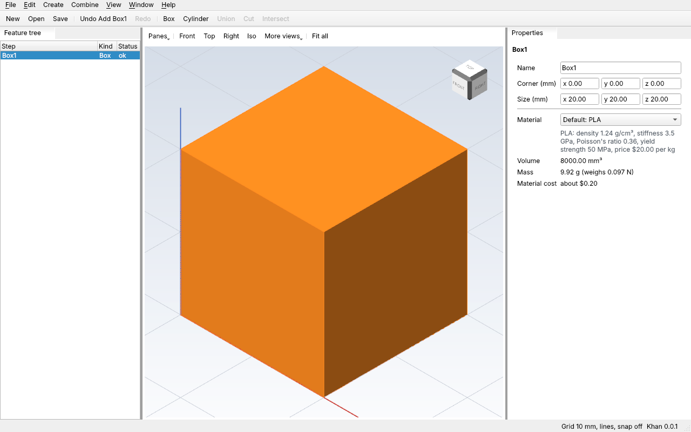

# Phase 0 exit check

Phase 0 (Foundations, see the [roadmap](roadmap.md#phase-0-foundations)) is done
when this works:

> Create a box, undo, save, reopen, export STL on all three OSes, with the box
> tool and the viewer loaded as plugins, and the guide's Hello plugin adding a
> working command.

The check has two halves. The **automated** half runs in CI on every pull request,
on Windows, macOS and Linux. The **by hand** half is a person using the real app
on a real screen, because CI draws without one.

## Automated (every pull request, all three OSes)

| Part of the exit check | Test | Where |
| --- | --- | --- |
| Box, undo, redo, save, new, reopen, export STL, through the app's menus | "Phase 0 exit check: box, undo, save, reopen, export STL, all through plugins" | `tests/app/test_shell.cpp` |
| The box tool is a plugin (`kh.modeling`) and the viewer is a plugin (`kh.viewer`) | Same test, plus "the shell is built from plugins" | `tests/app/test_shell.cpp` |
| The exported STL is a real box: 12 triangles | Same test, plus "File > Export writes the part as STL or STEP" | `tests/app/test_shell.cpp` |
| The guide's Hello plugin is built as an outside plugin, loads, and its command makes a cube | "the guide's Hello plugin loads and adds a working command" | `tests/plugin/test_hello_plugin.cpp` |
| Khan's own plugins load with no warnings | "Khan's own plugins follow the rules", and `cli.plugins_strict` | `tests/app/test_shell.cpp`, `tests/CMakeLists.txt` |
| The 3D view draws, picks, orbits and pans with real OpenGL | `view.gl` (Linux only, with a virtual screen) | `tests/view/test_view_gl.cpp` |

CI's three jobs (`ubuntu-24.04`, `windows-2022`, `macos-14`) build everything and
run all of these with `ctest`; the app tests run without a screen, so there the
viewer draws its flat fallback.

## By hand (Windows and macOS, before calling Phase 0 done)

On each computer: build with the usual preset (`win` or `dev` on Windows, `dev`
on macOS), run `kh_app`, and tick each step. Linux needs no one at a Linux
computer: Claude runs it in a Linux container with a virtual screen (see Linux,
below).

| Step | What you should see | Windows | macOS | Linux |
| --- | --- | --- | --- | --- |
| 1. Start `kh_app` | The window opens with the feature tree, a 3D viewer in the middle (not the flat stand-in) and Properties | ☐ | ☐ | ☑ |
| 2. Create > Box | A box in the viewer, `Box1` in the feature tree | ☐ | ☐ | ☑ |
| 3. Drag in the viewer, then Fit all | The view orbits, then the box fills the view | ☐ | ☐ | ☑ |
| 4. Edit > Undo, then Edit > Redo | The box goes away, then comes back | ☐ | ☐ | ☑ |
| 5. File > Save, as `box.khan` | The `*` leaves the title bar | ☐ | ☐ | ☑ |
| 6. File > New, then File > Open `box.khan` | The box is back, named `Box1` | ☐ | ☐ | ☑ |
| 7. File > Export..., as `box.stl` | The status bar says "Exported Box1 to box.stl" | ☐ | ☐ | ☑ |
| 8. Open `box.stl` in a slicer (Cura, PrusaSlicer, Bambu Studio) | A 20 mm cube (the default box) | ☐ | ☐ | ☑ |
| 9. `kh_cli plugins --plugins <build folder>/khan-plugins`, then `kh_cli run --plugins <build folder>/khan-plugins example.hello.add_cube size=25` | Hello is `loaded`; the run makes `Cube1` | ☐ | ☐ | ☑ |

Windows is the main machine; macOS is checked occasionally.

### Linux

Checked Oct 26, 2026 on commit `92bd10e`, by Claude in a Linux container with a
virtual screen (Xvfb) and Mesa's software OpenGL, so the real 3D viewer ran:

- Steps 1 to 4: `kh_app --trigger ... --screenshot`, with the steps' menu items
  triggered in order (Box; Top and Fit all; Undo; Redo), and each screenshot
  looked at. The 3D viewer drew the box, turned to the top view and fitted it,
  and Undo and Redo took it away and brought it back.
- Steps 5 to 7: the "Phase 0 exit check" app test, which clicks through Save,
  New, Open and Export, plus `kh_cli run --save` and `kh_cli open --export`.
- Step 8: the exported STL read back as 12 triangles (a box), 684 bytes.
- Step 9: `kh_cli plugins` lists Hello as `loaded`; `kh_cli run ...
  example.hello.add_cube size=25` made `Cube1`.

Dragging with a real mouse (step 3's orbit) is covered by the `view.gl` test,
which drags across the view on Linux in every CI run.

## Status

- Automated half: in place from the pull request that added File > Export
  (Oct 25, 2026), and running on all three OSes.
- By hand: Linux done (Oct 26, 2026, `92bd10e`). Windows and macOS not yet
  ticked; when a column is done, note the date and the commit here. The Windows
  3D view needed two fixes first (PR #30: OCCT gets the top-level window when
  Qt's context has none).
