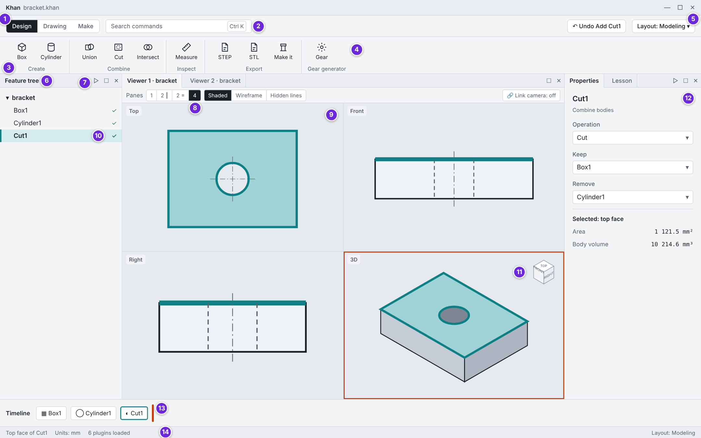
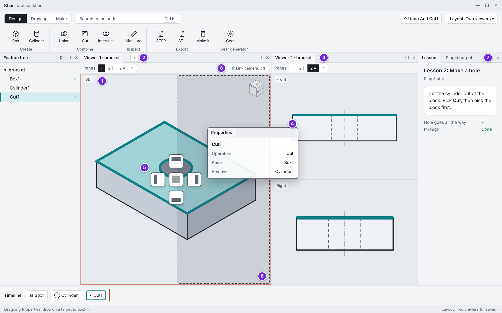
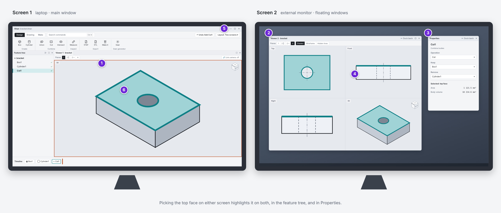
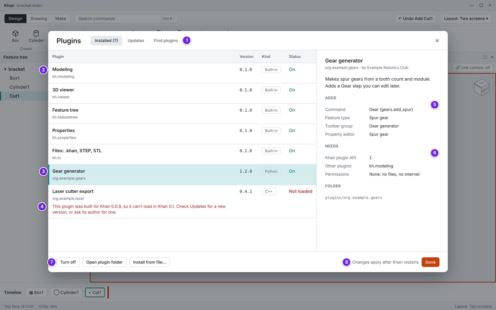

# UI screens

> **Draft.** This design changes as Khan is built. Questions and ideas are welcome in [GitHub Discussions](https://github.com/ddreeves70/khan/discussions).

Four mockups show the shell, the plugins and the docking from [UI and plugin architecture](architecture.md#ui-and-plugin-architecture). Each numbered marker matches a row in the table under its screen. The part is the 40 × 30 × 10 mm block with a 5 mm radius hole from PR #3's test, so the numbers shown are real.

## 1. Main window, Modeling layout

| # | What you see | From | How it works |
| --- | --- | --- | --- |
| 1 | Workspace switcher: Design, Drawing, Make | Shell | Workspaces |
| 2 | Command search finds any command by its name | Shell | Command registry |
| 3 | Ribbon groups Create, Combine, Inspect, Export | `kh.modeling`, `kh.io`, `kh.makeit` | Toolbar and ribbon extension point |
| 4 | A community plugin's own ribbon group | Gear generator (Python) | Same extension point as the built-ins |
| 5 | Layout menu: switch or save named layouts | Shell | Qt ADS perspectives |
| 6 | Feature tree panel | `kh.featuretree` | Panel extension point |
| 7 | Dock buttons: float, maximize, close; drag the title to move | Shell | Qt ADS |
| 8 | Pane layout: 1, 2 side by side, 2 stacked, 4 | `kh.viewer` | Viewer type |
| 9 | Top, Front, Right and 3D panes, each with its own camera | `kh.viewer` | One `V3d_View` per pane, one shared scene |
| 10 | The selected step is highlighted in the tree too | `kh.featuretree` | `SelectionChanged` event |
| 11 | View cube in the active pane (orange outline) | `kh.viewer` | Viewer tool |
| 12 | Properties of the step and the picked face, with units | `kh.properties` | Property editor, `SelectionChanged` |
| 13 | Timeline with the rollback marker | `kh.timeline` (Phase 2) | Panel extension point |
| 14 | Status bar: what is under the mouse, units, plugin count | Shell | `HoverChanged` event |

## 2. Two viewers and docking a panel

| # | What you see | From | How it works |
| --- | --- | --- | --- |
| 1 | Viewer 1 showing one 3D pane | `kh.viewer` | Viewer type |
| 2 | New viewer button (also Window > New viewer) | Shell | Opens another viewer of the active part |
| 3 | Viewer 2 of the same part, Front and Right stacked | `kh.viewer` | Shares the part's scene |
| 4 | The Properties panel, dragged by its title | Shell | Qt ADS |
| 5 | Drop targets: left, right, top, bottom, or center to add it as a tab | Shell | Qt ADS |
| 6 | Preview of where the panel will land | Shell | Qt ADS |
| 7 | Panels tabbed together: Lesson and Plugin output | `kh.lessons`, shell | Panel extension point |
| 8 | Link camera: two viewers follow each other | `kh.viewer` | `CameraChanged` event |

## 3. Two monitors

| # | What you see | From | How it works |
| --- | --- | --- | --- |
| 1 | Main window on the laptop with one 3D pane | Shell | Qt ADS |
| 2 | Viewer 2 floated onto the external monitor in four panes; Dock back returns it | Shell, `kh.viewer` | Qt ADS floating window |
| 3 | Properties floated in its own window | `kh.properties` | Qt ADS floating window |
| 4 | The same face is highlighted on both screens | `kh.viewer` | `SelectionChanged` event |
| 5 | The saved layout Two screens remembers which window goes on which monitor | Shell | Qt ADS perspective plus screen positions |
| 6 | A pick on either screen updates every view | Shell | Event bus |

## 4. Plugin manager

| # | What you see | From | How it works |
| --- | --- | --- | --- |
| 1 | Installed, Updates, Find plugins (the community catalog, later) | Shell | Extension registry |
| 2 | Built-in plugins listed like any other | Plugin host | Their own `plugin.json` |
| 3 | A community Python plugin, selected | Plugin host | Python bindings of the plugin API |
| 4 | A plugin that could not load, with a plain message and the fix | Plugin host | `apiVersion` check at load |
| 5 | Everything the plugin adds, by extension point | Plugin host | What it registered |
| 6 | What it needs: API version, other plugins, permissions | Plugin host | `plugin.json` |
| 7 | Turn off, open its folder, install from a file | Shell | Plugin settings |
| 8 | Changes apply after a restart in Phase 0 | Plugin host | Plugins load once, at start |

The gear and laser plugins are made-up examples. Icons are placeholders until the icon set is drawn.
