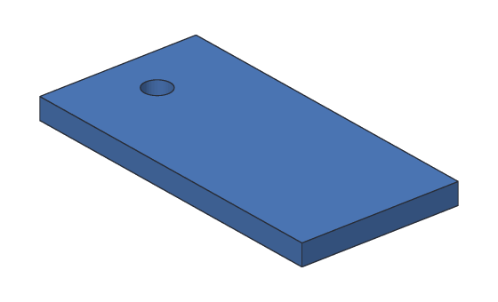
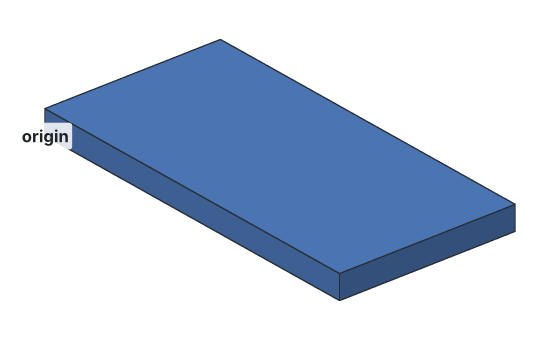

# Tutorial 1: Keychain tag

You'll make a keychain tag: a flat plate with a hole for the key ring. On the
way you'll learn how a Khan design is built from **steps**, and how to cut a hole.



**You'll learn:** steps, boxes, cylinders, cutting one body from another,
exporting for 3D printing. **Time:** about 10 minutes.

## How a design works

A Khan design is a list of **steps**, like a recipe. Each step makes or changes a
shape: "a box 60 mm wide", "a cylinder", "cut the cylinder out of the box". Khan
builds the steps in order to get the finished part. Because Khan keeps the recipe,
not just the shape, you can change any step later and the part rebuilds.

The tag takes three steps:

1. **Plate:** a box, 60 × 30 × 4 mm.
2. **Hole:** a cylinder where the hole goes.
3. **Tag:** the plate with the cylinder cut out of it.

## Step 1: Make the plate

Run this in an empty folder:

<!-- cli-example -->
```console
$ kh_cli run --save tag.khan feature.add_box name=Plate size=60,30,4
tag: 1 step
  Plate        ok  volume 7200.00 mm^3  mass 8.93 g (PLA)
wrote tag.khan
```

What each part means:

| Part | Meaning |
| --- | --- |
| `run` | Run one modeling command |
| `--save tag.khan` | Save the design in `tag.khan` |
| `feature.add_box` | The command: add a box |
| `name=Plate` | Call this step "Plate" |
| `size=60,30,4` | 60 mm wide (x), 30 mm deep (y), 4 mm tall (z) |

Khan rebuilt the design and printed each step: the plate built (`ok`), and its
volume is 60 × 30 × 4 = 7200 mm^3.



The box starts at the **origin**, the point 0,0,0. x goes to the right, y goes
back, and z goes up.

## Step 2: Add the hole's cylinder

The hole goes near the left end: 9 mm from the left edge and in the middle of the
30 mm depth, so at x = 9, y = 15. Make it 5 mm across (a radius of 2.5 mm).

<!-- cli-example -->
```console
$ kh_cli run --open tag.khan --save tag.khan feature.add_cylinder name=Hole base=9,15,-1 radius=2.5 height=6
tag: 2 steps
  Plate        ok  volume 7200.00 mm^3  mass 8.93 g (PLA)
  Hole         ok  volume 117.81 mm^3  mass 0.15 g (PLA)
wrote tag.khan
```

`--open tag.khan` starts from the design you saved, and `--save tag.khan` saves it
again with the new step.


Why `base=9,15,-1` and `height=6`? The plate is 4 mm thick, from z = 0 to z = 4.
The cylinder starts 1 mm below it (z = -1) and ends 1 mm above it (z = 5), so it
pokes out of both faces. A cutting tool that ends exactly on a face can leave a
paper-thin skin behind, so always let it stick out a little.

## Step 3: Cut the hole

Now cut the cylinder out of the plate:

<!-- cli-example -->
```console
$ kh_cli run --open tag.khan --save tag.khan feature.add_boolean name=Tag operation=cut a=Plate b=Hole
tag: 3 steps
  Plate        ok  volume 7200.00 mm^3
  Hole         ok  volume 117.81 mm^3
  Tag          ok  volume 7121.46 mm^3  mass 8.83 g (PLA)
wrote tag.khan
```

`operation=cut` keeps `a` (the plate) and takes away `b` (the hole's cylinder).


Check the volume: the hole takes away the part of the cylinder inside the plate,
π × 2.5² × 4 ≈ 78.54 mm^3, and 7200 − 78.54 = 7121.46 mm^3.

## Step 4: Export it for 3D printing

<!-- cli-example -->
```console
$ kh_cli open tag.khan --export tag.stl
tag: 3 steps
  Plate        ok  volume 7200.00 mm^3
  Hole         ok  volume 117.81 mm^3
  Tag          ok  volume 7121.46 mm^3  mass 8.83 g (PLA)
wrote tag.stl
```

Open `tag.stl` in your slicer (Cura, PrusaSlicer, Bambu Studio, ...) and print it.
A 4 mm tag prints in about 15 minutes.

## Step 5: Choose what it's made of

The last line says the tag weighs 8.83 g, in PLA: every body is PLA until you
pick a [material](../user-guide/materials.md). Printing in PETG instead? Pick
PETG for the plate. The tag is cut from the plate, so it's PETG too:

<!-- cli-example -->
```console
$ kh_cli run --open tag.khan --save tag.khan feature.set_material feature=Plate material=PETG
tag: 3 steps
  Plate        ok  volume 7200.00 mm^3
  Hole         ok  volume 117.81 mm^3
  Tag          ok  volume 7121.46 mm^3  mass 9.04 g (PETG)
wrote tag.khan
```

PETG is a little heavier than PLA, so the same tag weighs 9.04 g. (A real print
with some infill weighs less: your slicer gives the exact filament weight.)

## Try this

- Make the tag 50 mm long instead: start again with `size=50,30,4`.
- Make the hole bigger. A key ring needs about 4 mm, so try `radius=3`.
- Export a STEP file, for another CAD program: `kh_cli open tag.khan --export tag.step`.
- How heavy would it be in brass? Try `material="Brass (C360)"`. [`kh_cli materials`](../cli/materials.md) lists them all.

## What you learned

- A design is a list of steps. Khan rebuilds them in order.
- `feature.add_box` and `feature.add_cylinder` make shapes; `size`, `base` and
  `radius` are in mm.
- `feature.add_boolean` with `operation=cut` cuts one body out of another. Make
  the cutting tool stick out past the faces.
- `kh_cli open --export` writes a file for 3D printing.
- `feature.set_material` picks what a body is made of, which sets its mass.

**Next:** [Tutorial 2: Desk organizer](02-desk-organizer.md).
