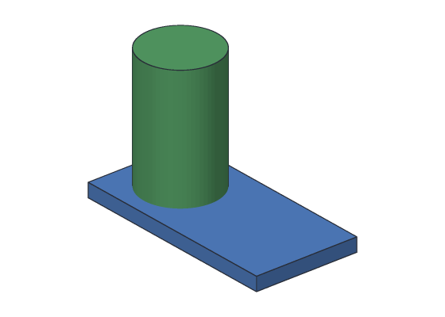
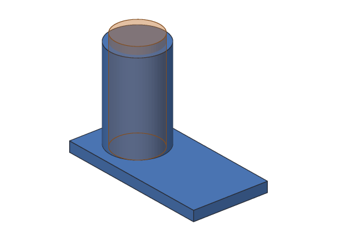
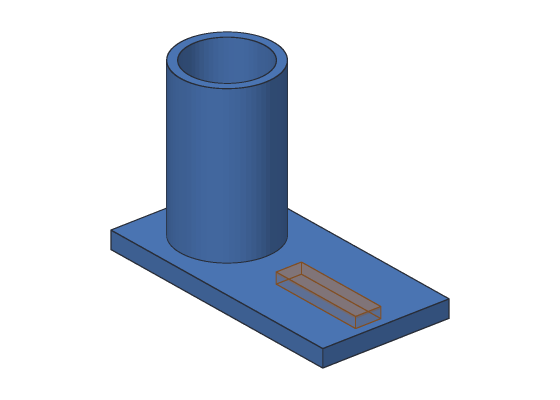
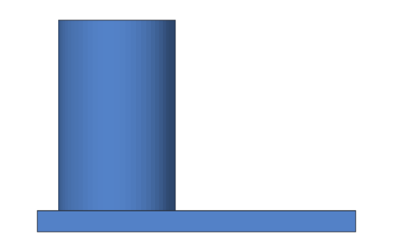

# Tutorial 2: Desk organizer

You'll make a desk organizer: a base with a pen cup on one end and a slot that
holds a phone or cards. It's bigger than the tag, so you'll place shapes with
care, **join** bodies together, and cut more than one thing out.


**You'll learn:** joining bodies (union), cutting several times, placing shapes
in x, y and z, renaming a step. **Time:** about 20 minutes.
**Before this:** [Tutorial 1: Keychain tag](01-keychain-tag.md).

## The plan

| Step | Command | What it makes |
| --- | --- | --- |
| Base | box | The 120 × 60 × 8 mm base |
| Cup | cylinder | The outside of the pen cup, 44 mm across and 80 mm tall |
| Body | union of Base and Cup | One solid body |
| PenHole | cylinder | The inside of the cup |
| Hollow | cut PenHole from Body | The hollow cup |
| Slot | box | The phone slot |
| Organizer | cut Slot from Hollow | The finished part |

Each Boolean step uses the step before it, so the design is a chain: the last
step is the finished part.

## Step 1: The base

<!-- cli-example -->
```console
$ kh_cli run --save organizer.khan feature.add_box name=Base size=120,60,8
organizer: 1 step
  Base         ok  volume 57600.00 mm^3
wrote organizer.khan
```

## Step 2: The cup

The cup stands on the base's left end. Its center is 30 mm from the left edge and
in the middle of the 60 mm depth: x = 30, y = 30. With a radius of 22 mm, its
edge is 8 mm from the base's left side.

<!-- cli-example -->
```console
$ kh_cli run --open organizer.khan --save organizer.khan feature.add_cylinder name=Cup base=30,30,0 radius=22 height=80
organizer: 2 steps
  Base         ok  volume 57600.00 mm^3
  Cup          ok  volume 121642.47 mm^3
wrote organizer.khan
```



Right now the design has **two bodies** that happen to overlap. A 3D printer
would get two separate parts. Next you'll join them.

## Step 3: Join them

`operation=union` makes one body out of two:

<!-- cli-example -->
```console
$ kh_cli run --open organizer.khan --save organizer.khan feature.add_boolean name=Body operation=union a=Base b=Cup
organizer: 3 steps
  Base         ok  volume 57600.00 mm^3
  Cup          ok  volume 121642.47 mm^3
  Body         ok  volume 167078.22 mm^3
wrote organizer.khan
```

Why isn't Body's volume 57 600 + 121 642.47? Because the bottom 8 mm of the cup
is inside the base, and a union counts that overlap only once:
57 600 + 121 642.47 − (π × 22² × 8 ≈ 12 164.25) = 167 078.22 mm^3.

## Step 4: Hollow out the cup

The inside of the cup is a smaller cylinder: radius 18 mm, so the wall is
22 − 18 = 4 mm thick. It starts at z = 6, leaving a floor 6 mm thick, and goes
up past the top of the cup.

<!-- cli-example -->
```console
$ kh_cli run --open organizer.khan --save organizer.khan feature.add_cylinder name=PenHole base=30,30,6 radius=18 height=80
organizer: 4 steps
...
  PenHole      ok  volume 81430.08 mm^3
wrote organizer.khan
$ kh_cli run --open organizer.khan --save organizer.khan feature.add_boolean name=Hollow operation=cut a=Body b=PenHole
organizer: 5 steps
...
  Hollow       ok  volume 91755.40 mm^3
wrote organizer.khan
```

(`...` stands for the steps you've already seen.)



## Step 5: The phone slot

The slot is a box cut 4 mm deep into the top of the base, on the right side. It
is 45 mm long (x), 12 mm wide (y) and starts at z = 4, half-way down the 8 mm
base. Like the hole in Tutorial 1, it sticks out above the top (to z = 9).

<!-- cli-example -->
```console
$ kh_cli run --open organizer.khan --save organizer.khan feature.add_box name=Slot corner=65,24,4 size=45,12,5
organizer: 6 steps
...
  Slot         ok  volume 2700.00 mm^3
wrote organizer.khan
$ kh_cli run --open organizer.khan --save organizer.khan feature.add_boolean name=Slotted operation=cut a=Hollow b=Slot
organizer: 7 steps
...
  Slotted      ok  volume 89595.40 mm^3
wrote organizer.khan
```



The slot took away 45 × 12 × 4 = 2160 mm^3: 91 755.40 − 2160 = 89 595.40.

## Step 6: Give the last step a better name

The last step is the finished part, so call it that:

<!-- cli-example -->
```console
$ kh_cli run --open organizer.khan --save organizer.khan feature.rename feature=Slotted name=Organizer
organizer: 7 steps
  Base         ok  volume 57600.00 mm^3
  Cup          ok  volume 121642.47 mm^3
  Body         ok  volume 167078.22 mm^3
  PenHole      ok  volume 81430.08 mm^3
  Hollow       ok  volume 91755.40 mm^3
  Slot         ok  volume 2700.00 mm^3
  Organizer    ok  volume 89595.40 mm^3
wrote organizer.khan
```

Renaming doesn't break anything: steps point at each other by an id that never
changes, not by name.

## Step 7: Export and print

<!-- cli-example -->
```console
$ kh_cli open organizer.khan --export organizer.stl
organizer: 7 steps
...
  Organizer    ok  volume 89595.40 mm^3
wrote organizer.stl
```



About 90 cm^3 of plastic: roughly 110 g in PLA at full density, much less with
normal infill.

## Try this

- Make the cup taller: start a new design and use `height=100` for both
  cylinders.
- Add a second, smaller pen cup at x = 85. You'll need another union and cut.
- Make the slot wider for a thick phone case: `size=45,16,5` and `corner=65,22,4`
  keep it centered.

## What you learned

- `operation=union` joins two bodies; overlapping material is counted once.
- A Boolean step can use the result of another Boolean step, so a design is a
  chain of steps.
- Positions (`base`, `corner`) place shapes; plan them from the part's edges.
- `feature.rename` changes a name without breaking the steps that use it.

**Next:** the [user's guide](../user-guide/README.md) explains every shape and
command in more depth.
