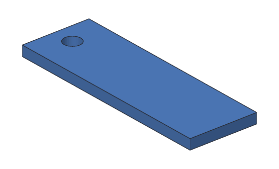

# Tutorial 3: Sketched name tag

You'll make a name tag for a bag: a flat plate with a hole for a cord, like the
keychain tag, but this time you **draw** its outline in a **sketch** and
**extrude** it into a solid. On the way you'll see why sketches are how most real
parts are made: change one number, and the part follows.



**You'll learn:** sketches, constraints, dimensions, closed shapes, extrude,
changing a part with one number. **Time:** about 20 minutes.

**Before you start:** do [Tutorial 1](01-keychain-tag.md) first, and read
[Sketches](../user-guide/sketches.md) if you want to know more about any step.

## The plan

The tag takes two steps:

1. **Sketch1:** the outline, a 45 × 20 mm rectangle with a circle for the hole.
2. **Extrude1:** the outline swept 3 mm up, into a solid plate.

In the desktop app you'd draw the lines with the mouse; here you type them. Both
make the same sketch.

## Step 1: Start a sketch and draw the outline roughly

A sketch is flat. This one is on the ground (the XY plane), which is where a
new sketch goes. Draw four lines that go roughly round a rectangle. Each line
starts where the last one ended, so they're joined. Don't worry about the
numbers being exact: that's what constraints are for.

<!-- cli-example -->
```console
$ kh_cli run --save tag.khan feature.add_sketch
tag: 1 step
  Sketch1      ok  empty
wrote tag.khan
$ kh_cli run --open tag.khan --save tag.khan sketch.add_line sketch=Sketch1 from=0,0 to=43,2
tag: 1 step
  Sketch1      ok  1 line, 0 constraints, free to move 4 ways
wrote tag.khan
$ kh_cli run --open tag.khan --save tag.khan sketch.add_line sketch=Sketch1 from=43,2 to=41,19
tag: 1 step
  Sketch1      ok  2 lines, 0 constraints, free to move 8 ways
wrote tag.khan
$ kh_cli run --open tag.khan --save tag.khan sketch.add_line sketch=Sketch1 from=41,19 to=1,21
tag: 1 step
  Sketch1      ok  3 lines, 0 constraints, free to move 12 ways
wrote tag.khan
$ kh_cli run --open tag.khan --save tag.khan sketch.add_line sketch=Sketch1 from=1,21 to=0,0
tag: 1 step
  Sketch1      ok  4 lines, 0 constraints, free to move 16 ways
wrote tag.khan
```

"Free to move 16 ways" means nothing holds the lines yet: each of their 8 ends
can still slide in x and in y.

## Step 2: Extrude it

The four lines go all the way round, so they make a **closed shape**. Extrude it
3 mm, straight up out of the sketch:

<!-- cli-example -->
```console
$ kh_cli run --open tag.khan --save tag.khan feature.add_extrude sketch=Sketch1 distance=3
tag: 2 steps
  Sketch1      ok  4 lines, 0 constraints, free to move 16 ways
  Extrude1     ok  volume 2365.50 mm^3  mass 2.93 g (PLA)
wrote tag.khan
```

You have a solid already, but a wonky one: its outline is still the rough one.
The sketch stays in the design as its own step. Extrude1 uses it, so from now
on, every change to the sketch changes the solid too. Watch the volume as you go.

## Step 3: Hold the corners together

Lines that start where another ends are joined for now, but nothing keeps them
that way when the solver moves things. A `coincident` constraint makes two
points stay together. Join the end of each line to the start of the next:

<!-- cli-example -->
```console
$ kh_cli run --open tag.khan --save tag.khan sketch.constrain sketch=Sketch1 kind=coincident on=Line1.end,Line2.start
tag: 2 steps
  Sketch1      ok  4 lines, 1 constraint, free to move 14 ways
  Extrude1     ok  volume 2365.50 mm^3  mass 2.93 g (PLA)
wrote tag.khan
$ kh_cli run --open tag.khan --save tag.khan sketch.constrain sketch=Sketch1 kind=coincident on=Line2.end,Line3.start
tag: 2 steps
  Sketch1      ok  4 lines, 2 constraints, free to move 12 ways
  Extrude1     ok  volume 2365.50 mm^3  mass 2.93 g (PLA)
wrote tag.khan
$ kh_cli run --open tag.khan --save tag.khan sketch.constrain sketch=Sketch1 kind=coincident on=Line3.end,Line4.start
tag: 2 steps
  Sketch1      ok  4 lines, 3 constraints, free to move 10 ways
  Extrude1     ok  volume 2365.50 mm^3  mass 2.93 g (PLA)
wrote tag.khan
$ kh_cli run --open tag.khan --save tag.khan sketch.constrain sketch=Sketch1 kind=coincident on=Line4.end,Line1.start
tag: 2 steps
  Sketch1      ok  4 lines, 4 constraints, free to move 8 ways
  Extrude1     ok  volume 2365.50 mm^3  mass 2.93 g (PLA)
wrote tag.khan
```

Each one takes away 2 of the ways it can move (the x and the y of one end).

## Step 4: Make it square

Make the bottom and top lines level (`horizontal`) and the sides upright
(`vertical`):

<!-- cli-example -->
```console
$ kh_cli run --open tag.khan --save tag.khan sketch.constrain sketch=Sketch1 kind=horizontal on=Line1
tag: 2 steps
  Sketch1      ok  4 lines, 5 constraints, free to move 7 ways
  Extrude1     ok  volume 2488.50 mm^3  mass 3.09 g (PLA)
wrote tag.khan
$ kh_cli run --open tag.khan --save tag.khan sketch.constrain sketch=Sketch1 kind=horizontal on=Line3
tag: 2 steps
  Sketch1      ok  4 lines, 6 constraints, free to move 6 ways
  Extrude1     ok  volume 2365.50 mm^3  mass 2.93 g (PLA)
wrote tag.khan
$ kh_cli run --open tag.khan --save tag.khan sketch.constrain sketch=Sketch1 kind=vertical on=Line2
tag: 2 steps
  Sketch1      ok  4 lines, 7 constraints, free to move 5 ways
  Extrude1     ok  volume 2422.50 mm^3  mass 3.00 g (PLA)
wrote tag.khan
$ kh_cli run --open tag.khan --save tag.khan sketch.constrain sketch=Sketch1 kind=vertical on=Line4
tag: 2 steps
  Sketch1      ok  4 lines, 8 constraints, free to move 4 ways
  Extrude1     ok  volume 2394.00 mm^3  mass 2.97 g (PLA)
wrote tag.khan
```

It's a true rectangle now, of whatever size the rough lines happened to make.

## Step 5: Pin it down and give it a size

`fix` holds a point where it is: pin the bottom left corner to the origin. Then
give the rectangle **dimensions**: the bottom line is 45 mm long, the right side
20 mm.

<!-- cli-example -->
```console
$ kh_cli run --open tag.khan --save tag.khan sketch.constrain sketch=Sketch1 kind=fix on=Line1.start
tag: 2 steps
  Sketch1      ok  4 lines, 9 constraints, free to move 2 ways
  Extrude1     ok  volume 2451.00 mm^3  mass 3.04 g (PLA)
wrote tag.khan
$ kh_cli run --open tag.khan --save tag.khan sketch.constrain sketch=Sketch1 kind=length on=Line1 value=45
tag: 2 steps
  Sketch1      ok  4 lines, 10 constraints, free to move 1 way
  Extrude1     ok  volume 2565.00 mm^3  mass 3.18 g (PLA)
wrote tag.khan
$ kh_cli run --open tag.khan --save tag.khan sketch.constrain sketch=Sketch1 kind=length on=Line2 value=20
tag: 2 steps
  Sketch1      ok  4 lines, 11 constraints, fully constrained
  Extrude1     ok  volume 2700.00 mm^3  mass 3.35 g (PLA)
wrote tag.khan
```

**Fully constrained** means nothing can move any more: the solver knows exactly
where every line goes. The plate is 45 × 20 × 3 = 2700 mm^3.

## Step 6: Add the hole

A circle inside a closed shape is a **hole** in it. Draw one near the left end,
then give it a radius of 2.5 mm (a 5 mm hole) and put its center 6 mm in from
the left and 10 mm up from the bottom, in the middle of the tag's height:

<!-- cli-example -->
```console
$ kh_cli run --open tag.khan --save tag.khan sketch.add_circle sketch=Sketch1 center=6,10 radius=3
tag: 2 steps
  Sketch1      ok  4 lines, 1 circle, 11 constraints, free to move 3 ways
  Extrude1     ok  volume 2615.18 mm^3  mass 3.24 g (PLA)
wrote tag.khan
$ kh_cli run --open tag.khan --save tag.khan sketch.constrain sketch=Sketch1 kind=radius on=Circle1 value=2.5
tag: 2 steps
  Sketch1      ok  4 lines, 1 circle, 12 constraints, free to move 2 ways
  Extrude1     ok  volume 2641.10 mm^3  mass 3.27 g (PLA)
wrote tag.khan
$ kh_cli run --open tag.khan --save tag.khan sketch.constrain sketch=Sketch1 kind=horizontal_distance on=Line1.start,Circle1.center value=6
tag: 2 steps
  Sketch1      ok  4 lines, 1 circle, 13 constraints, free to move 1 way
  Extrude1     ok  volume 2641.10 mm^3  mass 3.27 g (PLA)
wrote tag.khan
$ kh_cli run --open tag.khan --save tag.khan sketch.constrain sketch=Sketch1 kind=vertical_distance on=Line1.start,Circle1.center value=10
tag: 2 steps
  Sketch1      ok  4 lines, 1 circle, 14 constraints, fully constrained
  Extrude1     ok  volume 2641.10 mm^3  mass 3.27 g (PLA)
wrote tag.khan
```

The hole goes right through the plate: 2700 − π × 2.5² × 3 = 2641.10 mm^3. You
didn't need a cylinder or a cut, as in Tutorial 1: the extrude made the hole,
because it's part of the outline.

`kh_cli open --sketch` shows where the solver put everything, every constraint,
and the closed shapes it found:

<!-- cli-example -->
```console
$ kh_cli open tag.khan --sketch Sketch1
tag: 2 steps
  Sketch1      ok  4 lines, 1 circle, 14 constraints, fully constrained
  Extrude1     ok  volume 2641.10 mm^3  mass 3.27 g (PLA)
Sketch1 (XY plane): fully constrained
  Line1          line    0.00, 0.00 to 45.00, 0.00
  Line2          line    45.00, 0.00 to 45.00, 20.00
  Line3          line    45.00, 20.00 to 0.00, 20.00
  Line4          line    0.00, 20.00 to 0.00, 0.00
  Circle1        circle  center 6.00, 10.00  radius 2.50
  Coincident1    coincident          Line1.end, Line2.start
  Coincident2    coincident          Line2.end, Line3.start
  Coincident3    coincident          Line3.end, Line4.start
  Coincident4    coincident          Line4.end, Line1.start
  Horizontal1    horizontal          Line1
  Horizontal2    horizontal          Line3
  Vertical1      vertical            Line2
  Vertical2      vertical            Line4
  Fix1           fix                 Line1.start
  Length1        length              Line1  45.00 mm
  Length2        length              Line2  20.00 mm
  Radius1        radius              Circle1  2.50 mm
  HorizontalDistance1 horizontal_distance Line1.start, Circle1.center  6.00 mm
  VerticalDistance1 vertical_distance   Line1.start, Circle1.center  10.00 mm
closed shapes: 1
  shape 1  Line1, Line2, Line3, Line4  area 880.37 mm^2  holes: Circle1
```

## Step 7: Make it longer with one number

Here's the payoff. The name doesn't fit? Make the tag 60 mm long. `Length1` is
the 45 mm dimension; change it:

<!-- cli-example -->
```console
$ kh_cli run --open tag.khan --save tag.khan sketch.set_value sketch=Sketch1 constraint=Length1 value=60
tag: 2 steps
  Sketch1      ok  4 lines, 1 circle, 14 constraints, fully constrained
  Extrude1     ok  volume 3541.10 mm^3  mass 4.39 g (PLA)
wrote tag.khan
```

The solver moved the right side, the top line followed (it's joined and
level), the hole stayed 6 mm from the left, and the extrude rebuilt the solid:
60 × 20 × 3 − 58.90 = 3541.10 mm^3.

## Step 8: Export it

<!-- cli-example -->
```console
$ kh_cli open tag.khan --export tag.stl --step Extrude1
tag: 2 steps
  Sketch1      ok  4 lines, 1 circle, 14 constraints, fully constrained
  Extrude1     ok  volume 3541.10 mm^3  mass 4.39 g (PLA)
wrote tag.stl
```

`--step Extrude1` says which body to export. Print it flat on the bed: 3 mm
takes about 15 minutes.

## Try this

- Make it thicker: extrude again with `distance=4`, and delete the old Extrude1
  (`feature.delete feature=Extrude1`).
- Use `side=both` instead, so the plate sits half below the ground and half
  above. Does the volume change?
- Add a second hole at the other end. Where does its center go, in x, so it's
  6 mm from the right side? (Use `horizontal_distance` from `Line2.start`.)
- In the desktop app, open `tag.khan`, pick Sketch1, and press **Ctrl+K** to
  edit it. Drag a corner: nothing moves, because it's fully constrained. Change
  a number in the **Sketch** panel instead.

## What you learned

- A sketch is a flat drawing. Draw it roughly, then constraints (`coincident`,
  `horizontal`, `vertical`, `fix`) and dimensions (`length`, `radius`, distances)
  make it exact.
- **Fully constrained** means the solver knows where everything goes. Aim for
  it before you build on a sketch.
- `feature.add_extrude` turns a sketch's closed shapes into a solid; circles
  inside a shape become holes.
- Steps that use a sketch rebuild when it changes: `sketch.set_value` changes one
  dimension, and the part follows.

