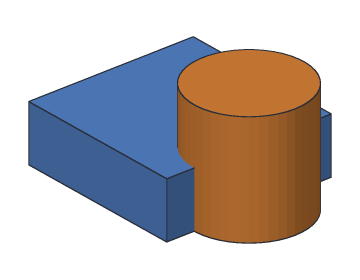

# Combining bodies

Most parts are simple shapes added together or cut from each other. Khan does
this with a **Boolean** step, which combines two bodies into one. There are three
kinds.

Here are the two bodies the examples combine: a 30 × 30 × 10 mm box and a
cylinder that overlaps its right side.



<!-- cli-example -->
```console
$ kh_cli run --save parts.khan feature.add_box size=30,30,10
parts: 1 step
  Box1         ok  volume 9000.00 mm^3
wrote parts.khan
$ kh_cli run --open parts.khan --save parts.khan feature.add_cylinder base=30,15,0 radius=10 height=20
parts: 2 steps
  Box1         ok  volume 9000.00 mm^3
  Cylinder1    ok  volume 6283.19 mm^3
wrote parts.khan
```

| Kind | Keeps | Use it for |
| --- | --- | --- |
| **union** | Everything in either body | Joining pieces: a cup on a base, a peg on a plate |
| **cut** | Body `a`, minus everything in body `b` | Holes, slots, pockets, notches |
| **intersect** | Only what is in both bodies | Rounding a shape off, keeping the part of one shape inside another |

## Union

| Before | After |
| --- | --- |
|  |  |

<!-- cli-example -->
```console
$ kh_cli run --open parts.khan feature.add_boolean operation=union a=Box1 b=Cylinder1
parts: 3 steps
  Box1         ok  volume 9000.00 mm^3
  Cylinder1    ok  volume 6283.19 mm^3
  Union1       ok  volume 13712.39 mm^3
```

The volume is less than 9000 + 6283.19, because the part where they overlap is
counted once.

## Cut

The cylinder (orange outline) is taken away from the box. The order matters:
`a` keeps its material, `b` is the cutting tool.


<!-- cli-example -->
```console
$ kh_cli run --open parts.khan feature.add_boolean operation=cut a=Box1 b=Cylinder1
parts: 3 steps
  Box1         ok  volume 9000.00 mm^3
  Cylinder1    ok  volume 6283.19 mm^3
  Cut1         ok  volume 7429.20 mm^3
```

## Intersect

Only the half-cylinder inside the box is left (the two outlines show the original
bodies).


<!-- cli-example -->
```console
$ kh_cli run --open parts.khan feature.add_boolean operation=intersect a=Box1 b=Cylinder1
parts: 3 steps
  Box1         ok  volume 9000.00 mm^3
  Cylinder1    ok  volume 6283.19 mm^3
  Intersect1   ok  volume 1570.80 mm^3
```

## Chains of Boolean steps

A Boolean step can use the result of another Boolean step. The
[desk organizer](../tutorials/02-desk-organizer.md) joins a cup to a base, then
cuts the inside of the cup, then cuts a slot: each step uses the one before.

## Tips

- **Bodies that don't touch:** a union of two bodies that don't touch still makes
  one step, but the result is two separate pieces.
- **The tool is kept:** after a cut, the cutting tool is still a step in the
  design. Change its size or position and the cut follows.
- **Check the volume:** if a cut didn't change the volume, the tool probably
  missed the body.
