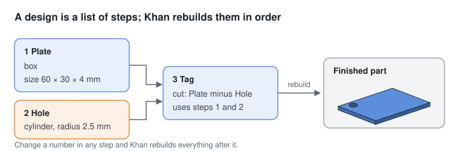
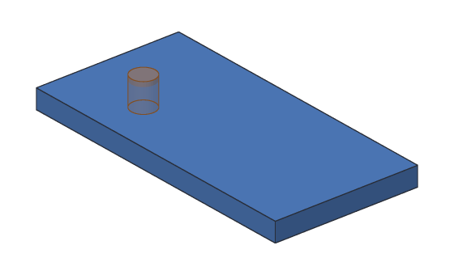

# Designs and steps

A Khan **design** is a list of **steps**, like a recipe. Khan keeps the recipe,
not just the finished shape, and rebuilds the shape from it whenever something
changes.



## Steps

Each step does one thing: makes a box, makes a cylinder, or combines two bodies.
A step has:

| Part | Example | Meaning |
| --- | --- | --- |
| A name | `Plate` | What you call it. You pick it, or Khan picks one like `Box1`. You can rename it any time |
| A kind | box | What the step makes |
| Its numbers | size 60 × 30 × 4 mm | The settings for that kind of step |
| Its inputs | Plate and Hole | The steps it uses (only for steps that combine others) |
| An id | `926bde46-9c5b-...` | A permanent label Khan uses inside the file. You never type it |

Steps that use other steps point at them by **id**, not by name. That's why
renaming a step never breaks the steps that use it.

## Rebuilding

When you open a design, or change it, Khan **rebuilds** it: it runs every step in
order and reports how each one went.

<!-- cli-example -->
```console
$ kh_cli demo tag.khan
wrote tag.khan
$ kh_cli open tag.khan
Demo tag: 3 steps
  Plate        ok  volume 7200.00 mm^3
  Hole         ok  volume 117.81 mm^3
  Tag          ok  volume 7121.46 mm^3
```

| Status | Meaning |
| --- | --- |
| `ok` | The step built |
| `failed` | The step couldn't be built, for example a box with a size of 0 mm. A message says why |
| `blocked` | The step uses a step that failed or is turned off, so it can't build either |
| `off` | The step is turned off (suppressed). Turning steps off arrives with the desktop app |

A step that fails doesn't stop the others. Khan builds everything it can and
tells you what to fix.

## Bodies

A **body** is one solid piece. Each box or cylinder step makes a body. A step that
combines two bodies (a [union, cut or intersect](combining.md)) makes a new body
and **uses up** the two it combined: they stay in the design, so you can still
change them, but they aren't finished bodies any more.

The **finished bodies** are the bodies no later step uses. In the tag, only `Tag`
is finished. A 3D printer prints the finished bodies.



## Changing a design

Every change is a **command**: add a step, rename a step, delete a step. Commands
are what the desktop app's buttons, scripts and the AI assistant run, and they
are why undo works for everything.

Today you run commands with [`kh_cli run`](../cli/run.md). The full list is on
the [Modeling commands](../cli/commands.md) page.

## Why a recipe?

- **Change your mind:** make the plate 50 mm long instead of 60, and the hole
  and the cut rebuild to match.
- **See how a part was made:** anyone opening your design sees each step.
- **Small files:** a design stores numbers, not millions of triangles. The tag's
  file is about 1.5 kB.
