# The desktop app

`kh_app` is Khan's desktop app. You build a part by adding steps from the menus,
see it in 3D as it grows, see every step in the feature tree, and change any
step's numbers in Properties. Everything you do can be undone.

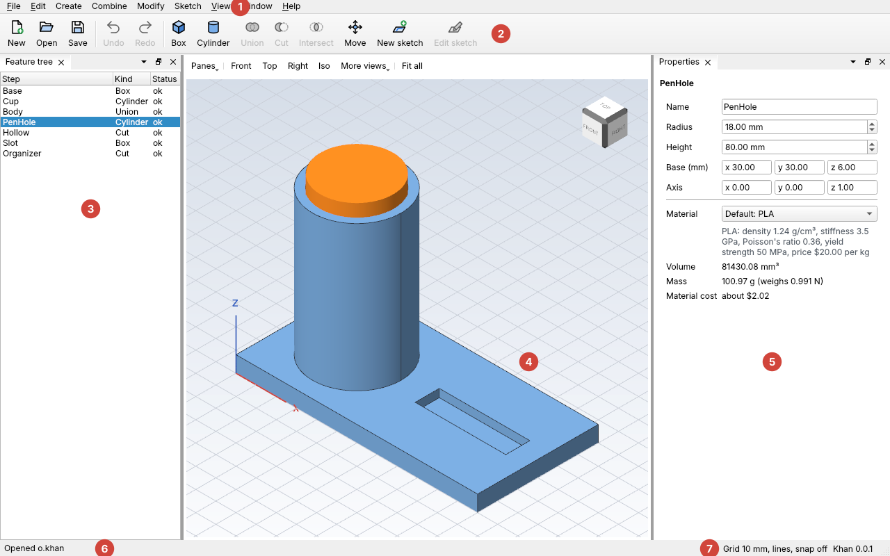

| # | Part | What it's for |
| --- | --- | --- |
| 1 | **Menus** | File (new, open, save), Edit (undo, redo, copy, paste, duplicate, turn off and on, folders, delete), Create (shapes), Combine (union, cut, intersect), Modify (move), Sketch (new, edit, draw), View (the grid), Window (panels, layouts) |
| 2 | **Toolbar** | The most-used menu items, one click away, each with a picture and its name. While you edit a sketch it shows the sketch tools instead, plus the constraint buttons that fit what you picked. If they don't all fit across the window, the rest go on a second row |
| 3 | **Feature tree** | Every step of the design, in the order Khan builds them, with how each one built. It floats over the viewer, see-through, and starts with the design's **Document settings** |
| 4 | **Viewer** | Your part in 3D, on the grid. Turn it with the mouse, the view cube or the **view bar** at its bottom, and click a body to pick it |
| 5 | **Properties** | The selected step's name and numbers. Change them here. It floats over the viewer's top right, under the view cube |
| 6 | **Status bar** | Messages, and what went wrong when something does |
| 7 | **Grid status** | The grid's spacing and style, and whether snapping is on |

## Starting it

After you build Khan, the app is in your build folder:

| System | Path |
| --- | --- |
| Windows | `build\win\apps\kh_app\kh_app.exe` |
| macOS | `build/dev/apps/kh_app/kh_app.app` |
| Linux | `build/dev/apps/kh_app/kh_app` |

It starts with an empty design called Untitled. To open a design straight away,
give its file: `kh_app tag.khan`.

## Make a part

The same keychain tag as [Tutorial 1](../tutorials/01-keychain-tag.md), with the
mouse:

1. **Create > Box.** Khan adds `Box1`, a 20 mm cube, and selects it.
2. In **Properties**, set the size to x 60, y 30, z 4, and change the name to
   `Plate`. Each change rebuilds the design, and the viewer shows the new plate.
3. **Create > Cylinder.** In Properties, set radius 2.5, height 6, base
   x 9, y 15, z -1, and name it `Hole`.
4. In the feature tree, click **Plate**, then hold Ctrl (⌘ on a Mac) and click
   **Hole**. The order matters: first the body to keep, then the cutting tool.
5. **Combine > Cut.** Khan adds `Cut1`: the plate with the hole cut out.
6. **File > Save**, and pick a name.

## The 3D viewer

The viewer in the middle of the window shows your finished bodies, sitting on the
grid. Steps used up by a later step (like the Hole that a Cut cut out) aren't
drawn, unless you pick them.

**Moving around** with the mouse:

| To | Do this |
| --- | --- |
| Orbit (turn around the part) | Drag with the left button |
| Pan (slide sideways) | Drag with the right or middle button, or Shift and the left button |
| Zoom | Roll the wheel; it zooms towards the mouse |
| Look from a side | Click a face of the **view cube** (top right). Click one of its edges or corners to look from in between |
| See everything | **Fit all** on the view bar |

Z always stays pointing up while you orbit, so the floor stays the floor.

**The view bar** floats at the bottom middle of the viewer:

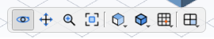

| Button | What it does |
| --- | --- |
| **Orbit** | Dragging with the left button turns the camera around the part. This is how it starts |
| **Pan** | Dragging with the left button slides the camera sideways instead. Handy on a laptop's touchpad |
| **Zoom** | Dragging with the left button zooms instead: drag right to move closer, left to move away |
| **Fit all** | Zooms so every body fits, in every pane |
| **Views** | Look from the Front, Top, Right, at an angle (Iso), Back, Left or Bottom |
| **Display** | How bodies are drawn (**Shaded with edges**, **Shaded** or **Wireframe**), and which [axes](#the-axes) and labels show |
| **Grid** | Show or hide the grid, its style and spacing, snapping to it, and **All view options...** |
| **Panes** | Split the viewer into 1, 2 or 4 panes |

Orbit, Pan and Zoom change only the left button: the right and middle buttons
always pan, and the wheel always zooms. A click still picks, whichever one is on.
Khan remembers the display style next time it starts.

**Wireframe** draws just the edges, so you can see inside the part, like where
the pen hole of the desk organizer ends:

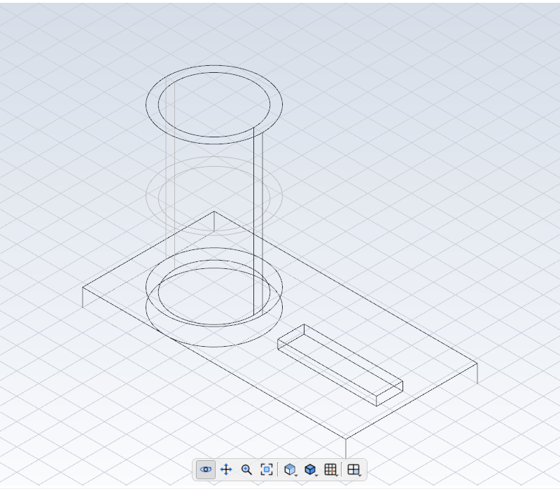

**Dragging.** A picked body shows three arrows and a square: drag one to slide
the body along x, y or z, or across the ground. See
[Dragging a body](moving.md#dragging-a-body).

**Picking.** Click a body to pick its step: it turns orange, and the feature tree
and Properties show the same step. Ctrl-click (⌘-click) or Shift-click picks more
than one, or un-picks one. Clicking empty space un-picks everything. Picking works
both ways: rows you pick in the feature tree turn orange in the viewer too. A
picked step that a later step used up is drawn in orange so you can see where it
is, like the cutting tool of a Cut.

**Standard views.** **Views** on the view bar turns the camera to look from the
Front, Top, Right, Iso, Back, Left or Bottom, and zooms to fit. Front looks from -y towards +y, Top looks down, and Iso looks
from the front, right and above at once.

**Panes.** **Panes** on the view bar splits the viewer into one pane, two side by
side, two stacked, or four. Each pane has its own camera. Four panes are set out
like a drawing: Top above Front, Right beside Front, and Iso in the corner. The
pane you clicked last has a blue frame, and **Views** turns that pane; **Fit
all** fits every pane.

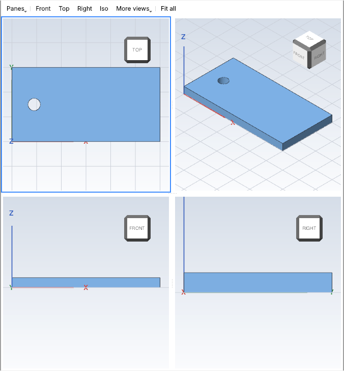

**More viewers.** **Window > New viewer** opens another viewer next to the first,
with its own panes and cameras, for example to keep a close-up and the whole part
on screen at once. Drag its tab to move it, even onto another monitor. Extra
viewers close with their tab's x, and aren't reopened next time.

**No 3D graphics?** The viewer needs OpenGL 2.1 or newer, which almost every
computer has. If it can't start, the viewer says why and how to fix it (usually:
update the graphics driver), and shows the grid from above with a list of your
finished bodies instead:

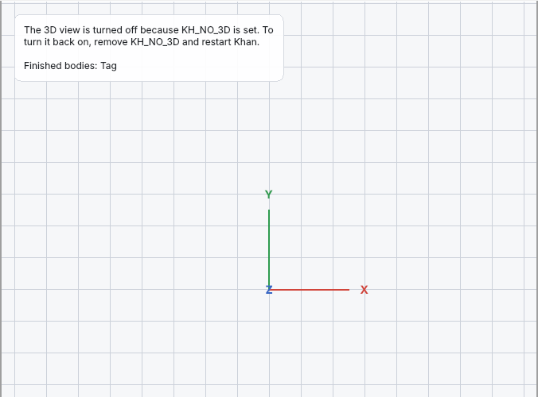

If the 3D view crashes or draws garbage on your computer, you can turn it off:
set the environment variable `KH_NO_3D` to `1` before starting Khan (on Windows:
`set KH_NO_3D=1`, then `kh_app`).

## Panels over the viewer

The feature tree, Properties, the Sketch panel and View options float over the
viewer, like the browser and dialogs in other CAD programs, so your part gets the
whole window. They're see-through, and only as tall as what's in them, so they
cover as little of your part as they can. The feature tree is at the top left;
Properties is at the top right, under the view cube, with the Sketch panel
(while you edit a sketch) and View options under it.

- **Fold one up** with the arrow on its title bar, so only the title shows.
  Click the arrow again to open it.
- **Make it bigger or smaller** by dragging its inner side edge or its bottom
  edge.
- **Dock it** beside the viewer as an ordinary panel with the button at the right
  of its title bar (or untick **Window > *panel* over the view**). Tick that menu
  item again to float it over the viewer once more.
- **Window > *panel*** hides it and shows it again.

Khan remembers all of this next time it starts.

## The feature tree

At the top are the design's name and **Document settings**. Click
**Document settings** to see the design's own settings in Properties; see
[Document settings and units](#document-settings-and-units).

Under them, each row is one step: its name, its kind, and its status.

| Status | Meaning |
| --- | --- |
| `ok` | It built |
| `failed` | It couldn't be built. Rest the mouse on it, or look in Properties, to see why |
| `blocked` | It uses a step that failed |
| `off` | It's turned off |

- **Pick** a step by clicking it. Ctrl-click (⌘-click) picks more than one; Khan
  remembers the order you picked them in.
- **Rename** a step by double-clicking its name, or pressing F2.
- **Delete** a step with the Delete key, or right-click > Delete step. A step that
  another step uses can't be deleted until that step is.

- **Turn off** steps with Edit > Turn off, or right-click > Turn off. A step
  that's off isn't built, but it isn't deleted: its numbers are kept, and Edit >
  Turn on (or right-click > Turn on) brings it back. Every picked step changes
  at once, as one Undo. A step that uses a step that's off shows `blocked`.
- **Put steps in a folder** with Edit > New folder. See [Folders](#folders).
- **Duplicate** a step with Edit > Duplicate step (Ctrl+D). See
  [Copying steps](#copying-steps).

Picking two steps turns on **Combine**: union, cut or intersect. For a cut, pick
the body to keep first.

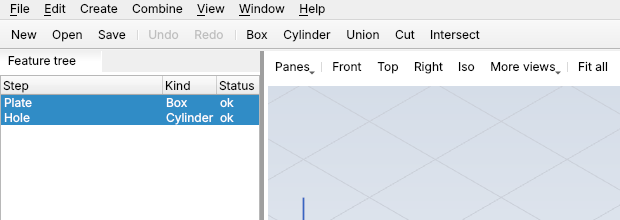

## Document settings and units

**Document settings**, at the top of the feature tree, shows the design's own
settings in Properties: its name, how many steps it has, and its **units**.

**Lengths** picks the unit for every length you see and type in this design:
millimeters (the usual one for 3D printing), centimeters, meters, inches or feet.
Changing it doesn't change anything's size, only how the numbers are written: a
box 25.4 mm wide shows as 1 in. After that, Properties, the Sketch panel and the
labels on a sketch all use the new unit, and volumes are in it cubed (in³).
Type `1` in a box in inches and it means 1 inch. Angles are always in degrees.

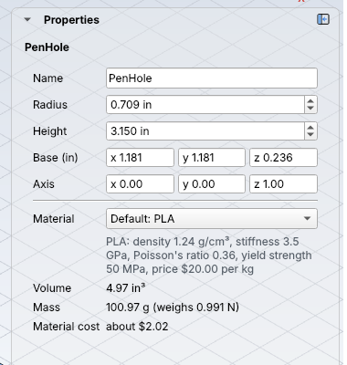

The unit is saved with the design, so it opens in inches next time, and on a
classmate's computer too. Changing it is one undo step, like any other change.
The grid's spacing is a View option, not part of the design: it stays in mm.

## Properties

Properties shows the picked step's name and numbers. Lengths are in the design's
unit, mm unless you picked another one in
[Document settings](#document-settings-and-units).

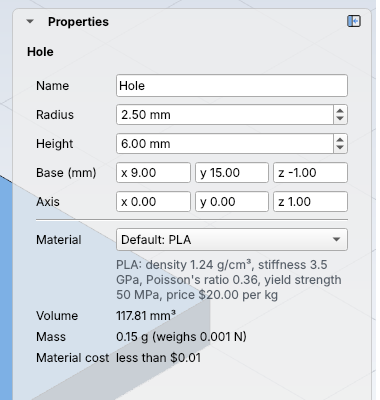

- Type a number and press Enter, or click elsewhere: the step changes and the
  design rebuilds. Edit > Undo puts it back.
- Holding an arrow key or rolling the mouse wheel changes a number in small
  steps. Quick changes to the same number undo as one step.
- **Base** and **Corner** are positions: x goes right, y goes back, z goes up
  (see [Shapes](shapes.md)).
- **Axis** is the direction a cylinder points: 0, 0, 1 is straight up.
- **Material** picks what the step's body is made of. Under it, Properties shows
  the body's volume, mass, weight and material cost. See [Materials](materials.md).

When a step doesn't build, Properties says why in red, and how to fix it:

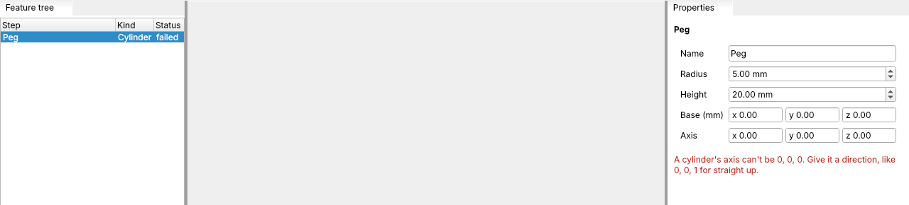

## The grid

The grid is a pattern of dots or lines on the ground (the x-y plane) that helps
you judge sizes and line things up. It starts **on**, every **10 mm**, drawn as
**lines**, with **snapping off**. Change it in the **View** menu:

| Menu item | Keys | What it does |
| --- | --- | --- |
| View > Show grid | Ctrl+G | Shows or hides the grid |
| View > Snap to grid | Ctrl+Shift+G | Points you pick with the mouse jump to the nearest grid crossing |
| View > Grid style > Lines or Dots | | Lines look like graph paper; dots are lighter and keep your part easy to see |
| View > Grid spacing | | 1, 2, 5, 10, 20 or 50 mm, or **Other...** for any size from 0.01 mm to 1000 mm |

| Lines, 10 mm (the start) | Dots, 5 mm |
| --- | --- |
| 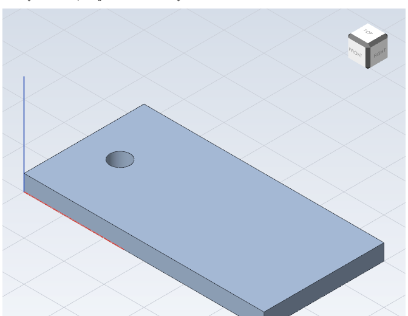 | 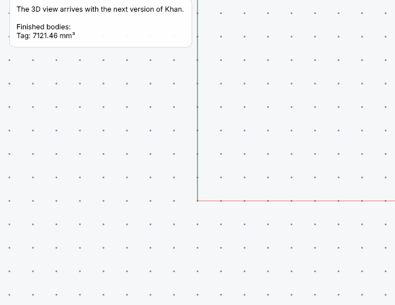 |

The status bar (7 in the picture at the top) always shows the
grid's settings, like "Grid 10 mm, lines, snap off". Khan remembers your grid
settings for next time, and they're also in the [View options](#view-options)
panel, where Grid spacing takes any size.

- **How far the grid reaches:** 50 lines each way from the origin (500 mm with
  10 mm spacing), but at least 100 mm and never more than 100 lines, so a fine
  grid stays quick to draw.
- **Snapping** matters once you place things with the mouse, in sketches (coming
  soon). Numbers you type in Properties are never snapped.
- **The grid is a plugin,** `kh.grid`, built into Khan. That's why it isn't in
  `kh_cli`: there's nothing to draw it on there.

## The axes

The coloured lines on the view cube are the **axes**: red **X**, green **Y** and
blue **Z**. They show which way is which, so you can tell a box's width (x) from
its depth (y) and height (z). They start at the cube's corner nearest x, y and z
all being smallest, and run along its edges, turning with the cube as you turn
the view.

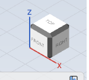

From this side, Y points away from you, so the cube hides it, just like the back
edge of a real box. Turn the view (try the cube's **Top** face) and it shows.

| Menu item | What it does | Starts |
| --- | --- | --- |
| View > Show axes | Shows or hides the axes on the view cube (and their letters) | on |
| View > Show axis labels | Shows or hides just the letters X, Y and Z | on |
| View > Show axes at the origin | Also draws the axes at the origin (0, 0, 0), 25 mm long, in your design. Handy when you sketch around the origin | off |

Khan remembers all three for next time, and they're also in the
[View options](#view-options) panel. The letters always face you and stay the
same size as you zoom. The axes are a plugin too, `kh.axes`, built into Khan.

## View options

Everything the viewer can show, the grid and the axes so far, is also in one
place: **View > View options...** opens the **View options** panel. It lists every
option, grouped, and changing one there is the same as using the View menu: the
menu's check marks follow, and Khan remembers it.

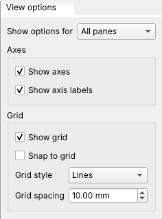

- The panel starts closed. Close it again with its **x**, or open and close it from
  the **Window** menu. Like any panel, you can dock it anywhere.
- **Grid spacing** takes any size from 0.01 mm to 1000 mm, not just the menu's
  sizes. Type it and press Enter.

### One pane only

Usually a view option changes **every pane** of every viewer. Sometimes you want
one pane to be different: a fine 2 mm grid in the 3D pane only, say, or no axis
letters in the top view.

- **Right-click in a pane** (click without dragging; a drag pans) for its **This
  pane only** menu: the same options, with that pane's check marks. Changing one
  there changes that pane alone.
- Or, in the **View options** panel, pick the pane in **Show options for**. A value
  the pane has of its own is in **bold**, with a round-arrow button that puts it
  back to the all-panes value.
- A pane with its own options shows a yellow **Own view options** strip at its top.
  **Same as all panes** puts every option in that pane back.

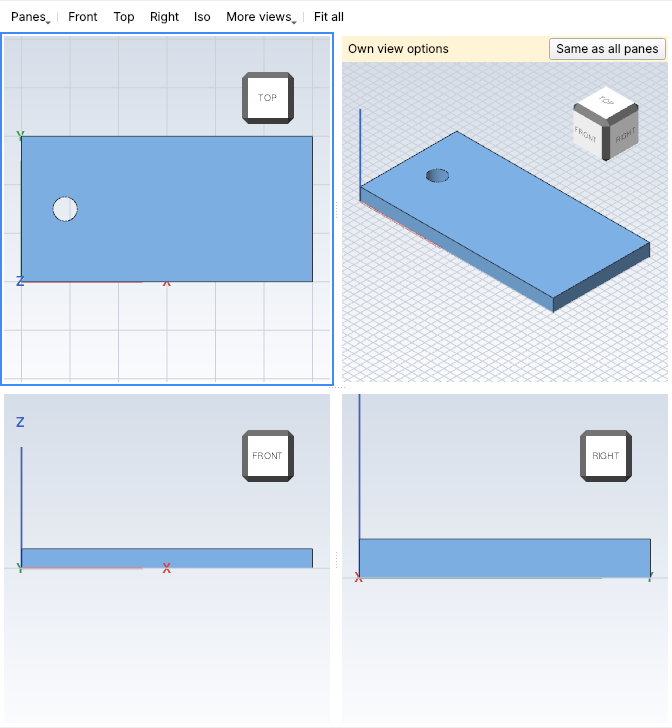

Things to know:

- **A change for all panes wins.** Changing an option from the View menu, or with
  **All panes** in the panel, applies to every pane, including one that had its
  own value for that option.
- **New panes start like all the others.** Switching from 1 to 4 panes gives the
  new panes the all-panes options. Going back to fewer panes forgets the own
  options of the panes that close.
- Khan remembers each pane's own options for next time.
- The status bar's grid text shows the grid of the pane you clicked last.

## Folders

A folder holds steps that are next to each other in the feature tree, so a long
tree is easier to read. Folders only keep the tree tidy: they never change what's
built.

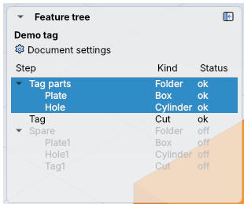

- **Make one:** pick the steps (Ctrl-click or Shift-click), then Edit > New folder,
  or right-click > New folder. It's called `Folder1`, `Folder2`, ...
- **Rename it:** double-click its name, or press F2.
- **Open and close it** with the arrow next to its name.
- **Pick the folder** to pick all its steps. Then Edit > Turn off turns them all off.
- **Right-click a folder** for Rename folder, Turn off (or Turn on), and Remove
  folder. Removing a folder keeps its steps.

The **Status** of a folder is a problem inside it (`failed` or `blocked`), or
`off` if all its steps are off.

Example: in the keychain tag, pick `Plate` and `Hole`, then Edit > New folder, and
rename it `Tag parts`. `Tag` stays outside, under the folder.

Tips:

- Only steps with no other steps between them can share a folder, and a step can
  be in only one folder.
- New steps go at the end of the tree, outside any folder.
- Deleting all of a folder's steps removes the folder too. Undo brings both back.

## Copying steps

Copying makes new steps with the same sizes and positions as the ones you picked.
Copying a step also copies every step it uses, so a copied cut still has its
hole: copying `Tag` (which cuts `Hole` out of `Plate`) gives `Plate1`, `Hole1`
and `Tag1`. The copies are separate: changing one never changes the other.

- **Edit > Duplicate step** (Ctrl+D) copies the picked step into the same design,
  at the end of the feature tree.
- **Edit > Copy** (Ctrl+C) copies the picked steps. **Edit > Paste** (Ctrl+V) adds
  them to the end of the design that's open, which can be a different design, or
  the same one. Paste works as often as you like, and every paste is one Undo.
- A copied name that's taken gets the next free number: `Plate` becomes `Plate1`.
- Materials of your own come along. If the design you paste into already has a
  material with the same name, the steps use that one.

Example: make a 20 mm box, pick it, press Ctrl+C, then File > New and Ctrl+V. The
new design has `Box1`, 20 mm on each side.

Tips:

- The copies sit exactly on top of the originals, so the viewer looks the same.
  Pick a copy and use Modify > Move to put it somewhere else (see
  [Moving bodies](moving.md)).
- What you copy is plain text, so you can paste it into a message or a file and
  paste it back into Khan later.

## Undo and redo

**Edit > Undo** (Ctrl+Z) takes back the last change, whatever made it: a menu
item, a renamed step, or a number typed in Properties. The menu item says what it
will undo, like "Undo Add Box1". **Edit > Redo** (Ctrl+Y or Ctrl+Shift+Z) puts it
back.

Opening a design starts a fresh undo history.

## Saving

| Menu item | Keys | What it does |
| --- | --- | --- |
| File > New | Ctrl+N | Starts an empty design |
| File > Open... | Ctrl+O | Opens a `.khan` design |
| File > Save | Ctrl+S | Saves to the design's file (asks for a name the first time) |
| File > Save as... | Ctrl+Shift+S | Saves under a new name |
| File > Export... | Ctrl+E | Writes the part as STL (for 3D printing) or STEP (for other CAD programs) |

A `*` after the name in the title bar means there are unsaved changes. Khan asks
before closing or replacing a design with unsaved changes. Khan has one design
open at a time for now.

## Exporting

**File > Export...** writes your part to a file another program can use: an
`.stl` file for your 3D printer's slicer, or a `.step` file for other CAD
programs. Pick the type in the box under the file name, or just end the name with
`.stl` or `.step`. The status bar says what was written, like "Exported Tag to
tag.stl".

Export writes one body:

- If you picked one step in the feature tree, that step's shape is exported
  (even one a later step used up, like the Hole of a Cut).
- Otherwise, the design's one finished body.
- If the design has two or more finished bodies and none is picked, Khan says so:
  pick the one you want in the feature tree, or join them with
  [Combine > Union](combining.md#union).

An exported file holds only the shape, so keep your `.khan` file too: it's the
one you can change later. More about the formats is on the
[Files](files.md#exporting) page.

## Panels and layouts

Every panel can be moved:

- **Drag** a panel's tab to dock it on another side, or onto another panel to
  share its space as a tab.
- **Drag it out** of the window to make it a window of its own, for example on a
  second monitor.
- **Window** lists every panel: tick one to show it again after closing it.
- The feature tree, Properties, the Sketch panel and View options float over the
  viewer until you dock them; see [Panels over the viewer](#panels-over-the-viewer).

Khan remembers where your panels were and puts them back next time. If a panel
was on a monitor that's no longer plugged in, it comes back onto your main screen.

**Window > Layouts** keeps named layouts:

- **Save layout as...** saves the current arrangement under a name.
- Pick a saved name to switch to it.
- **Reset layout** puts every panel back where it started, with the floating
  panels over the viewer again.

## Plugins in the app

The viewer, the feature tree, Properties, and the Create and Combine menus all
come from plugins that ship with Khan. Plugins you add (see [Plugins](plugins.md)) can add
menu items and panels too. Put plugin folders in a `plugins` folder next to
`kh_app`, or in Khan's folder in your user data:

| System | Folder |
| --- | --- |
| Windows | `%APPDATA%\Khan\Khan\plugins` |
| macOS | `~/Library/Application Support/Khan/Khan/plugins` |
| Linux | `~/.local/share/Khan/Khan/plugins` |
