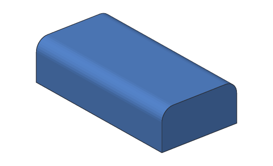
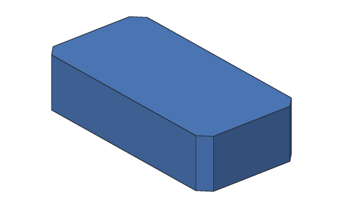

# Fillet and chamfer

A **fillet** rounds an edge: the sharp corner where two faces meet becomes a
smooth round face. A **chamfer** bevels an edge: the corner is cut off with a flat
face instead. Both make parts nicer to hold, stronger at inside corners, and
easier to 3D print (a chamfer on a bottom edge keeps it from spreading on the
print bed).





A fillet has a **radius**: the size of the round, in mm. A chamfer has a
**distance**: how far back from the edge the cut starts, the same on both faces.

## Edges keep their names

You pick which edges to round. SketchBillet remembers each one by where it came
from, like "the edge between the top and the side made from Line1", not by a
number. So when you change an earlier step (make the block wider, taller, or move
a hole), the fillet stays on the same edges and is worked out again.

Sometimes a change really does take an edge away: the hole you rounded no
longer reaches the top, say. Then the fillet stops and says so:

```text
Fillet1 can't find an edge it rounds: an earlier change took it away. Edit Fillet1 and pick its edges again.
```

SketchBillet never guesses which edge you meant. If an edge was split in two
by a change, it uses the piece that clearly looks most like the old edge, and
tells you to check; if two pieces look alike, it asks you to pick again.

## In the desktop app

Picking edges in the 3D view comes next. Until then, add a fillet or chamfer
with `sketchbillet_cli` (below), and open the design in the app: pick the
**Fillet1** step in the feature tree to change its **Radius** in **Properties**
(a chamfer's is its **Distance**).

## Example with sketchbillet_cli

Make a 40 × 20 × 10 mm block, and list its edges. Each edge has a number,
counting from the bottom up, and says which faces it runs between:

<!-- cli-example -->
```console
$ sketchbillet_cli run --save block.sb feature.add_sketch
block: 1 step
  Sketch1      ok  empty
wrote block.sb
$ sketchbillet_cli run --open block.sb --save block.sb sketch.add_rectangle sketch=Sketch1 from=0,0 to=40,20
block: 1 step
  Sketch1      ok  4 lines, 8 constraints, free to move 4 ways
wrote block.sb
$ sketchbillet_cli run --open block.sb --save block.sb feature.add_extrude sketch=Sketch1 distance=10
block: 2 steps
  Sketch1      ok  4 lines, 8 constraints, free to move 4 ways
  Extrude1     ok  volume 8000.00 mm^3  mass 9.92 g (PLA)
wrote block.sb
$ sketchbillet_cli open block.sb --edges Extrude1
block: 2 steps
  Sketch1      ok  4 lines, 8 constraints, free to move 4 ways
  Extrude1     ok  volume 8000.00 mm^3  mass 9.92 g (PLA)
edges of Extrude1: 12
   1  line           40.00 mm  at 20.00,0.00,0.00  between side from Line1 of Sketch1 (Extrude1) and start of Extrude1
   2  line           20.00 mm  at 0.00,10.00,0.00  between side from Line4 of Sketch1 (Extrude1) and start of Extrude1
   3  line           20.00 mm  at 40.00,10.00,0.00  between side from Line2 of Sketch1 (Extrude1) and start of Extrude1
   4  line           40.00 mm  at 20.00,20.00,0.00  between side from Line3 of Sketch1 (Extrude1) and start of Extrude1
   5  line           10.00 mm  at 0.00,0.00,5.00  between side from Line1 of Sketch1 (Extrude1) and side from Line4 of Sketch1 (Extrude1)
   6  line           10.00 mm  at 40.00,0.00,5.00  between side from Line1 of Sketch1 (Extrude1) and side from Line2 of Sketch1 (Extrude1)
   7  line           10.00 mm  at 0.00,20.00,5.00  between side from Line3 of Sketch1 (Extrude1) and side from Line4 of Sketch1 (Extrude1)
   8  line           10.00 mm  at 40.00,20.00,5.00  between side from Line2 of Sketch1 (Extrude1) and side from Line3 of Sketch1 (Extrude1)
   9  line           40.00 mm  at 20.00,0.00,10.00  between end of Extrude1 and side from Line1 of Sketch1 (Extrude1)
  10  line           20.00 mm  at 0.00,10.00,10.00  between end of Extrude1 and side from Line4 of Sketch1 (Extrude1)
  11  line           20.00 mm  at 40.00,10.00,10.00  between end of Extrude1 and side from Line2 of Sketch1 (Extrude1)
  12  line           40.00 mm  at 20.00,20.00,10.00  between end of Extrude1 and side from Line3 of Sketch1 (Extrude1)
```

Round the two long top edges, 9 and 12, by 3 mm:

<!-- cli-example -->
```console
$ sketchbillet_cli run --open block.sb --save block.sb feature.add_fillet body=Extrude1 edges=9,12 radius=3
block: 3 steps
  Sketch1      ok  4 lines, 8 constraints, free to move 4 ways
  Extrude1     ok  volume 8000.00 mm^3
  Fillet1      ok  volume 7845.49 mm^3  mass 9.73 g (PLA)
wrote block.sb
```

Each round takes away a 3 × 3 mm square less a quarter of a circle, all along
the 40 mm edge: 8000 − 2 × (3² − π × 3² ÷ 4) × 40 = 7845.49 mm³.

Now make the block 30 mm tall. The fillet stays on the top edges:

<!-- cli-example -->
```console
$ sketchbillet_cli run --open block.sb --save block.sb feature.set_value feature=Extrude1 setting=distance value=30
block: 3 steps
  Sketch1      ok  4 lines, 8 constraints, free to move 4 ways
  Extrude1     ok  volume 24000.00 mm^3
  Fillet1      ok  volume 23845.49 mm^3  mass 29.57 g (PLA)
wrote block.sb
```

Bevel the four upright corners of the block itself (Extrude1, without the rounds), edges 5 to 8, by 2 mm:

<!-- cli-example -->
```console
$ sketchbillet_cli run --open block.sb feature.add_chamfer body=Extrude1 edges=5,6,7,8 distance=2
block: 4 steps
  Sketch1      ok  4 lines, 8 constraints, free to move 4 ways
  Extrude1     ok  volume 24000.00 mm^3
  Fillet1      ok  volume 23845.49 mm^3  mass 29.57 g (PLA)
  Chamfer1     ok  volume 23760.00 mm^3  mass 29.46 g (PLA)
```

[`feature.add_fillet`](../cli/commands.md#featureadd_fillet),
[`feature.add_chamfer`](../cli/commands.md#featureadd_chamfer) and
[`feature.set_edges`](../cli/commands.md#featureset_edges) have every setting.

## Tips

- **"The radius may be too big."** A round has to fit between the faces next to
  the edge: on a 10 mm tall block, a radius over 10 mm can't. Try a smaller one.
- **Round inside corners** of parts that take a load, like where a bracket's arm
  meets its base: a sharp inside corner is where cracks start.
- **Fillet last.** Add rounds and bevels after the main shape is done, so changing
  the shape doesn't take their edges away.
- **Several edges in one step** round together, and their rounds meet neatly at
  the corners. To change the radius of only some, use two steps.
