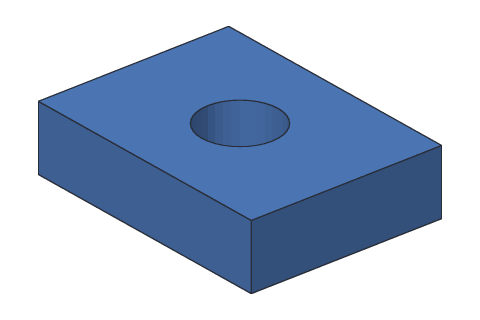

# Getting started

This page gets you from nothing to a part ready to 3D print.

## 1. Get SketchBillet

Download SketchBillet for Windows, macOS or Linux and install it: see
[Installing SketchBillet](install.md). (Or build it from its source code: the main
[README](../../README.md) has the steps.)

When it's done, check that it works:

<!-- cli-example -->
```console
$ sketchbillet_cli --version
sketchbillet_cli 0.0.1
```

Where `sketchbillet_cli` is depends on how you got SketchBillet; see
[Where to find it](../cli/README.md#where-to-find-it).

## 2. Make your first part

Make an empty folder, open a terminal there, and make a box 40 mm wide, 30 mm deep
and 10 mm tall:

<!-- cli-example -->
```console
$ sketchbillet_cli run --save first.sb feature.add_box size=40,30,10
first: 1 step
  Box1         ok  volume 12000.00 mm^3  mass 14.88 g (PLA)
wrote first.sb
```

SketchBillet made a design with one step, `Box1`, checked that it builds (`ok`), and saved
it as `first.sb`.

## 3. Add to it

Cut a round hole through the middle. First add a cylinder where the hole goes,
then cut it out of the box:

<!-- cli-example -->
```console
$ sketchbillet_cli run --open first.sb --save first.sb feature.add_cylinder base=20,15,-1 radius=6 height=12
first: 2 steps
  Box1         ok  volume 12000.00 mm^3  mass 14.88 g (PLA)
  Cylinder1    ok  volume 1357.17 mm^3  mass 1.68 g (PLA)
wrote first.sb
$ sketchbillet_cli run --open first.sb --save first.sb feature.add_boolean operation=cut a=Box1 b=Cylinder1
first: 3 steps
  Box1         ok  volume 12000.00 mm^3
  Cylinder1    ok  volume 1357.17 mm^3
  Cut1         ok  volume 10869.03 mm^3  mass 13.48 g (PLA)
wrote first.sb
```



## 4. Export it

In the desktop app, that's **File > Export...** (Ctrl+E). With `sketchbillet_cli`:

<!-- cli-example -->
```console
$ sketchbillet_cli open first.sb --export first.stl
first: 3 steps
  Box1         ok  volume 12000.00 mm^3
  Cylinder1    ok  volume 1357.17 mm^3
  Cut1         ok  volume 10869.03 mm^3  mass 13.48 g (PLA)
wrote first.stl
```

Open `first.stl` in a slicer to print it, or in any 3D viewer to look at it.

## Or use the desktop app

Everything above also works in the desktop app, `sketchbillet`, with menus instead of
commands: see [The desktop app](desktop-app.md).

## Next

- Do [Tutorial 1: Keychain tag](../tutorials/01-keychain-tag.md).
- Read [Designs and steps](designs-and-steps.md) to see how it all fits together.
