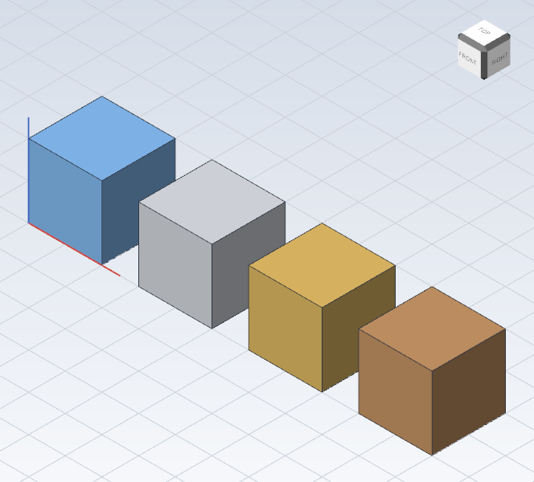
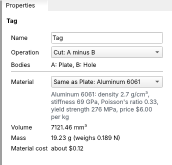

# Materials

Every body is made of a **material**: PLA, aluminum, oak, or one of your own. The
material gives the body its **mass** (how heavy it is), its **weight**, an estimate
of what the **material costs**, and its **color** in the viewer. A body is PLA
until you pick something else.



## Pick a material

**In the desktop app:** pick the step in the feature tree, then choose from the
**Material** list in Properties. Under the list, Properties shows the material's
numbers, and the body's volume, mass, weight and material cost.



**With `kh_cli`:** run [`feature.set_material`](../cli/commands.md#featureset_material)
with the material's name. Here the demo keychain tag changes from PLA to
aluminum. It weighs more than twice as much:

<!-- cli-example -->
```console
$ kh_cli demo tag.khan
wrote tag.khan
$ kh_cli open tag.khan
Demo tag: 3 steps
  Plate        ok  volume 7200.00 mm^3
  Hole         ok  volume 117.81 mm^3
  Tag          ok  volume 7121.46 mm^3  mass 8.83 g (PLA)
$ kh_cli run --open tag.khan --save tag.khan feature.set_material feature=Plate material="Aluminum 6061"
Demo tag: 3 steps
  Plate        ok  volume 7200.00 mm^3
  Hole         ok  volume 117.81 mm^3
  Tag          ok  volume 7121.46 mm^3  mass 19.23 g (Aluminum 6061)
wrote tag.khan
```

## Which step's material counts

You picked aluminum for `Plate`, but the finished body is `Tag`. That works
because **a union, cut or intersect takes the material of its first body (`a`)**,
unless you pick a material for it too. The cutting tool's material (`Hole`, `b`)
doesn't matter: it's cut away.

So the easy way is to pick the material on the first step, and every step built
from it follows. In Properties, a Boolean step's list starts with **Same as
Plate: Aluminum 6061**, so you can see where its material comes from. Pick a
material on the Boolean step itself to override it.

Each finished body has its own material, so a design with two bodies (a box and
its lid, say) can have two materials.

## Khan's materials

[`kh_cli materials`](../cli/materials.md) lists them, with their numbers:

| Group | Materials |
| --- | --- |
| 3D printing | PLA, PETG, ABS, TPU (flexible), Nylon (PA12), Resin (standard), Acrylic (PMMA), Polycarbonate |
| Metals | Aluminum 6061, Steel (mild, 1018), Stainless steel 304, Brass (C360), Copper (C110) |
| Wood and sheets | Oak (red), Plywood (birch), MDF |

| Number | What it means |
| --- | --- |
| Density (g/cm³) | How heavy one cubic centimeter is. Water is 1, PLA 1.24, steel 7.87 |
| Stiffness (GPa) | Young's modulus: how hard it is to stretch or bend. Steel is about 60 times stiffer than PLA |
| Poisson's ratio | How much thinner it gets when you stretch it, from 0 to 0.5 |
| Yield strength (MPa) | The stress where it starts to bend for good instead of springing back |
| Price (per kg) | A rough price in US dollars. Yours will differ |

Stiffness and strength aren't used yet: they're there to compare materials, and
for the strength simulations coming in a later version.

## How Khan works it out

| Number | How |
| --- | --- |
| Mass (g) | volume (mm³) ÷ 1000 × density (g/cm³). The tag: 7121.46 ÷ 1000 × 1.24 = 8.83 g |
| Weight (N) | mass (kg) × 9.81, the pull of gravity on Earth |
| Material cost | mass (kg) × price per kg |

## Your own materials

For a filament or stock that isn't in the list, add your own:

- **In the app:** choose **New material...** at the bottom of the Material list.
  Give it a name and a density (on the maker's data sheet, often in g/cm³), pick a
  color, and fill in the other numbers if you know them.
- **With `kh_cli`:** run [`material.define`](../cli/commands.md#materialdefine).

Your materials are saved in the design, so they travel with the file. Defining a
material with the same name again changes it everywhere it's used.
[`material.delete`](../cli/commands.md#materialdelete) removes one no step uses.

## Tips

- **3D prints aren't solid.** Khan's mass is for a solid part. A print with 20 %
  infill weighs much less; your slicer gives the real filament weight.
- **Wood is stronger along the grain.** Khan's numbers for wood are along the grain.
- **Check before you trust a strength number.** These are typical values. For
  anything that must not break, use the supplier's data sheet and ask someone
  who knows.
- **Undo works.** Picking or adding a material is one step, like any other change.
