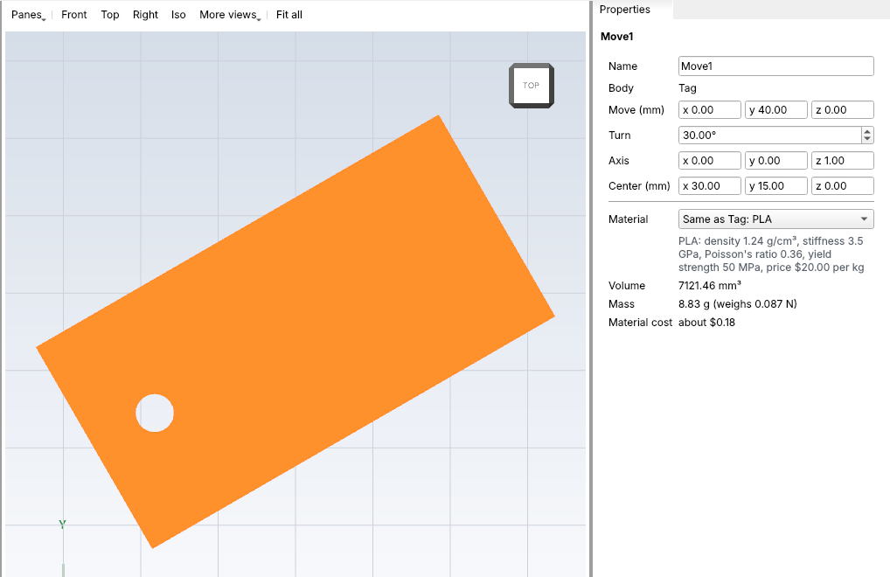

# Moving bodies

A **Move** step slides a body to a new place, turns it, or both. The body keeps
its size and shape. Like a Boolean, a Move uses up the body it moves: the moved
body is the one that's finished, and the original isn't drawn or exported any more.



## Example

Slide the [demo tag](../cli/demo.md) 40 mm along y:

<!-- cli-example -->
```console
$ kh_cli demo tag.khan
wrote tag.khan
$ kh_cli run --open tag.khan --save tag.khan feature.add_move body=Tag by=0,40,0
Demo tag: 4 steps
  Plate        ok  volume 7200.00 mm^3
  Hole         ok  volume 117.81 mm^3
  Tag          ok  volume 7121.46 mm^3
  Move1        ok  volume 7121.46 mm^3  mass 8.83 g (PLA)
wrote tag.khan
```

The volume stays 7121.46 mm³: moving never changes a body's size.

## Turning

A Move can also turn the body, before sliding it. Three numbers say how:

| Setting | In Properties | Meaning |
| --- | --- | --- |
| `turn` | Turn | How far to turn, in degrees. Positive turns counterclockwise, looking down the axis (from its tip back toward the center) |
| `axis` | Axis | The direction of the line it turns about. `0,0,1` (the default) is straight up, so the body spins flat on the table |
| `about` | Center (mm) | A point on that line. Pick the middle of the body to turn it in place |

Turn the tag 30° about its middle (it's 60 × 30 mm, so its middle is at 30, 15):

<!-- cli-example -->
```console
$ kh_cli demo tag.khan
wrote tag.khan
$ kh_cli run --open tag.khan --save tag.khan feature.add_move body=Tag turn=30 about=30,15,0
Demo tag: 4 steps
  Plate        ok  volume 7200.00 mm^3
  Hole         ok  volume 117.81 mm^3
  Tag          ok  volume 7121.46 mm^3
  Move1        ok  volume 7121.46 mm^3  mass 8.83 g (PLA)
wrote tag.khan
```

## In the desktop app

1. Pick a step in the feature tree.
2. **Modify > Move** (Ctrl+M), or the **Move** button. A `Move1` step is added and
   picked; it doesn't move anything yet.
3. In Properties, type how far in **Move (mm)**, and how far to **Turn**.

Change the numbers whenever you like: the design rebuilds, and Edit > Undo takes
a change back.

## Tips

- A Move of a step that's turned off is `blocked`, like any step that uses it.
- The moved body is made of what the original is made of, unless you pick a
  material for the Move step.
- To keep the original and move a copy, duplicate it first (Edit > Duplicate
  step), then move the copy.
- Turning about an axis of `0,0,0` doesn't work: there's no line to turn about.
  Give the axis a direction, like `0,0,1`.
