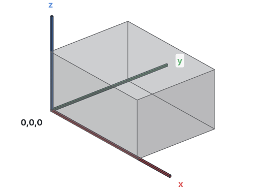
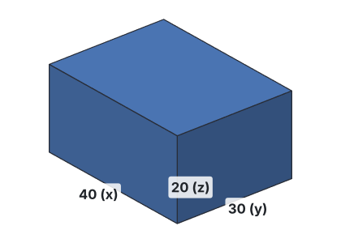
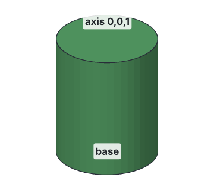
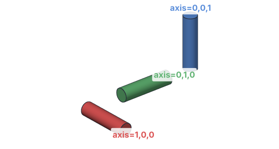

# Shapes

Every part starts with simple shapes. Khan has two today: boxes and cylinders.
More come with sketches (draw a profile, then extrude or revolve it).

## Where things go: x, y and z

Positions and sizes are three numbers, **x,y,z**, in mm:

- **x** goes to the right,
- **y** goes away from you (back),
- **z** goes up.

The point 0,0,0 is the **origin**.



Negative numbers go the other way: z = -1 is 1 mm below the origin.

## Box

A box has a **size** (width in x, depth in y, height in z) and a **corner**: the
corner nearest the origin. The box grows from the corner along +x, +y and +z.



<!-- cli-example -->
```console
$ kh_cli run feature.add_box size=40,30,20
Untitled: 1 step
  Box1         ok  volume 24000.00 mm^3  mass 29.76 g (PLA)
```

Move it by changing the corner. This box starts 10 mm to the right and 5 mm up:

<!-- cli-example -->
```console
$ kh_cli run feature.add_box corner=10,0,5 size=40,30,20
Untitled: 1 step
  Box1         ok  volume 24000.00 mm^3  mass 29.76 g (PLA)
```

Every size must be more than 0 mm. [All box settings](../cli/commands.md#featureadd_box).

## Cylinder

A cylinder has a **radius** (half its diameter), a **height**, a **base** (the
center of its bottom circle), and an **axis** (the direction it points).



<!-- cli-example -->
```console
$ kh_cli run feature.add_cylinder radius=10 height=25
Untitled: 1 step
  Cylinder1    ok  volume 7853.98 mm^3  mass 9.74 g (PLA)
```

The axis is a direction, written like a position: `0,0,1` points up (the
default), `1,0,0` points along x, `0,1,0` along y.



<!-- cli-example -->
```console
$ kh_cli run feature.add_cylinder radius=5 height=40 axis=1,0,0
Untitled: 1 step
  Cylinder1    ok  volume 3141.59 mm^3  mass 3.90 g (PLA)
```

Only the direction of the axis matters, not its length: `0,0,1` and `0,0,5` are
the same. [All cylinder settings](../cli/commands.md#featureadd_cylinder).

## Tips

- **Make holes from cylinders:** add a cylinder where the hole goes, then cut it
  away ([Combining bodies](combining.md)).
- **Let cutting tools stick out:** a cylinder that ends exactly on a face can
  leave a paper-thin skin. Start it 1 mm below and end it 1 mm above.
- **Diameter vs radius:** a 5 mm hole has a radius of 2.5 mm.
