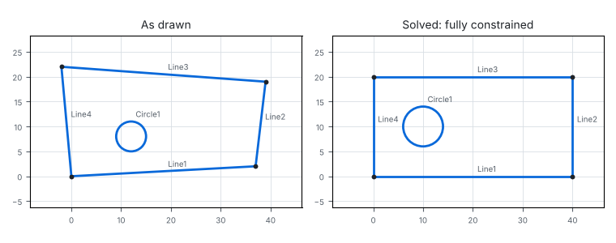
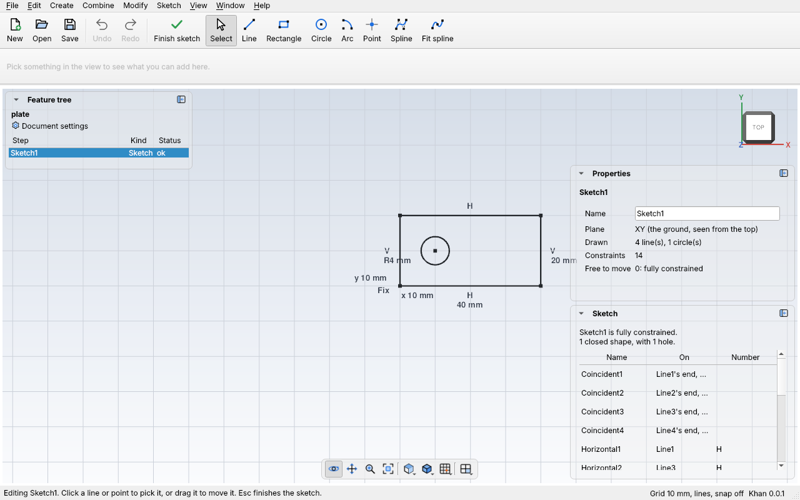
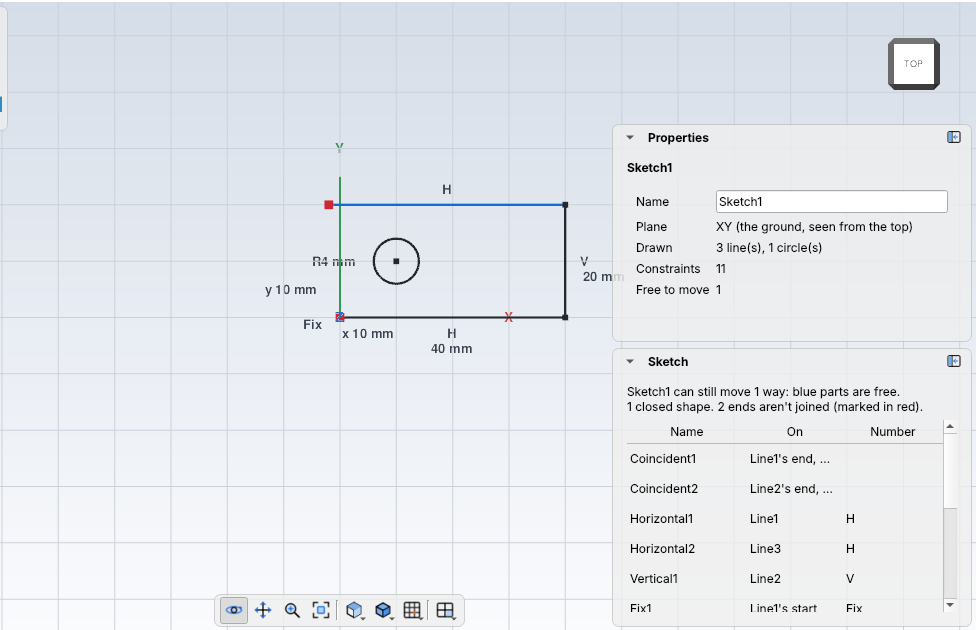
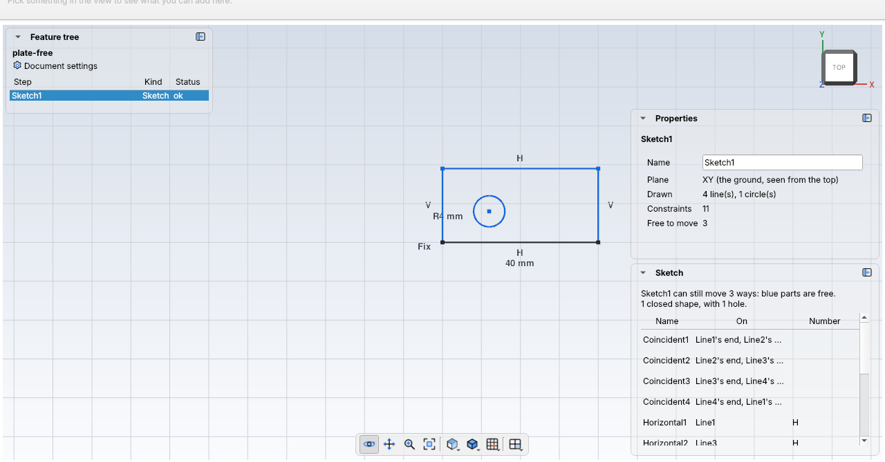
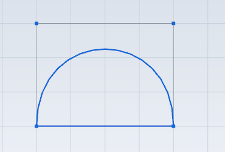
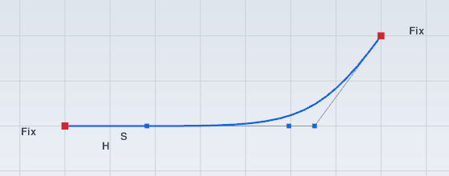
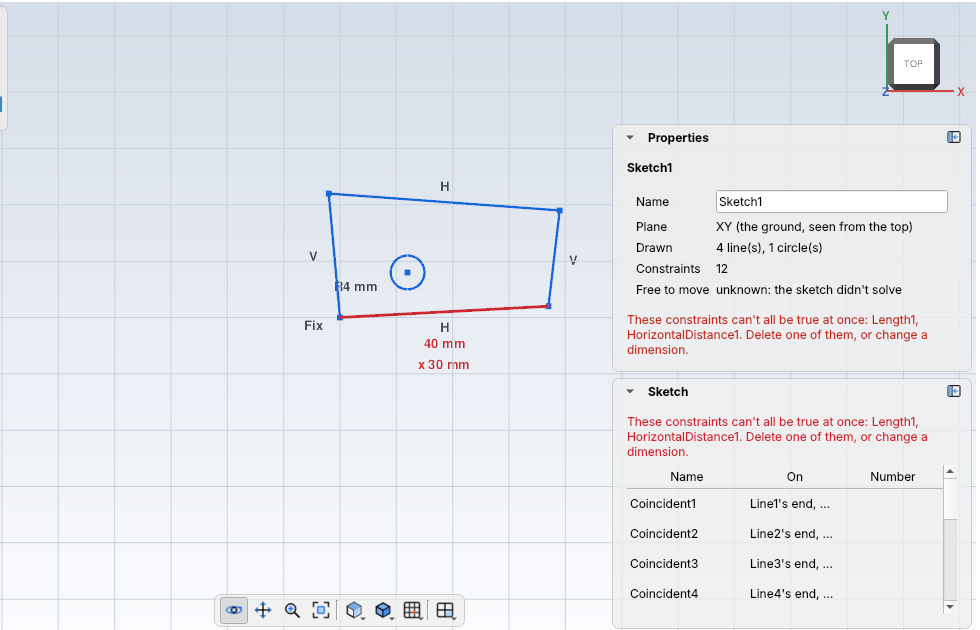

# Sketches

A **sketch** is a flat drawing (lines, circles, arcs and points) on one of the
three main planes. **Constraints** say how the pieces relate (this line is
horizontal, these two ends meet) and **dimensions** give sizes (this line is
40 mm long). Khan's solver moves the drawing until every constraint and dimension
is true. Then [extrude](extrude.md) turns a sketch's closed shapes into solid parts.

You don't have to draw exactly: draw roughly, then add constraints and
dimensions, and the solver makes it exact.



## Drawing in the desktop app



1. **Sketch > New sketch on XY (the ground)** (Ctrl+Shift+K), or on XZ or YZ. Khan
   adds `Sketch1`, turns the view to look straight at its plane, and starts
   drawing lines. To work on a sketch you already have, pick it in the feature
   tree and use **Sketch > Edit sketch** (Ctrl+K); it starts with **Select**, for
   picking and dragging (see below). Edit sketch is grey unless exactly one
   sketch is picked, and while you're already editing one.
2. Pick a tool in **Sketch > Draw**, then click in the view. The status bar says
   what to click next. The tools (and **Finish sketch**) are grey until you're
   editing a sketch. While you edit, the toolbar changes to just the sketch
   buttons (**Finish sketch**, **Select**, **Line**, **Rectangle**, **Circle**,
   **Arc**, **Point** and the spline tools); when you finish, the 3D buttons (**Box**, **Cylinder** and the
   rest) come back.

| Tool | Click |
| --- | --- |
| **Line** | Where it starts, then where it ends. The next line starts where this one ended, so a few clicks draw a closed shape. |
| **Rectangle** | One corner, then the opposite corner. Its four lines come joined at the corners, with **Horizontal** and **Vertical** on its sides, so it stays a rectangle: add a width and a height with **Dimension**, and it's sized. |
| **Circle** | Its center, then a point on its edge. |
| **Arc** | Its center, where it starts, then where it ends. It goes counterclockwise. |
| **Point** | Where it goes. |

3. **Escape** steps back one thing at a time: it stops the shape you're
   drawing, then switches to **Select**, then lets go of what's picked, then
   finishes the sketch. **Sketch > Finish sketch** finishes straight away. After
   that, clicks pick steps and turn the view again.

While drawing:

- **Snapping to points.** A click close to a point of the sketch (an end, a
  center) lands exactly on it, and Khan joins them with a `coincident`
  constraint. An orange dot shows the point it will snap to. Clicking the first
  point of a closed shape ends the line chain.
- **Snapping onto lines and circles.** A click close to a line, circle, arc or
  spline (but not near one of its points) lands exactly on it, and Khan adds an
  `On` constraint, so it stays there.
- **Level, upright and smooth lines.** A line's end within 6 pixels of level
  (or of straight up and down) is made exactly level (or upright), with a
  `Horizontal` (or `Vertical`) constraint. A line drawn off the end of an arc,
  in nearly the way the arc was going, carries straight on from it, with a
  `Tangent` constraint.
- **The hint.** Before you click, a small orange **H**, **V**, **T** or **On**
  beside the mouse shows what will be added.
- **Drawing freely.** Turn off **Sketch > Add constraints while drawing** to put
  ends exactly where you click, with nothing added (joins at points still snap).
- **Snapping to the grid.** With **View > Snap to grid** on, clicks land on the
  grid's crossings (when they don't land on a point, line or circle).
- **Undo.** Each line, circle, arc or point is one undo step, with the constraints
  added with it.
- Right-drag or middle-drag moves the view, and the wheel zooms, while you draw.

## Closed shapes



[**Extrude**](extrude.md) turns a sketch's **closed shapes** into solid parts. A
closed shape is lines and arcs joined end to end all the way round, or a circle.
A closed shape inside another one is a **hole** in it (like the plate's circle).

- The **Sketch** panel says how many closed shapes the sketch has, and how many
  holes.
- An end of a line or arc that nothing else meets is marked with a **red dot**,
  and the panel counts them. To close the shape, drag one end onto the other
  (they join), or pick both ends (Ctrl-click) and click **Coincident**.
- Where three or more lines meet at one point, or two shapes cross each other,
  Khan can't tell which shape is which: the panel says where. Delete the extra
  line, or make it a helper line.
- Helper (construction) lines and points are never part of a shape.

## Picking and dragging



With **Select** (the arrow on the toolbar, or **Sketch > Draw > Select**):

- **Pick** a line, circle, arc or point by clicking it; it turns orange. Click
  near an end or a center to pick just that point. Hold **Ctrl** (or Shift) to
  pick more, or to let go of one; click on nothing to let go of everything.
- **Drag** to move things, and the solver keeps every constraint true as you
  go:
  - drag a **point** (an end, a center) to move it, and whatever is joined to it
    follows;
  - drag a **line** to move all of it;
  - drag the **edge of a circle or arc** to make it bigger or smaller.

  - drop a **point** within a few pixels of another point (an orange dot shows
    it) and it lands exactly there, and the two are **joined** with a
    `coincident` constraint: the quick way to close a gap in a shape.

  Each drag is one undo step. Press **Escape** while dragging to put it back.
- **Delete** (the key, or **Sketch > Delete picked**) deletes the picked lines,
  circles, arcs and points, with their constraints. A picked end loses its
  constraints instead (it isn't a thing of its own). While you edit a sketch,
  the Delete key works on the sketch, not on the steps in the feature tree.

**Colors tell you what can still move.** Blue lines and points can still move or
change size; black ones are fixed by the constraints. When the whole sketch is
black it's **fully constrained**: its size and place are completely set, which
is what you want before you build a part from it. Dragging something black moves
nothing. Properties shows the same thing as a number: **Free to move**.

## Splines



A **spline** is a smooth curve for shapes lines and arcs can't make: a car's
side, a handle, a wave. It's pulled towards its **control points** like a bendy
ruler held by pins: an open spline starts at its first control point and ends at
its last, and the ones between pull the curve towards them without it touching
them. Its **degree** says how smooth it is: 3 (the usual) bends smoothly
everywhere; 1 is just straight lines from point to point. A **closed** spline is
a smooth loop, with no ends.

There are two ways to draw one, both on the sketch toolbar:

| Button | Click | The curve |
| --- | --- | --- |
| **Spline** | its control points, in order | is pulled towards them, starting at the first and ending at the last |
| **Fit spline** | points it should go through, in order | goes exactly through every one |

- **Click the last point again** (or press **Esc**) to finish. **Click the first
  point** (once you have 3) to make a closed loop instead.
- While you draw, the curve so far follows the mouse in orange.
- It's degree 3, or less if you click only 2 or 3 points. If its ends land on
  points already in the sketch, they're joined with **Coincident**.
- A fit spline is turned into control points (one for each point you clicked)
  when you finish. After that you shape it by its control points, like any spline.

To change a spline, pick it, or one of its control points, with **Select**. The
Sketch panel then shows its settings:

| Setting | What it does |
| --- | --- |
| **Degree** | How smooth: 1 to 5. A spline needs one more control point than its degree |
| **Closed loop** | A smooth loop, or a curve with two ends |
| **Weight** | (A control point picked.) How hard it pulls the curve: 1 is normal, 3 pulls the curve much closer, 0.5 lets it go |
| **Add control point** | Adds one after the picked control point, halfway to the next, and picks it so you can drag it straight away. More control points let you shape the curve more finely |
| **Remove control point** | Removes the picked control point, and the constraints on it |

- A spline being edited shows its control points, joined by thin lines (its
  *control polygon*). **Drag a control point** to reshape the curve; drag the
  curve itself to move all of it.
- In `kh_cli`, the same things are [`sketch.add_spline`](../cli/commands.md#sketchadd_spline)
  (with `poles` or `through`), [`sketch.set_spline`](../cli/commands.md#sketchset_spline),
  [`sketch.set_weight`](../cli/commands.md#sketchset_weight),
  [`sketch.add_pole`](../cli/commands.md#sketchadd_pole) and
  [`sketch.remove_pole`](../cli/commands.md#sketchremove_pole).
- Constraints work on its control points like on any point: join its end to a
  line's end with `coincident`, `fix` a control point, or put two of them a
  distance apart with **Dimension**. Name them `Spline1.pole1`, `Spline1.pole2`,
  ... in `kh_cli`.
- **Where a spline meets another curve.** Draw a spline starting on the end of a
  line, arc or spline, and they're joined. Then pick both and click:

  

  - **Tangent**: no corner at the join. The spline leaves heading the same way
    the other curve arrives.
  - **Smooth**: no seam you can see, the way car bodies and phone cases are
    shaped. As well as no corner, the spline bends just as much as the other
    curve right at the join (not at all, for a straight line). Spot it by
    looking at a reflection: a Tangent join shows a kink in it, a Smooth one
    doesn't.
- **On** puts a point on a spline, like on a line or circle. A click close to a
  spline while drawing snaps onto it and adds On.

### Splines from a file of points

Got the shape as numbers already: measured off a real part, worked out in a
spreadsheet, or exported from another program? Put them in a file, one point
per line, x then y:

```text
x,y
0,0
10,8
20,10
30,0
```

- While editing a sketch, use **Sketch > Import spline through points...** (the
  curve goes through every point) or **Sketch > Import spline with control
  points...** (the points are its control points), and pick the file.
- The numbers are taken to be in the design's unit (mm, or the one picked in
  **Document settings**).
- Commas, spaces, tabs or semicolons can go between the numbers, so a
  spreadsheet saved as CSV works. A first line like `x,y` is skipped, a `#`
  starts a comment, and a third number (z) is left out. Up to 500 points.
- **Reload from file.** Khan remembers the file. Change it (in a spreadsheet,
  say), then pick the spline and click **Reload from file** in the Sketch panel:
  the spline follows. Its degree and weights stay; constraints on control
  points it doesn't have anymore go. Undo puts the old points back.
- If you move the design to another computer, take the file too: Reload looks
  for it where it was, and says so if it isn't there.
- A line Khan can't read is named, like *Line 4 of wave.csv isn't 2 numbers (x
  and y): "20,1O"*, so you can fix it.
- In `kh_cli`: [`sketch.import_spline`](../cli/commands.md#sketchimport_spline)
  and [`sketch.reload_spline`](../cli/commands.md#sketchreload_spline).
- A closed shape can have spline edges, so [extrude](extrude.md) turns it into a
  solid, and a closed spline is a shape on its own, like a circle.

## Constraints and dimensions


Pick what you want to constrain with **Select**, then click a button. The
buttons only show when they fit what's picked: pick one line and you get
**Horizontal**, **Vertical**, **Dimension**, **Width** and **Height**; pick two
lines and you get **Parallel**, **Perpendicular**, **Equal** and an angle
**Dimension**. (All of them are in **Sketch > Constrain** and **Sketch >
Dimension** too, greyed out when they don't fit.) If the buttons don't fit across
the window, the rest go on a second row.

| Button | Pick | It keeps true |
| --- | --- | --- |
| **Coincident** | two points (ends or centers) | they're the same point |
| **Horizontal**, **Vertical** | one or more lines | each line is level, or straight up and down |
| **Parallel** | two or more lines | they point the same way |
| **Perpendicular** | two lines | they meet at 90° |
| **Equal** | two or more lines, or circles and arcs | the same length, or the same size |
| **Tangent** | a line and a circle or arc, or two circles or arcs | they touch without crossing |
| **Tangent** | a spline and a line, arc or spline joined to its end | no corner at the join: they head the same way there |
| **Smooth** | a spline and a line, arc or spline joined to its end | no seam you can see: no corner, and they bend just as much on both sides of the join |
| **On** | a point and a line, circle, arc or spline | the point is on it |
| **Midpoint** | a point and a line | the point is in the middle of the line |
| **Fix** | one or more points | they stay where they are now |
| **Dimension** | a line, a circle, an arc, two points, or two lines | its length, diameter (Ø), radius (R), the distance between the points, or the angle between the lines |
| **Width**, **Height** | two points, or a line | how far apart they are from left to right, or bottom to top |

- **Typing a number.** A new dimension starts at the size the drawing already
  has, so nothing jumps. The **Sketch** panel (over the viewer, under
  Properties, while you edit a sketch) opens with the cursor in its
  number: type the size you want and press **Enter**, and the sketch changes to
  match. You can change any dimension there later, the same way.
- **Labels.** Every constraint has a label beside what it's on: **H**, **V**,
  **//** (parallel), **90°** (perpendicular), **=**, **T** (tangent), **S**
  (smooth), **On**,
  **Mid**, **Fix**, and the numbers of the dimensions (**40 mm**, **Ø8 mm**,
  **R4 mm**, **x 10 mm** for a width, **y 10 mm** for a height). Coincident
  points just share a dot.
- **Picking a constraint.** Click its label, or its row in the Sketch panel. It
  turns orange, and **Delete** deletes it.
- **Already there?** Adding a constraint the sketch already has does nothing, and
  says which one it is.

### When constraints fight



If constraints can't all be true at once (a line can't be 40 mm long *and*
30 mm wide while it's horizontal), Khan doesn't change the drawing: it shows
those constraints, and what they're on, in **red**, and the status bar and the
Sketch panel say which ones. Undo, delete one of them, or change a number.

A constraint in **amber** says what others already say (a line that's horizontal
twice). The sketch still works; you can delete it to tidy up.

## Example with kh_cli

Make a sketch, draw a line, and pin it down: horizontal, starting where it is,
40 mm long.

<!-- cli-example -->
```console
$ kh_cli run --save line.khan feature.add_sketch
line: 1 step
  Sketch1      ok  empty
wrote line.khan
$ kh_cli run --open line.khan --save line.khan sketch.add_line sketch=Sketch1 from=0,0 to=38,3
line: 1 step
  Sketch1      ok  1 line, 0 constraints, free to move 4 ways
wrote line.khan
$ kh_cli run --open line.khan --save line.khan sketch.constrain sketch=Sketch1 kind=horizontal on=Line1
line: 1 step
  Sketch1      ok  1 line, 1 constraint, free to move 3 ways
wrote line.khan
$ kh_cli run --open line.khan --save line.khan sketch.constrain sketch=Sketch1 kind=fix on=Line1.start
line: 1 step
  Sketch1      ok  1 line, 2 constraints, free to move 1 way
wrote line.khan
$ kh_cli run --open line.khan --save line.khan sketch.constrain sketch=Sketch1 kind=length on=Line1 value=40
line: 1 step
  Sketch1      ok  1 line, 3 constraints, fully constrained
wrote line.khan
```

See where the solver put the line with [`kh_cli open --sketch`](../cli/open.md):

<!-- cli-example -->
```console
$ kh_cli open line.khan --sketch Sketch1
line: 1 step
  Sketch1      ok  1 line, 3 constraints, fully constrained
Sketch1 (XY plane): fully constrained
  Line1          line    0.00, 0.00 to 40.00, 0.00
  Horizontal1    horizontal          Line1
  Fix1           fix                 Line1.start
  Length1        length              Line1  40.00 mm
closed shapes: 0
open ends: Line1.start, Line1.end
```

A single line isn't a closed shape, so it has no area yet: both of its ends are
open.

The line was drawn from 0, 0 to 38, 3. Now it runs from 0, 0 to 40, 0.

## Planes

| Plane | It's | Sketch x and y are |
| --- | --- | --- |
| `xy` (the default) | The ground, seen from the top | x and y |
| `xz` | Standing up, facing the front | x and z (up) |
| `yz` | Standing up, facing the right | y and z (up) |

## What you can draw

| Command | Draws | Its points |
| --- | --- | --- |
| `sketch.add_line` | A straight line, `from` one end `to` the other | `.start`, `.end` |
| `sketch.add_circle` | A circle, from its `center` and `radius` | `.center` |
| `sketch.add_arc` | Part of a circle, counterclockwise from `start` to `end` (degrees: 0 points right, 90 up) | `.start`, `.end`, `.center` |
| `sketch.add_spline` | A smooth curve pulled towards its control points (see [Splines](#splines)) | `.pole1`, `.pole2`, ...; `.start`, `.end` (its first and last) |
| `sketch.add_point` | A single point | the point itself (`Point1`) |

Each one gets a name: `Line1`, `Line2`, `Circle1`, ... Add `construction=true`
for helper geometry (a center line, say) that isn't part of the shape.

## Constraints and dimensions

Add them with `sketch.constrain`: `kind` says what, and `on` says what to: lines,
circles and arcs by name (`Line1`), and points as `Line1.start`, `Line1.end` or
`Circle1.center`.

| `kind` | `on` | Keeps true |
| --- | --- | --- |
| `fix` | a point | The point stays where it is |
| `coincident` | two points | They're the same point (corners meet) |
| `horizontal`, `vertical` | a line | It's flat, or straight up and down |
| `parallel`, `perpendicular` | two lines | They never meet, or they meet square |
| `equal` | two lines, or two circles or arcs | Same length, or same radius |
| `point_on_line`, `point_on_circle`, `point_on_spline` | a point and a line, a circle or arc, or a spline | The point is on it |
| `midpoint` | a point and a line | The point is in the middle of the line |
| `tangent` | a line and a circle or arc, or two circles or arcs | They touch without crossing |
| `tangent` | a spline and a line, arc or spline joined to its end | No corner at the join |
| `smooth` | a spline and a line, arc or spline joined to its end | No corner, and the same bend on both sides |

Dimensions need a `value`:

| `kind` | `on` | `value` |
| --- | --- | --- |
| `length` | a line | mm |
| `distance` | two points | mm |
| `horizontal_distance`, `vertical_distance` | two points | mm from the first to the second (negative: left or down) |
| `radius`, `diameter` | a circle or arc | mm |
| `angle` | two lines | degrees, counterclockwise from the first line to the second |

Change a dimension with `sketch.set_value`, and delete anything with
`sketch.delete` (deleting a line also deletes the constraints on it).

## Free to move: degrees of freedom

Khan counts how many ways the drawing can still move or change size. A free line
can move 4 ways (each end, across and up). Each constraint takes some away: a
horizontal line can move 3 ways; fix its start and it can only stretch (1 way);
give it a length and it's **fully constrained** (0). Aim for 0, so the part comes
out the same every time.

## When constraints fight

If constraints can't all be true at once, the sketch fails and Khan names them:

<!-- cli-example exit=1 -->
```console
$ kh_cli run --open line.khan sketch.constrain sketch=Sketch1 kind=horizontal_distance on=Line1.start,Line1.end value=50
line: 1 step
  Sketch1      failed
    error [sketch.conflicting]: These constraints can't all be true at once: Length1, HorizontalDistance1. Delete one of them, or change a dimension.
```

A line can't be 40 mm long and reach 50 mm across. Delete one, or change a value.
If a constraint only repeats what others already say, the sketch still works, and
Khan says which one you could delete.

## Tips

- In the app, the sketch you're editing is drawn in blue, with its points as dark
  dots. Other sketches are grey.

- Draw close to the shape you want. The solver moves things as little as it can,
  so a rough drawing near the answer solves the way you expect.
- Fix one point first (often a corner at 0, 0), so the sketch can't drift around.
- A line running smoothly into an arc needs both: `coincident` where they meet,
  and `tangent`.
